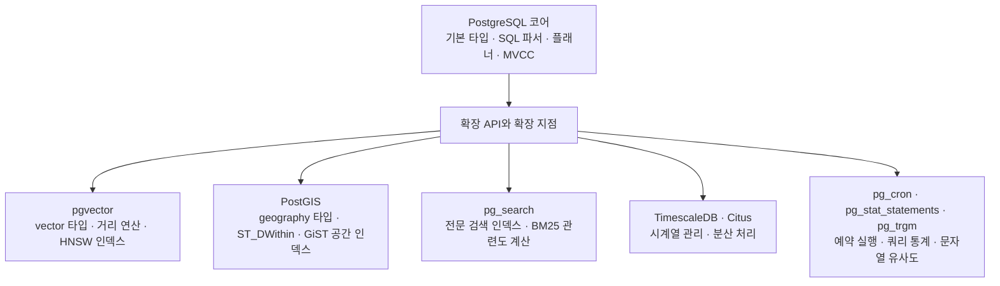

## PostgreSQL extension이란?

PostgreSQL 확장(extension)은 데이터베이스에 새로운 타입, 함수, 인덱스 같은 기능을 추가하는 방식입니다. 기존 SQL과 데이터베이스 연결을 사용하면서 공간 연산, 벡터 검색, 시계열 데이터 관리 등을 할 수 있습니다.

예를 들어 주변 매장을 찾을 때는 PostGIS의 공간 함수를, 임베딩으로 비슷한 문서를 찾을 때는 pgvector의 벡터 연산을 사용할 수 있습니다. 쿼리 통계를 수집하거나 SQL을 주기적으로 실행하는 운영용 확장도 있습니다.

## PostgreSQL 코어와 확장의 관계

PostgreSQL 코어가 기본적인 SQL 처리와 데이터 관리를 담당하고, 확장은 타입·함수·인덱스·훅 같은 확장 지점을 통해 기능을 더합니다.



확장마다 사용하는 방식은 다릅니다. 위 그림은 코어에 어떤 기능을 더하는지 보여 주는 개념도이며, SQL의 실행 순서를 나타내지는 않습니다.

## 어떤 확장이 있나요?

| 확장                                                                                         | 역할                              | 사용 예                      |
| -------------------------------------------------------------------------------------------- | --------------------------------- | ---------------------------- |
| [PostGIS]()                       | 공간 데이터와 반경 검색           | 반경 내 매장 찾기            |
| [pgvector]()                     | 벡터 저장과 유사도 검색           | 임베딩 기반 문서 검색        |
| [pg_search]()                   | 전문 검색과 BM25 랭킹             | 상품·본문 검색 순위          |
| [TimescaleDB]()               | 시계열 데이터와 시간 단위 집계    | 센서 측정값 집계             |
| [Citus]()                           | 다중 노드 구성과 분산 테이블 실습 | 계좌·테넌트 단위 데이터 분산 |
| [pg_cron]()                       | SQL 예약 실행과 작업 확인         | 주기적인 DB 작업             |
| [pg_stat_statements]() | 쿼리별 누적 실행 통계             | 비용이 큰 쿼리 찾기          |
| [pg_trgm]()                       | 문자열 유사도와 부분 일치 검색    | 오타 후보와 제목 검색        |

각 링크에서 확장의 동작 방식과 Docker Compose·SQL 예제를 확인할 수 있습니다. `pg_search`는 ParadeDB가 제공하는 확장을 뜻합니다.

## 설치와 활성화

먼저 PostgreSQL 서버에 확장 파일을 설치하고, 사용할 데이터베이스에서 `CREATE EXTENSION`으로 활성화합니다. 이 명령이 확장 패키지를 다운로드하는 것은 아닙니다. 일부 확장은 서버 시작 설정과 재시작도 필요합니다. [PostgreSQL 공식 문서](https://www.postgresql.org/docs/17/sql-createextension.html)

```sql
-- 서버에 설치 파일이 있는 확장과 현재 DB의 활성화 여부
SELECT name, default_version, installed_version
FROM pg_available_extensions
ORDER BY name;

-- pg_trgm 활성화 예시: 서버에 확장 파일이 준비되어 있어야 합니다.
CREATE EXTENSION IF NOT EXISTS pg_trgm;
```

`pg_trgm`과 `pg_stat_statements`는 PostgreSQL 배포판에 함께 제공되는 모듈이고, 나머지는 별도 프로젝트에서 제공합니다. 실제 사용 가능 여부는 배포판이나 관리형 DB 서비스의 지원 목록을 확인해야 합니다.

확장마다 해결하는 문제는 다릅니다. 기능을 추가하기 전에 필요한 조회나 작업이 무엇인지 정리하면, 필요한 확장을 선택하기 쉽습니다.
