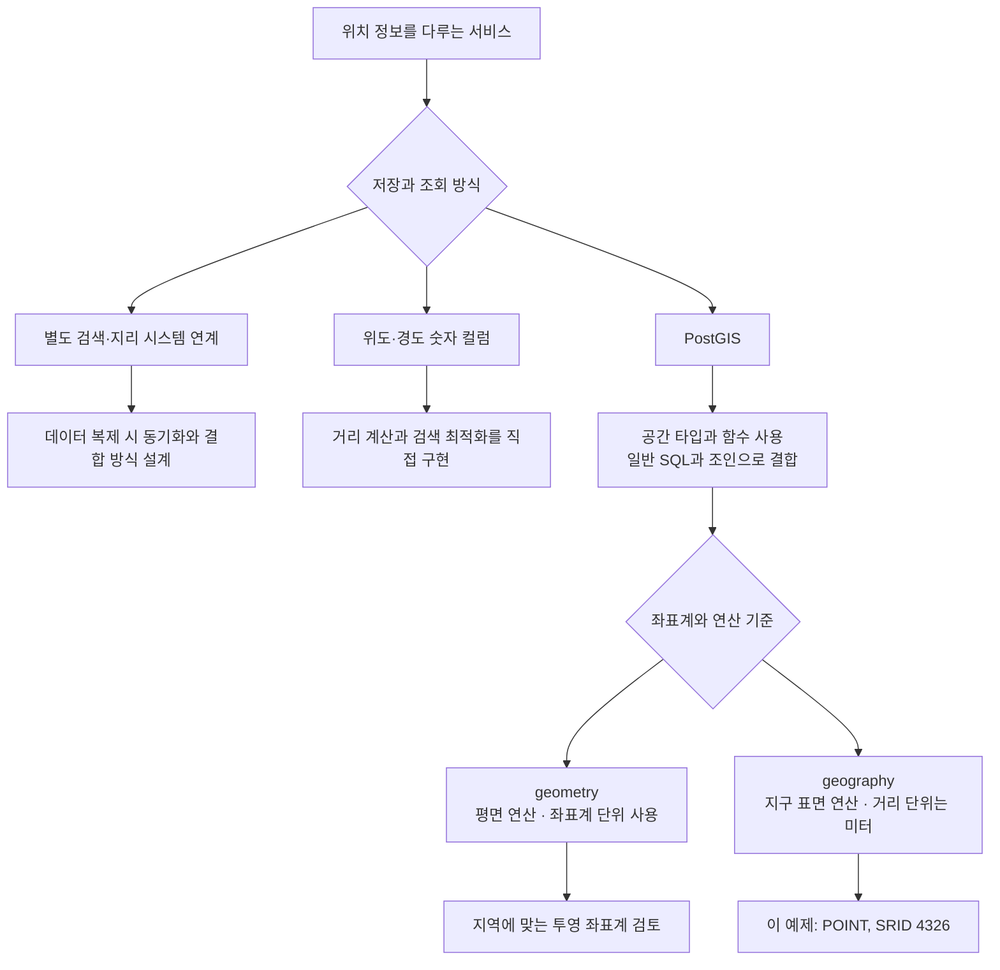
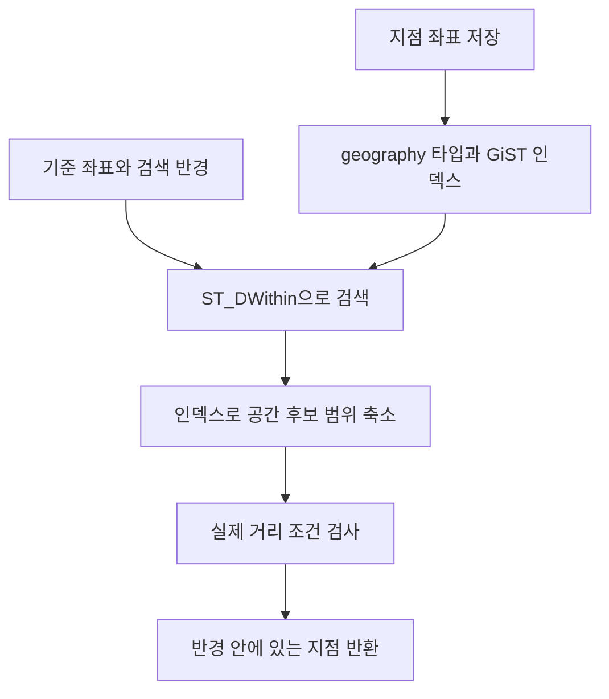

가까운 지점을 찾는 기능을 만든다고 생각해 보겠습니다. 지점의 위도와 경도를 저장한 다음에는 “현재 위치에서 10km 안에 있는 지점”, “가장 가까운 지점 5개”, “특정 지역 안에 있는 지점”을 조회해야 합니다.

PostGIS는 이런 조건을 SQL로 표현할 수 있도록 PostgreSQL에 공간 타입과 함수를 더합니다. 예제는 지점 10개의 위치를 저장하는 것으로 시작해 거리·반경·영역 검색으로 이어집니다. 데이터가 많아진 경우에는 공간 인덱스 적용 전후의 실행 계획을 비교합니다.

## 위치 정보는 어떻게 저장할까요? (지점 위치 관리)

좌표만 저장하는 것과 거리·영역 검색까지 처리하는 것은 다릅니다. 숫자 컬럼으로 위도와 경도를 저장해도 올바른 거리 공식을 적용하면 검색할 수 있지만, 공간 연산과 인덱스 활용을 직접 설계해야 합니다. 별도 시스템에 데이터를 복제한다면 동기화와 시스템 간 데이터 결합도 고려해야 합니다.



GeoServer처럼 지도 데이터를 제공하는 서버와 검색 엔진은 역할이 다르며, PostGIS와 함께 사용할 수도 있습니다. 별도 시스템을 사용한다고 항상 이중 쓰기가 필요하거나 조인이 불가능한 것은 아닙니다. 여기서는 지점 정보와 공간 검색을 PostgreSQL 안에서 함께 처리합니다.

## 좌표를 어떤 기준으로 해석할까요? (GPS 좌표와 거리 계산)

PostGIS를 사용하기로 했다면, 다음은 좌표를 해석할 기준을 정할 차례입니다. 같은 두 점이라도 평면 위의 직선 거리를 구할지, 지구 표면을 따라 거리를 구할지에 따라 계산이 달라집니다. 앞의 그림에서 나눈 `geometry`와 `geography`가 이 차이와 관련됩니다.

`geometry`는 평면 좌표 연산을 합니다. 평면 직교 좌표계에서 두 점을 직선으로 이은 거리를 **유클리드 거리**라고 합니다. 다만 계산 결과의 단위는 좌표계에 따라 달라집니다. 경도·위도를 저장한 `geometry(..., 4326)`의 거리 값을 미터로 읽으면 안 되는 이유입니다. 특정 지역의 거리를 평면에서 계산하려면 그 지역에 적합한 투영 좌표계를 선택해야 합니다.

`geography`는 지구 표면을 기준으로 공간 연산을 합니다. 지구를 구로 보고 표면의 최단 거리를 구하면 **구면 거리**, 타원체로 모델링해서 계산하면 **타원체 거리**입니다. `geography`의 `ST_Distance`는 기본적으로 SRID에 맞는 타원체 거리를 미터로 반환하고, 세 번째 인자를 `false`로 주면 구면 계산을 사용합니다. [ST_Distance 문서](https://postgis.net/docs/ST_Distance.html)

여기서 좌표계를 식별하는 정수 ID가 **SRID(Spatial Reference System Identifier)**입니다. `4326`은 WGS 84 경도·위도 좌표계를 가리킵니다. 좌표 숫자만 저장하는 대신 SRID도 지정해야 그 숫자가 어떤 좌표계의 값인지 알 수 있습니다. GPS 좌표 등에 자주 쓰이지만, 지도 서비스의 모든 데이터가 4326인 것은 아니므로 원본 좌표계는 확인해야 합니다.

이 글에서는 여러 지역의 지점 사이 거리를 미터로 계산하기 위해 `geography`와 SRID `4326`을 사용합니다. 평면 연산보다 계산 비용이 커질 수 있고 `geometry`와 지원 함수도 다르지만, 경도·위도로 받은 지점 위치를 다루기 편합니다. 검색 범위가 특정 지역으로 한정되어 적절한 투영 좌표계를 사용할 수 있다면, 거리 오차와 실행 시간을 측정해 `geometry` 사용도 검토할 수 있습니다.

## 지점은 점으로, 검색 영역은 면으로 표현하기 (매장·이동 경로·행정구역)

좌표계를 정했다면 저장할 대상의 모양을 정합니다. 지점 하나의 위치는 점으로 충분하지만, 이동 경로에는 선이 필요하고 행정구역에는 면이 필요합니다. PostGIS에서는 이를 다음 도형으로 표현합니다.

| 타입           | 표현하는 도형                                      | 사용 예                                       |
| -------------- | -------------------------------------------------- | --------------------------------------------- |
| `POINT`        | 좌표 하나로 표현한 점                              | 지점, 사용자 위치                             |
| `LINESTRING`   | 여러 좌표를 순서대로 연결한 선                     | 도로, 이동 경로                               |
| `POLYGON`      | 닫힌 외곽선으로 둘러싼 영역. 내부 구멍도 표현 가능 | 건물, 행정구역                               |
| `MULTIPOLYGON` | 여러 다각형을 묶은 객체                            | 섬을 포함하거나 떨어진 영역으로 구성된 시군구 |

이 실습에서는 지점 위치를 `POINT`로 저장하고, 영역 검색에 사용할 경계를 `POLYGON`으로 만듭니다. 앞서 선택한 타입과 좌표계까지 합치면 지점 컬럼은 `geography(Point, 4326)`이 됩니다.

## Docker Compose로 실행하기

PostGIS 3.6.4 / PostgreSQL 17.11 기준입니다. [이미지 태그](https://hub.docker.com/r/postgis/postgis/tags)

`compose.yml`

```yaml
name: pg-postgis-lab

x-environment: &environment
  POSTGRES_USER: postgres
  POSTGRES_PASSWORD: ${POSTGRES_PASSWORD:?Set POSTGRES_PASSWORD}
  POSTGRES_DB: lab

x-healthcheck: &healthcheck
  test: ["CMD-SHELL", "pg_isready -U postgres -d lab"]
  interval: 5s
  timeout: 5s
  retries: 20

services:
  postgis:
    image: postgis/postgis:17-3.6-alpine@sha256:a8ffa9afeea4ad6eada171fa2afdb57cd3eb90f92ce20156aa2cb8411d70e0cd
    # 공식 이미지의 amd64 지원 기준. ARM에서는 에뮬레이션 필요.
    platform: linux/amd64
    environment: *environment
    ports: ["127.0.0.1:5541:5432"]
    volumes: ["postgis-data:/var/lib/postgresql/data"]
    healthcheck: *healthcheck

volumes:
  postgis-data:
```

```bash
read -r -s -p 'Lab DB password: ' POSTGRES_PASSWORD
echo
export POSTGRES_PASSWORD

docker compose config --quiet
docker compose up -d --wait
docker compose exec postgis psql -U postgres -d lab
```

## 좌표를 만들고 출력하기 (지도에 표시할 위치 데이터)

테이블을 만들기 전에 강남역 좌표 하나로 점 생성과 출력 방법부터 확인하겠습니다. 접속한 `lab` DB에서 PostGIS를 활성화한 뒤 실행합니다.

```sql
CREATE EXTENSION IF NOT EXISTS postgis;

-- x, y 순서로 점 생성. 경도·위도 좌표에서는 경도 먼저 입력한다.
SELECT ST_AsText(ST_MakePoint(127.0276, 37.4979));
-- POINT(127.0276 37.4979)

-- WGS 84 좌표계 정보를 지정한 뒤 geography로 변환한다.
SELECT ST_AsText(
    ST_SetSRID(ST_MakePoint(127.0276, 37.4979), 4326)::geography
);

-- 웹 지도 등에서 교환하기 쉬운 GeoJSON 형식으로 출력한다.
SELECT ST_AsGeoJSON(
    ST_SetSRID(ST_MakePoint(127.0276, 37.4979), 4326)::geography
);
```

`ST_AsText`는 공간 객체를 WKT(Well-Known Text)로 표현합니다. `ST_AsGeoJSON`은 점의 타입과 좌표를 JSON으로 표현하며, 위 예제의 좌표 배열은 `[127.0276, 37.4979]`입니다.

**`ST_SetSRID`는 좌표계 정보를 붙일 뿐 좌표 숫자를 바꾸지 않습니다.** 다른 좌표계의 값을 변환할 때는 원래 SRID를 지정하고 `ST_Transform`을 사용해야 합니다. WKT만으로는 SRID가 표시되지 않으므로 `ST_SRID`로 따로 확인합니다. [ST_SetSRID 문서](https://postgis.net/docs/ST_SetSRID.html)

## 지점 10개 저장하기 (지역별 지점 목록 관리)

이름·도시 같은 일반 컬럼과 공간 컬럼 `location`을 한 테이블에서 함께 관리합니다.

아래 SQL은 `branches`가 없는 빈 실습 DB에서 한 번 실행합니다. Citus 글의 같은 이름 테이블과는 별도의 DB이며, 공간 인덱스는 뒤에서 검색 성능을 비교할 때 생성합니다.

```sql
CREATE TABLE branches (
    branch_id BIGSERIAL PRIMARY KEY,
    name VARCHAR(100) NOT NULL,
    city VARCHAR(50) NOT NULL,
    location GEOGRAPHY(POINT, 4326) NOT NULL,
    created_at TIMESTAMPTZ DEFAULT NOW()
);

INSERT INTO branches (name, city, location) VALUES
('강남역 지점', '서울', ST_SetSRID(ST_MakePoint(127.0276, 37.4979), 4326)::geography),
('홍대입구 지점', '서울', ST_SetSRID(ST_MakePoint(126.9236, 37.5568), 4326)::geography),
('여의도 지점', '서울', ST_SetSRID(ST_MakePoint(126.9243, 37.5219), 4326)::geography),
('명동 지점', '서울', ST_SetSRID(ST_MakePoint(126.9830, 37.5635), 4326)::geography),
('잠실 지점', '서울', ST_SetSRID(ST_MakePoint(127.1000, 37.5133), 4326)::geography),
('부평 지점', '인천', ST_SetSRID(ST_MakePoint(126.7248, 37.4898), 4326)::geography),
('서면 지점', '부산', ST_SetSRID(ST_MakePoint(129.0593, 35.1581), 4326)::geography),
('해운대 지점', '부산', ST_SetSRID(ST_MakePoint(129.1636, 35.1630), 4326)::geography),
('동성로 지점', '대구', ST_SetSRID(ST_MakePoint(128.5932, 35.8699), 4326)::geography),
('제주공항 지점', '제주', ST_SetSRID(ST_MakePoint(126.4930, 33.5070), 4326)::geography);

SELECT name,
       ST_X(location::geometry) AS lon,
       ST_Y(location::geometry) AS lat,
       ST_SRID(location) AS srid,
       ST_GeometryType(location::geometry) AS geom_type
FROM branches
WHERE city = '서울'
ORDER BY branch_id;
```

`ST_X`, `ST_Y`로 경도와 위도를 꺼내고, SRID가 `4326`, 도형 타입이 `ST_Point`인지 확인합니다. `location::geometry`는 해당 함수가 받는 타입에 맞추기 위한 캐스팅입니다. 좌표계 변환을 하는 것은 아닙니다.

## 두 지점 사이 거리 계산하기 (기준 지점과의 거리 비교)

새 테이블의 첫 행인 강남역 지점(`branch_id = 1`)을 기준으로 다른 지점까지의 거리를 계산합니다. 기존 데이터를 사용한다면 기준 ID를 먼저 확인해야 합니다.

```sql
SELECT b2.name, b2.city,
       ROUND(ST_Distance(b1.location, b2.location)::numeric, 0) AS distance_m
FROM branches AS b1
CROSS JOIN branches AS b2
WHERE b1.branch_id = 1
  AND b2.branch_id <> b1.branch_id
ORDER BY ST_Distance(b1.location, b2.location);
```

`distance_m`은 미터 단위이며 출력만 정수로 반올림합니다. 정렬에는 반올림 전 거리를 사용합니다. 도로를 따라 이동하는 거리나 이동 시간은 아니므로, 경로 안내에는 별도의 도로망과 경로 탐색이 필요합니다.

## 특정 위치에서 10km 이내 지점 찾기 (내 주변 매장 검색)

앞에서는 모든 지점의 거리를 계산했습니다. 이번에는 강남역 좌표에서 10km 이내인 지점만 조회합니다. 거리 값을 반환하는 `ST_Distance`와 달리, `ST_DWithin`은 지정한 반경 안에 있는지를 판단하므로 `WHERE` 조건에 사용합니다.

```sql
SELECT name, city,
       ROUND(ST_Distance(
           location,
           ST_SetSRID(ST_MakePoint(127.0276, 37.4979), 4326)::geography
       )::numeric, 0) AS distance_m
FROM branches
WHERE ST_DWithin(
    location,
    ST_SetSRID(ST_MakePoint(127.0276, 37.4979), 4326)::geography,
    10000
)
ORDER BY ST_Distance(
    location,
    ST_SetSRID(ST_MakePoint(127.0276, 37.4979), 4326)::geography
);
```

`ST_DWithin(A, B, radius)`는 두 공간 객체의 거리가 radius 이하인지 검사합니다. 여기서는 `geography`이므로 `10000`은 10km입니다. 강남역 지점 자체도 거리 0으로 포함됩니다. [ST_DWithin 문서](https://postgis.net/docs/ST_DWithin.html)

## KNN으로 가까운 지점 5개 찾기 (가까운 매장 순으로 안내)

반경을 정하는 대신 “가까운 순서로 5개만 보여 달라”는 요구도 있습니다. 이처럼 기준점에서 거리순으로 가까운 K개를 찾는 검색을 **KNN(K-Nearest Neighbors)**이라고 합니다. 반경 검색은 거리 범위를 정하고, KNN은 결과 개수 K를 정합니다. 반경 조건을 추가하지 않으면 멀리 있는 지점도 상위 K개에 포함될 수 있습니다.

```sql
SELECT name, city,
       ROUND(ST_Distance(
           location,
           ST_SetSRID(ST_MakePoint(127.0276, 37.4979), 4326)::geography
       )::numeric, 0) AS distance_m
FROM branches
ORDER BY location <->
    ST_SetSRID(ST_MakePoint(127.0276, 37.4979), 4326)::geography
LIMIT 5;
```

`ORDER BY location <-> 기준점` 형태는 GiST 인덱스를 이용한 KNN 검색을 지원합니다. 아직 인덱스를 만들지 않았어도 실행은 가능하지만, 인덱스를 활용하는지는 뒤에서 생성한 후 실행 계획으로 확인합니다.

여기서 **`geography`의 `<->`는 구면 거리로 정렬**하고, 출력한 `ST_Distance`는 기본적으로 타원체 거리를 계산합니다. 두 기준의 순위는 달라질 수 있습니다. 타원체 기준의 정확한 상위 5개가 필요하다면 `ORDER BY ST_Distance(...) LIMIT 5`로 정렬하되, 같은 KNN 인덱스 최적화를 기대하지 말고 비용을 확인해야 합니다. [KNN 거리 연산자 문서](https://postgis.net/docs/geometry_distance_knn.html)

## 다각형 안에 있는 지점 찾기 (배송 구역·행정구역 검색)

지금까지는 기준점과 거리를 사용했습니다. 배송 구역이나 행정구역처럼 경계가 정해진 영역을 검색하려면, 그 경계를 다각형으로 표현하고 지점이 안에 있는지 검사합니다. 여기서는 `ST_Within`으로 간단한 사각형 안의 지점을 찾습니다.

```sql
SELECT name, city
FROM branches
WHERE ST_Within(
    location::geometry,
    ST_GeomFromText(
        'POLYGON((126.80 37.70, 127.20 37.70, 127.20 37.40, 126.80 37.40, 126.80 37.70))',
        4326
    )
)
ORDER BY branch_id;
```

다각형은 첫 좌표와 마지막 좌표를 같게 써서 닫습니다. 예제는 서울 주변에 임의로 그린 사각형이며, 실제 서울 행정구역 경계가 아닙니다. 행정구역 조회에는 실제 경계 데이터를 사용해야 합니다.

| 함수                            | 점과 다각형에서의 의미                                             |
| ------------------------------- | ------------------------------------------------------------------ |
| `ST_Within(point, polygon)`     | 점이 다각형 내부에 있는지 검사합니다. 경계 위의 점은 제외합니다.   |
| `ST_Contains(polygon, point)`   | 위 조건을 반대 인자 순서로 표현합니다. 경계 위의 점은 제외합니다.  |
| `ST_Intersects(point, polygon)` | 하나라도 공통 위치가 있는지 검사합니다. 경계 위의 점도 포함합니다. |
| `ST_Covers(polygon, point)`     | 다각형 내부 또는 경계에 점이 있는지 검사합니다.                    |

위 표의 조건은 점과 다각형을 비교할 때의 기준입니다. 선·면끼리 비교할 때는 각 함수의 정의를 확인해야 합니다. `ST_Within`의 두 geometry는 같은 좌표계여야 합니다. [ST_Within](https://postgis.net/docs/ST_Within.html), [ST_Covers](https://postgis.net/docs/ST_Covers.html)

여기서는 `location`을 geometry로 캐스팅해 평면상의 포함 관계를 검사합니다. 뒤에서 만드는 geography 컬럼의 GiST 인덱스가 이 캐스팅 표현식에 그대로 적용된다고 가정하면 안 됩니다. 영역 검색도 자주 한다면 geometry 컬럼이나 캐스팅 표현식에 맞는 인덱스가 필요할 수 있습니다.

## GiST 인덱스 전후 비교하기 (대량 위치 데이터 검색 최적화)

지점 10개로 거리와 영역 조건을 확인했지만, 데이터가 많아지면 검색할 후보를 줄이는 과정도 중요해집니다. 앞에서 미뤄 둔 공간 인덱스를 만들고, 반경 검색과 KNN의 실행 계획을 비교해 보겠습니다.

GiST는 공간 검색 등에 사용하는 인덱스 구조입니다. PostGIS는 이를 활용해 먼저 후보 영역을 좁힌 뒤 실제 공간 조건을 검사합니다. 모든 점의 거리를 매번 계산하는 비용을 줄일 수 있지만, 효과는 데이터 분포와 검색 반경에 따라 달라집니다.



인덱스는 검색할 후보를 줄이고, 거리 조건으로 최종 결과를 판단합니다. 작은 테이블에서는 플래너가 인덱스 대신 순차 스캔을 선택할 수도 있습니다.

### 더미 지점 10만 개 추가

아래 범위에서 난수 좌표를 만듭니다. 바다를 포함한 사각형 영역에 생성하므로 실제 지점 분포를 재현한 데이터는 아닙니다.

```sql
INSERT INTO branches (name, city, location)
SELECT
    '더미 지점 ' || g,
    '더미시',
    ST_SetSRID(ST_MakePoint(
        124.0 + random() * 8.0,
        33.0 + random() * 6.0
    ), 4326)::geography
FROM generate_series(1, 100000) AS g;

-- 최초 10개 + 더미 100000개 = 100010개
SELECT COUNT(*) FROM branches;

-- 플래너가 참고하는 통계 갱신
ANALYZE branches;
```

### 인덱스 생성 전

먼저 공간 인덱스가 없는 상태에서 5km 반경 검색의 실행 계획을 확인합니다. `EXPLAIN ANALYZE`는 쿼리를 실제로 실행하므로, 이 결과를 생성 후 결과와 비교할 기준으로 사용합니다.

```sql
EXPLAIN (ANALYZE, BUFFERS)
SELECT COUNT(*)
FROM branches
WHERE ST_DWithin(
    location,
    ST_SetSRID(ST_MakePoint(127.0276, 37.4979), 4326)::geography,
    5000
);
```

### 인덱스 생성 후 같은 쿼리 실행

이제 `location`에 GiST 인덱스를 만들고 같은 반경 쿼리를 실행합니다. 이어서 가까운 지점 5개를 찾는 KNN 쿼리도 확인합니다.

```sql
CREATE INDEX idx_branches_location ON branches USING gist (location);
ANALYZE branches;

EXPLAIN (ANALYZE, BUFFERS)
SELECT COUNT(*)
FROM branches
WHERE ST_DWithin(
    location,
    ST_SetSRID(ST_MakePoint(127.0276, 37.4979), 4326)::geography,
    5000
);

-- KNN 검색도 인덱스를 사용하는지 확인
EXPLAIN (ANALYZE, BUFFERS)
SELECT name, city
FROM branches
ORDER BY location <->
    ST_SetSRID(ST_MakePoint(127.0276, 37.4979), 4326)::geography
LIMIT 5;
```

반경 검색에서는 `Seq Scan`과 `Index Scan` 또는 `Bitmap Index Scan` 등의 선택을 비교합니다. 인덱스가 있어도 넓은 반경 등에서는 순차 스캔이 선택될 수 있습니다. KNN은 인덱스 스캔의 `Order By`에 거리 연산자가 나타나는지 확인합니다.

두 반경 쿼리의 건수는 같아야 합니다. 실행 시간과 함께 읽은 버퍼, 후보 행과 필터로 제외된 행을 비교합니다. 마지막 `Aggregate`의 `actual rows = 1`은 COUNT 결과 한 행을 뜻하므로, 검사한 지점 수와 혼동하지 않습니다.

실행 계획과 속도는 여기서 실측하지 않았습니다. 캐시 상태와 동시 부하를 맞추고 여러 번 비교해야 하며, 한 번 빨라진 결과만으로 인덱스의 효과를 단정하지 않습니다. [PostgreSQL EXPLAIN 문서](https://www.postgresql.org/docs/17/using-explain.html)

### 실습용 더미 데이터 정리

더미 지점만 조회한 뒤 삭제합니다.

```sql
SELECT COUNT(*) FROM branches WHERE city = '더미시';

DELETE FROM branches WHERE city = '더미시';
ANALYZE branches;

-- 이 글을 한 번씩 실행했다면 원래 지점 10개가 남는다.
SELECT COUNT(*) FROM branches;
```

공간 인덱스는 유지됩니다. `DELETE` 직후 데이터 파일 크기가 바로 줄어드는 것은 아닙니다.

예제에 나온 ID와 건수는 새 테이블에서 각 INSERT를 한 번씩 실행한 기준입니다. 더미 데이터를 넣는 SQL을 다시 실행하면 매번 10만 행이 추가되고, 정리 SQL은 `city = '더미시'`인 행을 모두 삭제합니다. 기존 데이터가 있는 환경에서는 예제의 건수와 다를 수 있으므로, 삭제 전에 같은 조건으로 조회해 대상을 확인합니다.

검색 결과가 예상과 다르다면 입력 좌표도 확인해야 합니다. 경도·위도 순서가 뒤바뀌거나 원본과 다른 SRID를 지정하면, 저장된 위치를 다르게 해석해 거리와 영역 검색 결과가 잘못될 수 있습니다.

## 정리

PostGIS를 사용하면 지점 위치와 일반 데이터를 같은 테이블에서 관리하면서 거리·반경·영역 조건을 SQL로 표현할 수 있습니다. 위치를 저장할 때는 좌표계와 거리 기준을 먼저 정하고, 데이터가 많아지면 GiST 인덱스가 검색 후보를 얼마나 줄이는지 실행 계획으로 확인합니다.

전체 확장 목록은 [PostgreSQL 확장 소개]()에서 확인할 수 있습니다.
