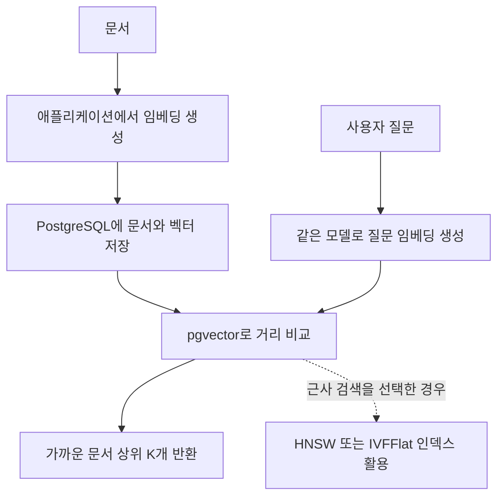

pgvector는 벡터 타입과 거리 연산, HNSW·IVFFlat 같은 근사 최근접 이웃 인덱스를 제공합니다. 문서를 임베딩으로 변환한 뒤 질문 벡터와 가까운 문서를 찾는 RAG 검색 등에 활용합니다.

## 문서와 질문을 벡터로 비교하기



임베딩 생성은 애플리케이션에서 담당하고, pgvector는 저장한 벡터를 비교합니다. 인덱스 없이 정확 검색을 할 수도 있으며, 근사 인덱스를 사용할 때는 속도와 recall을 함께 확인합니다.

## Docker Compose로 실행하기

pgvector 0.8.6 / PostgreSQL 17.11 기준입니다. [이미지 태그](https://hub.docker.com/r/pgvector/pgvector/tags)

`compose.yml`

```yaml
name: pg-pgvector-lab

x-environment: &environment
  POSTGRES_USER: postgres
  POSTGRES_PASSWORD: ${POSTGRES_PASSWORD:?Set POSTGRES_PASSWORD}
  POSTGRES_DB: lab

x-healthcheck: &healthcheck
  test: ["CMD-SHELL", "pg_isready -U postgres -d lab"]
  interval: 5s
  timeout: 5s
  retries: 20

services:
  vector:
    image: pgvector/pgvector:0.8.6-pg17-bookworm@sha256:cf134a767f474095eeba57e0117be8e568e011a63f33fbf252f14c9b760f8e6f
    environment: *environment
    ports: ["127.0.0.1:5542:5432"]
    volumes: ["vector-data:/var/lib/postgresql/data"]
    healthcheck: *healthcheck

volumes:
  vector-data:
```

```bash
read -r -s -p 'Lab DB password: ' POSTGRES_PASSWORD
echo
export POSTGRES_PASSWORD

docker compose config --quiet
docker compose up -d --wait
docker compose exec vector psql -U postgres -d lab
```

## SQL로 사용해 보기

아래 3차원 값은 거리 연산을 보여 주기 위한 임의의 숫자이며, 실제 텍스트 임베딩은 아닙니다.

```sql
CREATE EXTENSION IF NOT EXISTS vector;

CREATE TABLE documents (
    id bigint GENERATED ALWAYS AS IDENTITY PRIMARY KEY,
    content text NOT NULL,
    embedding vector(3) NOT NULL
);

INSERT INTO documents (content, embedding) VALUES
('PostgreSQL 인덱스', '[1,0,0]'),
('데이터베이스 검색', '[0.9,0.1,0]'),
('여행 일정', '[0,0,1]');

-- <=>는 코사인 거리이며 작을수록 가깝다.
SELECT content, embedding <=> '[1,0,0]'::vector AS distance
FROM documents
ORDER BY embedding <=> '[1,0,0]'::vector
LIMIT 2;

-- 데이터가 커져 근사 검색이 필요할 때 사용할 인덱스
CREATE INDEX documents_embedding_idx
ON documents USING hnsw (embedding vector_cosine_ops);
```

기본 검색은 정확 검색입니다. HNSW 인덱스를 사용할 때는 검색 속도와 recall(찾아야 할 이웃을 얼마나 찾았는지)을 함께 확인해야 합니다. 효과는 실제 데이터로 측정해야 하며, 인덱스 생성만으로 항상 더 빠른 것은 아닙니다. [pgvector 문서](https://github.com/pgvector/pgvector)

이 예제를 실제 문서 검색에 적용하려면 먼저 텍스트를 임베딩으로 바꾸는 과정이 필요합니다. pgvector는 생성된 벡터를 저장하고 검색하는 역할을 하므로, 임베딩은 애플리케이션에서 모델을 호출하거나 별도 파이프라인을 통해 준비합니다. 문서와 질문에는 같은 임베딩 모델을 사용해야 합니다. 서로 다른 모델에서 만든 벡터는 차원이 같아도 좌표가 나타내는 의미가 달라 유사도를 의미 있게 비교하기 어렵습니다.

인덱스에 들어가는 값과 검색 조건도 확인해야 합니다. 코사인 거리용 인덱스는 모든 성분이 0인 영벡터를 인덱싱하지 않습니다. 또 필터 조건과 근사 검색을 함께 사용한다면, 실제 조건을 적용한 상태에서 원하는 개수의 결과가 나오는지와 recall을 함께 확인합니다.

## 정리

pgvector는 임베딩 벡터를 PostgreSQL에 저장하고 가까운 데이터를 검색하는 확장입니다. 문서와 질문을 같은 모델로 임베딩한 뒤 거리 연산으로 비교하며, 데이터가 많아져 HNSW를 사용한다면 검색 속도와 recall을 함께 확인합니다. 텍스트를 벡터로 만드는 과정과 저장된 벡터를 검색하는 과정은 각각 준비해야 합니다.

전체 확장 목록은 [PostgreSQL 확장 소개]()에서 확인할 수 있습니다.
