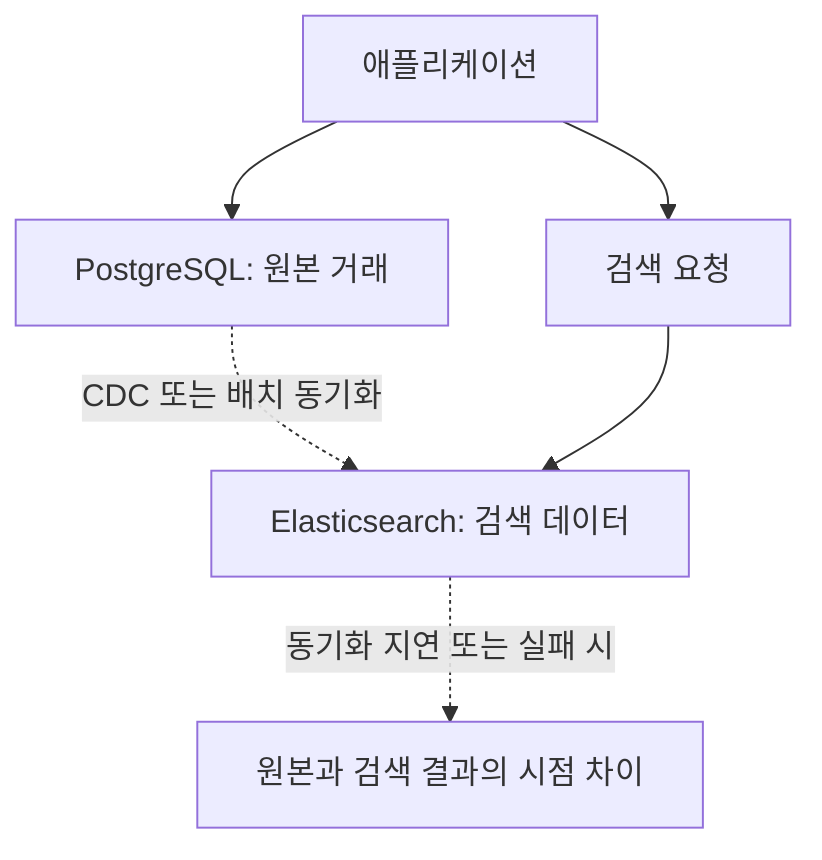
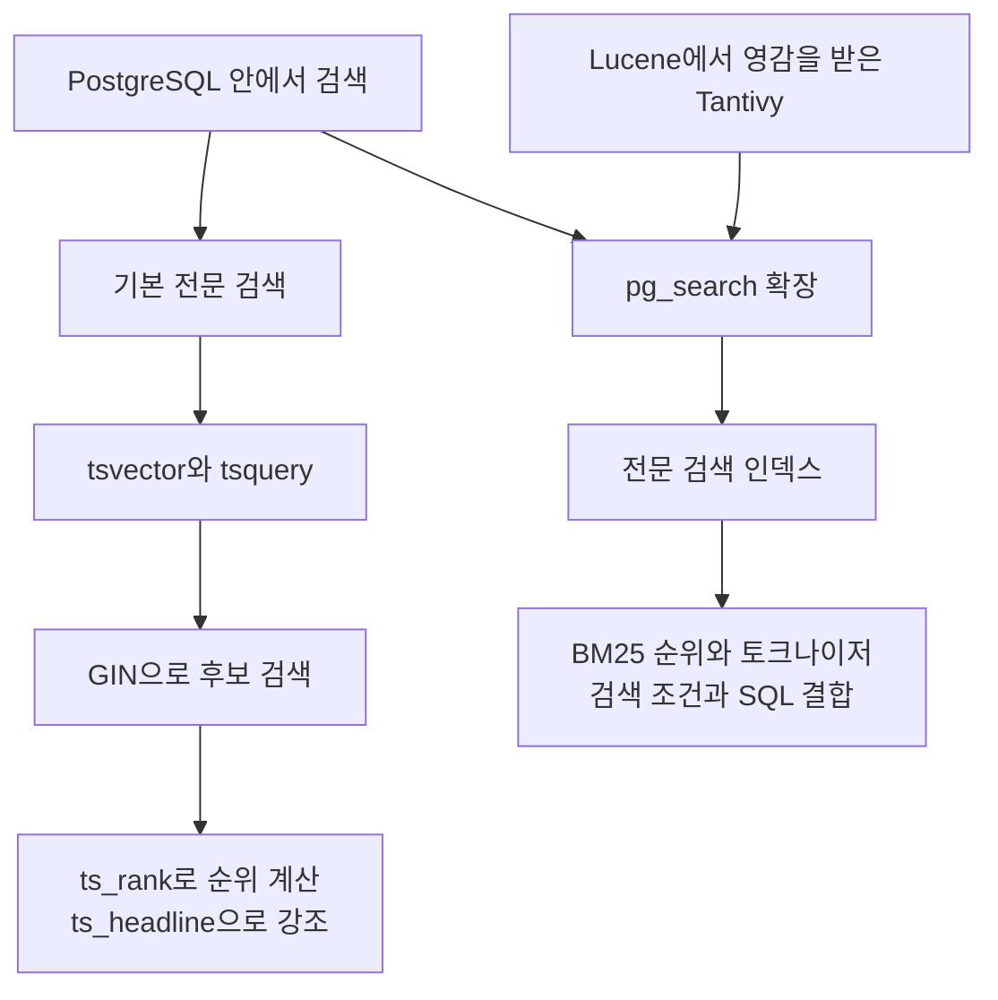
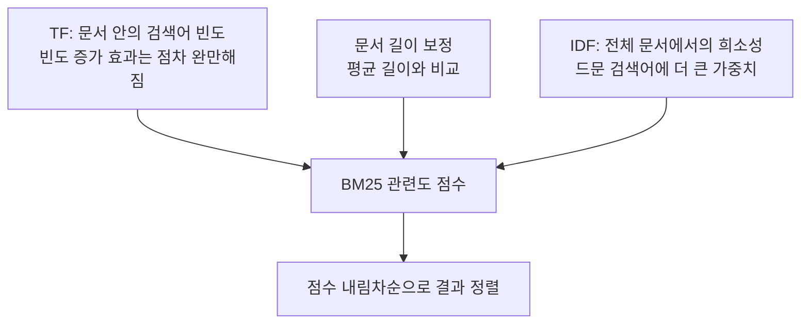
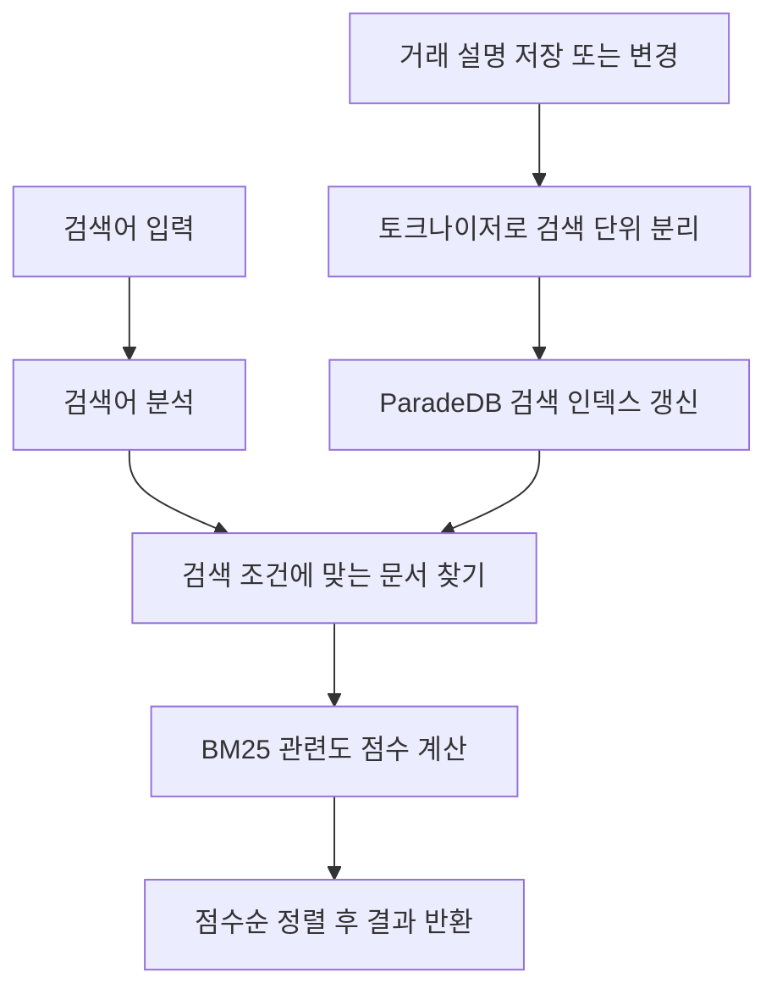
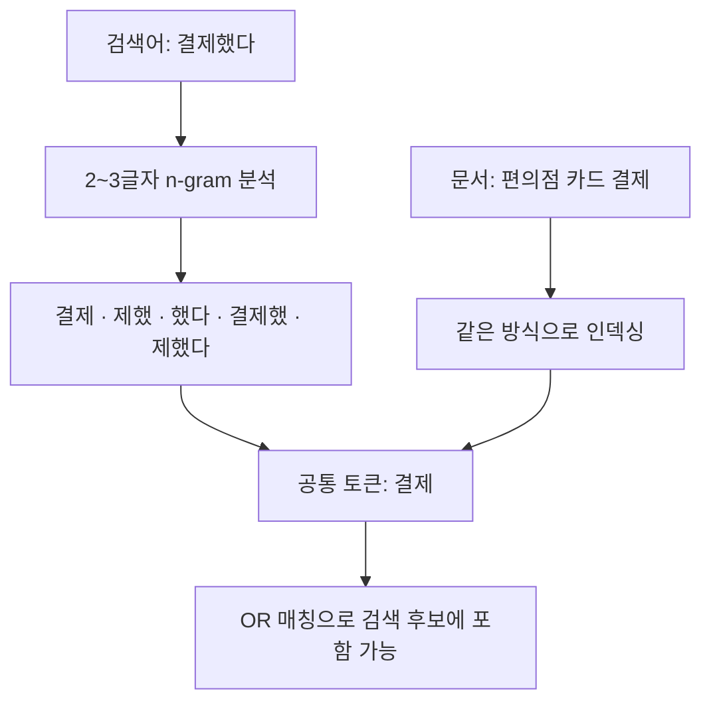

ParadeDB의 `pg_search`는 PostgreSQL 내부에서 전문 검색을 제공하는 확장입니다. 이 예제에서는 키워드로 문서를 찾고 관련도순으로 정렬합니다. [ParadeDB 소개](https://www.paradedb.com/docs/start/introduction)

## 검색 엔진을 별도로 운영할 때 생기는 일

거래는 PostgreSQL에 저장하고 검색은 Elasticsearch에서 처리하는 구성을 생각해 볼 수 있습니다. 이 경우 검색용 데이터를 별도로 유지하려면 애플리케이션의 이중 쓰기나 CDC·배치 같은 동기화 경로가 필요합니다.



위 그림은 CDC·배치 방식의 예시입니다. 애플리케이션이 두 시스템에 직접 쓰는 방식도 있지만, 두 쓰기의 성공 여부를 함께 관리해야 합니다. 별도 검색 엔진은 독립적인 확장과 검색 기능을 제공하는 대신 동기화·재처리·모니터링이 추가됩니다.

pg_search는 PostgreSQL 테이블에 검색 인덱스를 만들어 이런 별도 검색 저장소와의 동기화 경로를 줄입니다. 대신 검색 인덱스의 저장 공간과 갱신 비용을 같은 DB에서 부담합니다.

## PostgreSQL 기본 검색과 pg_search

PostgreSQL에는 `tsvector`와 `tsquery`, GIN 인덱스를 사용하는 기본 전문 검색이 있습니다. `ts_rank`·`ts_rank_cd`로 순위를 계산하고, `ts_headline`으로 검색어를 강조할 수도 있습니다. 기본 전문 검색에서도 순위 계산과 검색어 강조가 가능합니다. [PostgreSQL 전문 검색 문서](https://www.postgresql.org/docs/17/textsearch-controls.html)

pg_search는 Tantivy 기반 검색을 PostgreSQL 확장으로 제공합니다. Tantivy는 Lucene에서 영감을 받은 Rust 검색 라이브러리이며, Lucene 자체를 PostgreSQL에 넣은 것은 아닙니다. [Tantivy 프로젝트](https://github.com/quickwit-oss/tantivy)



어느 쪽이든 한국어 분석은 별도로 검토해야 합니다. 접두어, 사전, 동의어 처리를 기본 검색에서도 구성할 수 있지만, 필요한 검색 품질이 자동으로 갖춰지는 것은 아닙니다. pg_search 역시 토크나이저와 검색 조건을 맞춰야 합니다.

이 실습에서는 같은 거래 데이터에 BM25 관련도 점수와 n-gram 토큰화를 적용해 검색 결과를 비교하기 위해 pg_search를 사용합니다. 확장 버전과 인덱스를 관리해야 하고, 검색과 일반 거래 처리가 DB 자원을 공유한다는 점도 고려해야 합니다. 실제 서비스의 평가 검색어로 테스트했을 때 PostgreSQL 기본 전문 검색만으로 품질과 응답 시간 목표를 충족한다면, 확장 없이 구성할 수도 있습니다.

## BM25는 무엇을 보고 점수를 매길까요?

BM25는 검색어와 문서의 관련도를 계산합니다. 대표적으로 단어의 출현 빈도, 문서 길이, 전체 문서에서 해당 단어가 얼마나 흔한지를 반영합니다.



같은 단어를 반복한다고 점수가 무한정 비례해 오르는 것은 아닙니다. 다른 조건이 같다면 길이가 짧은 문서에서의 일치가 더 크게 반영될 수 있지만, 짧은 문서가 무조건 먼저 나오는 것도 아닙니다. 아래 데이터에서는 흔한 `결제`와 드문 `환전`처럼 단어마다 통계가 다릅니다.

BM25 점수는 확률이나 0~1 사이의 유사도가 아닙니다. 데이터와 토크나이저가 바뀌면 값도 바뀌므로 고정 점수를 정답처럼 비교하지 않습니다. [ParadeDB BM25 문서](https://www.paradedb.com/docs/reference/full-text/score)

## 검색 인덱스와 관련도 순위



문서와 검색어를 검색 단위로 분석하고, 일치한 문서의 관련도를 계산합니다. 아래 SQL 예제처럼 점수 기준 ORDER BY를 지정해야 관련도순으로 결과를 받습니다.

## Docker Compose로 실행하기

ParadeDB 0.25.10 / PostgreSQL 17.11 기준입니다. [이미지 태그](https://hub.docker.com/r/paradedb/paradedb/tags)

`compose.yml`

```yaml
name: pg-pg-search-pg17-lab

x-environment: &environment
  POSTGRES_USER: postgres
  POSTGRES_PASSWORD: ${POSTGRES_PASSWORD:?Set POSTGRES_PASSWORD}
  POSTGRES_DB: lab

x-healthcheck: &healthcheck
  test: ["CMD-SHELL", "pg_isready -U postgres -d lab"]
  interval: 5s
  timeout: 5s
  retries: 20

services:
  search:
    image: paradedb/paradedb:0.25.10-pg17@sha256:293e187d9007952ceeed35b3ed7b10ec996566f48795d71fb8cd5a60c5738634
    environment: *environment
    ports: ["127.0.0.1:5543:5432"]
    # PostgreSQL 17 전용 이미지의 데이터 경로입니다.
    volumes: ["search-data:/var/lib/postgresql/data"]
    healthcheck: *healthcheck

volumes:
  search-data:
```

```bash
read -r -s -p 'Lab DB password: ' POSTGRES_PASSWORD
echo
export POSTGRES_PASSWORD

docker compose config --quiet
docker compose up -d --wait
docker compose exec search psql -U postgres -d lab
```

## 실습 문법과 버전 확인

아래 예제는 현재 공식 문서의 `USING paradedb`, `pdb.score()`, `pdb.ngram` 문법으로 통일했습니다. 기존 자료에서 자주 보이는 표현과 비교하면 다음과 같습니다.

| 기존 예제의 표현                    | 이 글에서 사용하는 표현                       |
| ----------------------------------- | --------------------------------------------- |
| `USING bm25`                        | `USING paradedb`                              |
| `paradedb.score(transaction_id)`    | `pdb.score(transaction_id)`                   |
| `text_fields` 안의 ngram JSON 설정  | 인덱스 표현식의 `description::pdb.ngram(2,3)` |
| 문자열을 넣는 `description @@@ ...` | 토큰 OR 검색은 `\|\|\|`, AND 검색은 `&&&`     |

마지막 행은 단순한 이름 변경이 아닙니다. 검색 의도를 OR 또는 AND로 명시한 것입니다. `@@@`도 현재 쿼리 빌더와 파서에서 사용하는 연산자이므로, 없어진 문법으로 이해하면 안 됩니다. 선택한 릴리스에서 제공하는 API를 확인합니다. [Match 문서](https://www.paradedb.com/docs/reference/full-text/match), [Query Parser 문서](https://www.paradedb.com/docs/reference/full-text/query-parser)

```sql
CREATE EXTENSION IF NOT EXISTS pg_search;

SELECT version();
SELECT extname, extversion FROM pg_extension WHERE extname = 'pg_search';
```

## 지점과 거래 데이터 준비하기

이 실습은 `search` 서비스의 빈 `lab` DB에서 실행합니다. Citus·PostGIS 글과 독립적으로 실행할 수 있도록 외래 키가 참조하는 `branches`도 먼저 만듭니다. 일반 테이블이며 Citus 분산 테이블이 아닙니다.

```sql
CREATE TABLE branches (
    branch_id BIGINT PRIMARY KEY,
    name VARCHAR(100) NOT NULL,
    city VARCHAR(50) NOT NULL
);

INSERT INTO branches VALUES
(1, '강남 지점', '서울'), (2, '명동 지점', '서울'),
(3, '여의도 지점', '서울'), (4, '잠실 지점', '서울'),
(5, '홍대입구 지점', '서울'), (6, '부평 지점', '인천'),
(7, '동성로 지점', '대구'), (8, '서면 지점', '부산'),
(9, '해운대 지점', '부산'), (10, '제주공항 지점', '제주');

CREATE TABLE transactions (
    transaction_id BIGSERIAL PRIMARY KEY,
    account_id BIGINT NOT NULL,
    customer_tier VARCHAR(20) NOT NULL,
    description TEXT NOT NULL,
    amount NUMERIC(15, 2) NOT NULL,
    branch_id BIGINT REFERENCES branches(branch_id),
    metadata JSONB,
    created_at TIMESTAMPTZ DEFAULT NOW()
);

INSERT INTO transactions (account_id, customer_tier, description, amount, branch_id, metadata, created_at) VALUES
(101, 'VIP',     '강남 백화점 카드 결제',              450000, 1, '{"channel":"offline","category":"shopping"}', NOW() - INTERVAL '1 day'),
(102, 'GENERAL', '편의점 카드 결제',                    12500, 1, '{"channel":"offline","category":"food"}',     NOW() - INTERVAL '2 day'),
(103, 'GENERAL', '온라인 쇼핑몰 결제',                 89000, 2, '{"channel":"online","category":"shopping"}',  NOW() - INTERVAL '3 day'),
(104, 'VIP',     '해외 카드 결제 환전 수수료 포함',    720000, 3, '{"channel":"offline","category":"shopping"}', NOW() - INTERVAL '5 day'),
(105, 'GENERAL', 'ATM 현금 출금',                      100000, 4, '{"channel":"atm","category":"cash"}',         NOW() - INTERVAL '7 day'),
(106, 'GENERAL', '계좌 이체 송금 완료',               500000, 5, '{"channel":"mobile","category":"transfer"}',  NOW() - INTERVAL '10 day'),
(107, 'VIP',     '급여 입금 처리',                    3200000, 3, '{"channel":"batch","category":"income"}',     NOW() - INTERVAL '15 day'),
(108, 'GENERAL', '월급 입금 급여 계정',               2500000, 4, '{"channel":"batch","category":"income"}',     NOW() - INTERVAL '15 day'),
(101, 'VIP',     '공과금 자동 납부 전기 요금',          52000, 1, '{"channel":"auto","category":"utility"}',     NOW() - INTERVAL '20 day'),
(102, 'GENERAL', '관리비 자동 이체',                  180000, 2, '{"channel":"auto","category":"utility"}',     NOW() - INTERVAL '20 day'),
(109, 'VIP',     '자동차 할부 결제',                  450000, 5, '{"channel":"auto","category":"loan"}',        NOW() - INTERVAL '22 day'),
(110, 'GENERAL', '카드론 이자 납부',                   75000, 6, '{"channel":"auto","category":"loan"}',        NOW() - INTERVAL '25 day'),
(111, 'VIP',     '예금 이자 입금',                     38000, 7, '{"channel":"batch","category":"income"}',     NOW() - INTERVAL '28 day'),
(112, 'GENERAL', '보험료 자동 납부',                  125000, 8, '{"channel":"auto","category":"insurance"}',   NOW() - INTERVAL '30 day'),
(113, 'VIP',     '마트 할인 쇼핑 카드 결제',          235000, 9, '{"channel":"offline","category":"shopping"}', NOW() - INTERVAL '3 day'),
(114, 'GENERAL', '주차료 결제',                         5000, 1, '{"channel":"offline","category":"transport"}',NOW() - INTERVAL '4 day'),
(115, 'GENERAL', '주유소 결제 카드',                   85000, 2, '{"channel":"offline","category":"transport"}',NOW() - INTERVAL '5 day'),
(116, 'VIP',     '레스토랑 결제 고액',                550000, 4, '{"channel":"offline","category":"food"}',     NOW() - INTERVAL '6 day'),
(117, 'GENERAL', '카페 결제',                           8500, 5, '{"channel":"offline","category":"food"}',     NOW() - INTERVAL '6 day'),
(118, 'GENERAL', '대중교통 정기권 결제',                55000, 1, '{"channel":"offline","category":"transport"}',NOW() - INTERVAL '8 day'),
(119, 'VIP',     '부동산 중개 수수료 납부',          1200000, 3, '{"channel":"offline","category":"realestate"}',NOW() - INTERVAL '12 day'),
(120, 'GENERAL', '학원 수강료 납부',                  320000, 6, '{"channel":"online","category":"education"}', NOW() - INTERVAL '14 day'),
(121, 'GENERAL', '병원 진료비 결제',                   45000, 7, '{"channel":"offline","category":"health"}',   NOW() - INTERVAL '16 day'),
(122, 'VIP',     '해외 송금 완료 달러',              2800000, 8, '{"channel":"mobile","category":"transfer"}',  NOW() - INTERVAL '18 day'),
(123, 'GENERAL', '통신비 자동 납부',                   88000, 9, '{"channel":"auto","category":"utility"}',     NOW() - INTERVAL '21 day'),
(124, 'VIP',     '골프장 이용료 카드 결제',           420000, 8,'{"channel":"offline","category":"leisure"}', NOW() - INTERVAL '23 day'),
(125, 'GENERAL', '서점 도서 결제',                     32000,10, '{"channel":"offline","category":"shopping"}', NOW() - INTERVAL '26 day'),
(126, 'GENERAL', '온라인 스트리밍 정기 결제',          14900, 1, '{"channel":"online","category":"subscription"}',NOW() - INTERVAL '27 day'),
(127, 'VIP',     '항공권 결제 일등석',               4500000, 2, '{"channel":"online","category":"travel"}',    NOW() - INTERVAL '29 day'),
(128, 'GENERAL', '호텔 숙박 결제',                    280000, 3, '{"channel":"online","category":"travel"}',    NOW() - INTERVAL '40 day');

SELECT COUNT(*) FROM transactions;
-- 최초 한 번 실행했다면 30행
```

카드 결제, 급여 입금, 송금, 자동 납부 등 서로 다른 설명을 넣었습니다. `metadata`에는 채널과 분류를 저장하고, 금액과 고객 등급은 검색 조건과 함께 사용합니다. 예제의 지점 연결과 거래 설명은 검색 실습용입니다.

## 기본 검색과 비교하기: tsvector + GIN

pg_search와 비교하기 위해, 먼저 PostgreSQL 기본 전문 검색으로 거래 설명을 검색합니다.

> 아래 쿼리의 `simple` 설정은 한국어 형태소를 분석하지 않으므로 조사나 어미를 분리하지 않습니다.

```sql
CREATE INDEX trans_description_fts_idx
ON transactions USING gin (to_tsvector('simple', description));

SELECT transaction_id, description,
       ts_rank(
           to_tsvector('simple', description),
           to_tsquery('simple', '카드 & 결제')
       ) AS rank
FROM transactions
WHERE to_tsvector('simple', description)
      @@ to_tsquery('simple', '카드 & 결제')
ORDER BY rank DESC, transaction_id;
```

`@@`는 tsquery 조건과의 일치를 확인하고, `&`는 두 토큰을 모두 요구합니다. GIN은 후보 검색을 돕고, `ts_rank`는 결과의 순위를 계산합니다. 이것이 BM25와 동일한 점수 체계인 것은 아닙니다. 아래 pg_search 결과와 비교할 때도 절대 점수보다 검색된 문서와 순서를 봅니다.

## pg_search 인덱스 생성과 검색

```sql
CREATE INDEX trans_search ON transactions
USING paradedb (transaction_id, description)
WITH (key_field = 'transaction_id');

-- 카드 또는 결제 토큰 중 하나 이상에 일치
SELECT transaction_id, description, amount
FROM transactions
WHERE description ||| '카드 결제'
ORDER BY transaction_id;

-- 카드와 결제 토큰을 모두 포함
SELECT transaction_id, description, amount
FROM transactions
WHERE description &&& '카드 결제'
ORDER BY transaction_id;
```

`key_field`는 검색 인덱스에서 원본 행을 식별하는 키입니다. 이 예제에서는 PK인 `transaction_id`를 사용합니다. `|||`는 입력을 토큰화한 뒤 하나 이상 일치하는 행을, `&&&`는 모든 토큰이 일치하는 행을 찾습니다. 같은 문장 순서나 연속된 구절까지 요구하는 조건은 아닙니다.

## BM25 관련도순으로 정렬하기

```sql
SELECT transaction_id, description,
       pdb.score(transaction_id) AS score
FROM transactions
WHERE description ||| '카드 결제'
ORDER BY score DESC, transaction_id
LIMIT 10;
```

ID순 검색은 저장 순서를 확인하는 데 쓰고, 점수순 검색은 관련도 높은 거래를 먼저 보여 주는 데 사용합니다. 점수가 같은 행의 순서를 고정하려고 `transaction_id`도 정렬 조건에 넣었습니다. 실제 점수와 순위는 여기서 실행해 측정하지 않았습니다.

일반 SQL 조건과 조인도 함께 사용할 수 있습니다.

```sql
SELECT t.transaction_id, t.description, t.amount, b.name AS branch_name,
       pdb.score(t.transaction_id) AS score
FROM transactions AS t
JOIN branches AS b ON b.branch_id = t.branch_id
WHERE t.description &&& '카드 결제'
  AND t.customer_tier = 'VIP'
  AND t.amount >= 200000
  AND t.metadata ->> 'channel' = 'offline'
ORDER BY score DESC, t.transaction_id;
```

이 인덱스에는 설명과 키만 넣었습니다. 금액·등급·JSON 조건까지 모두 검색 인덱스로 처리한다고 가정하지 않습니다. 필요한 조건의 인덱싱 여부와 실제 처리 위치는 실행 계획으로 확인합니다.

## 한국어 활용형과 토크나이저

```sql
SELECT transaction_id, description
FROM transactions
WHERE description ||| '결제했다'
ORDER BY transaction_id;
```

`결제`와 `결제했다`가 같은 검색 단위로 분석되지 않으면 `편의점 카드 결제`를 찾지 못할 수 있습니다. `결제하면`, `결제는`, `결제도`도 마찬가지입니다. BM25는 분석된 토큰의 관련도를 계산할 뿐, 한국어 어미를 자동으로 이해해 주는 기능은 아닙니다.

부분 문자열을 공통 토큰으로 만들기 위해 n-gram을 적용해 볼 수 있습니다.



### n-gram 인덱스로 바꾸기

아래는 **실습용 검색 인덱스를 교체하는 단계**입니다. 테이블 데이터는 유지하지만 교체 중 해당 pg_search 인덱스를 사용하는 검색은 사용할 수 없습니다. 운영 인덱스 변경 절차로 그대로 사용하지 않습니다.

```sql
DROP INDEX trans_search;

CREATE INDEX trans_search_idx ON transactions
USING paradedb (
    transaction_id,
    (description::pdb.ngram(2,3))
)
WITH (key_field = 'transaction_id');

-- 실제 토큰을 확인한다. 배열의 출력 순서와 무관하게 토큰 집합을 본다.
SELECT '결제했다'::pdb.ngram(2,3)::text[];

SELECT transaction_id, description, pdb.score(transaction_id) AS score
FROM transactions
WHERE description ||| '결제했다'
ORDER BY score DESC, transaction_id
LIMIT 5;
```

기존 예제의 `min_gram = 2`, `max_gram = 3`, `prefix_only = false` 의도를 현재 문법으로 옮겼습니다. 접두어만이 아니라 문자열 전체에서 2~3글자 조각을 만듭니다. `|||`는 인덱스 필드의 토크나이저를 사용해 질문도 분석하므로 공통 조각인 `결제`로 후보를 찾을 수 있습니다. 모든 조각을 요구하는 `&&&`를 사용하면 결과가 달라집니다. [Ngram 문서](https://www.paradedb.com/docs/reference/tokenizers/available-tokenizers/ngrams)

n-gram은 형태소 분석이나 동의어 처리의 대체물이 아닙니다. 관련 없는 단어의 일부도 일치할 수 있고 토큰 수와 인덱스 크기도 늘어납니다. 최소 길이가 2이면 한 글자 검색어로는 같은 방식의 토큰을 만들 수 없습니다. 형태소 분석기와 n-gram 중 무엇이 적합한지는 실제 검색어와 기대 결과로 평가해야 합니다.

또한 `결제`를 찾는다고 `카드론`까지 같은 의미로 이해하거나, `급여`와 `월급`을 자동으로 동의어 처리하는 것은 아닙니다. 따라서 검색 대상과 검색어가 어떤 토큰으로 나뉘는지 확인해야 합니다.

## 실행 계획 확인하기

```sql
EXPLAIN (ANALYZE, BUFFERS)
SELECT transaction_id, description, pdb.score(transaction_id) AS score
FROM transactions
WHERE description ||| '결제했다'
ORDER BY score DESC, transaction_id
LIMIT 5;
```

`ANALYZE` 옵션은 쿼리를 실제 실행합니다. 검색 인덱스 접근과 정렬이 어느 단계에서 수행되는지 확인합니다. 30행 데이터로 검색 속도의 우열을 판단하기는 어렵고, 기본 토큰과 n-gram은 검색 의미도 다르므로 처리 시간만 비교해서는 안 됩니다.

이 예제의 SQL은 본문에 명시한 확장 버전을 기준으로 실행합니다. 다른 버전에서 동작하지 않으면 해당 릴리스의 문법을 확인합니다. INSERT를 반복하면 거래가 추가되고 인덱스 교체는 검색에 영향을 주므로 실습 전용 DB를 사용합니다. 한국어 토큰 처리에 따라서도 결과가 달라지기 때문에 실제 검색어로 품질과 실행 성능을 확인해야 합니다.

## 정리

pg_search는 PostgreSQL 안에서 키워드 검색과 BM25 관련도 정렬을 수행합니다. 검색 결과를 일반 SQL의 필터·조인과 결합할 수 있어 거래 내역이나 문서 검색에 활용할 수 있습니다. 검색 품질은 인덱스 생성만으로 정해지지 않으므로, 실제 검색어로 토큰화 방식과 OR·AND 조건, 결과 순위를 확인합니다.

전체 확장 목록은 [PostgreSQL 확장 소개]()에서 확인할 수 있습니다.
