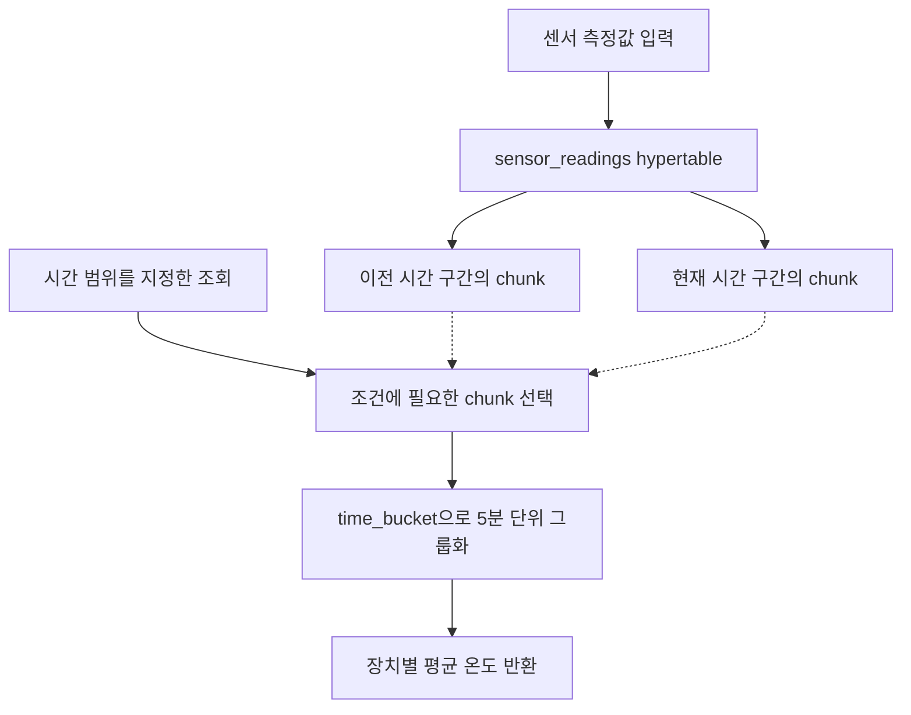

TimescaleDB는 시계열 데이터를 다루는 PostgreSQL 확장입니다. hypertable은 하나의 테이블처럼 접근하지만 내부 데이터를 시간 등의 기준으로 chunk로 나눕니다. 시간 범위 조회와 보관 정책, 반복 집계에 활용할 수 있습니다. [TimescaleDB 프로젝트](https://github.com/timescale/timescaledb)

## 하나의 테이블을 시간 구간으로 나누기



애플리케이션은 하나의 hypertable에 접근하고, TimescaleDB가 내부 chunk를 관리합니다. 데이터를 나누는 chunk 간격과 조회에서 묶는 5분 집계 간격은 서로 다른 설정입니다.

## Docker Compose로 실행하기

TimescaleDB 2.30.1 / PostgreSQL 17.11 기준입니다. [이미지 태그](https://hub.docker.com/r/timescale/timescaledb/tags)

`compose.yml`

```yaml
name: pg-timescaledb-lab

x-environment: &environment
  POSTGRES_USER: postgres
  POSTGRES_PASSWORD: ${POSTGRES_PASSWORD:?Set POSTGRES_PASSWORD}
  POSTGRES_DB: lab

x-healthcheck: &healthcheck
  test: ["CMD-SHELL", "pg_isready -U postgres -d lab"]
  interval: 5s
  timeout: 5s
  retries: 20

services:
  timescale:
    image: timescale/timescaledb:2.30.1-pg17@sha256:c79fa5891443d1cdf6de5258d4c2bdb8cde29052c45df2062b13d351e0202005
    environment: *environment
    ports: ["127.0.0.1:5544:5432"]
    volumes: ["timescale-data:/var/lib/postgresql/data"]
    healthcheck: *healthcheck

volumes:
  timescale-data:
```

```bash
read -r -s -p 'Lab DB password: ' POSTGRES_PASSWORD
echo
export POSTGRES_PASSWORD

docker compose config --quiet
docker compose up -d --wait
docker compose exec timescale psql -U postgres -d lab
```

## SQL로 사용해 보기

`timescale` 서비스에서 실행합니다. 여기서는 기존 `create_hypertable` API를 사용합니다.

```sql
CREATE EXTENSION IF NOT EXISTS timescaledb;

CREATE TABLE sensor_readings (
    measured_at timestamptz NOT NULL,
    device_id bigint NOT NULL,
    temperature double precision NOT NULL,
    PRIMARY KEY (device_id, measured_at)
);

-- 일반 테이블을 시간 기준 hypertable로 전환
SELECT create_hypertable('sensor_readings', by_range('measured_at'));

INSERT INTO sensor_readings VALUES
('2026-09-23 10:01:00+09', 1, 22.0),
('2026-09-23 10:03:00+09', 1, 24.0),
('2026-09-23 10:06:00+09', 1, 25.0);

SELECT time_bucket(INTERVAL '5 minutes', measured_at) AS bucket,
       device_id,
       avg(temperature) AS avg_temperature
FROM sensor_readings
WHERE measured_at >= TIMESTAMPTZ '2026-09-23 10:00:00+09'
  AND measured_at < TIMESTAMPTZ '2026-09-23 11:00:00+09'
GROUP BY bucket, device_id
ORDER BY bucket;
```

같은 장치의 측정값을 5분 단위로 묶습니다. 첫 구간의 평균은 23.0, 다음 구간은 25.0입니다. 출력 시각의 시간대는 세션 설정에 따릅니다. 단순 `time_bucket` 조회는 집계 결과를 저장하지 않습니다. 반복 집계 결과를 유지하려면 continuous aggregate와 갱신 정책을 별도로 구성합니다. [Hypertable 문서](https://www.tigerdata.com/docs/reference/timescaledb/hypertables)

hypertable의 PK와 UNIQUE 제약은 파티션 키를 포함해야 하므로, 예제에서도 `measured_at`을 키에 넣었습니다. 시계열 데이터라고 해서 모든 조회가 빨라지는 것은 아닙니다. 시간 범위 조건과 조회 패턴에 맞춰 chunk 간격과 인덱스를 설계해야 불필요한 관리 비용을 줄일 수 있습니다.

## 정리

TimescaleDB는 시간에 따라 쌓이는 데이터를 hypertable로 관리하고, 시간 범위 조회와 구간별 집계를 SQL로 표현할 수 있게 합니다. 데이터 저장 단위인 chunk 간격과 조회 결과를 묶는 집계 간격을 구분하면 센서·로그 데이터의 저장과 분석 구조를 설계하기 쉽습니다.

전체 확장 목록은 [PostgreSQL 확장 소개]()에서 확인할 수 있습니다.
