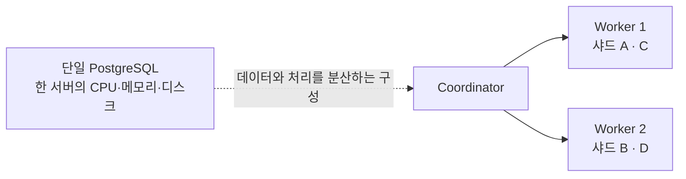
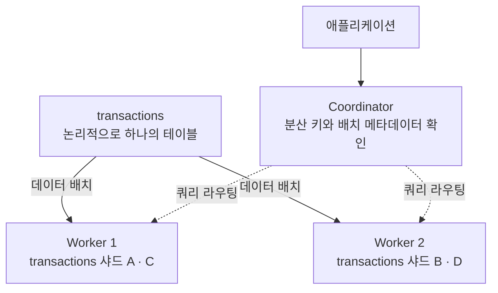
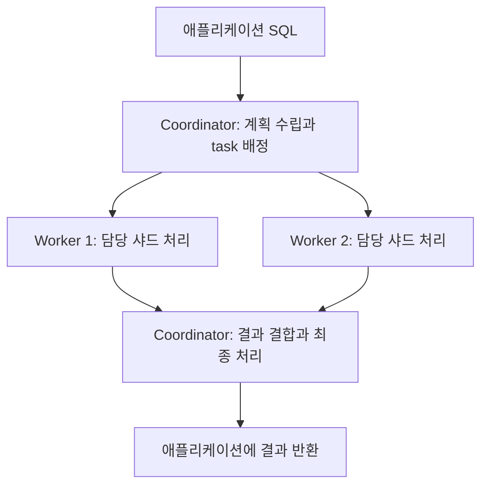
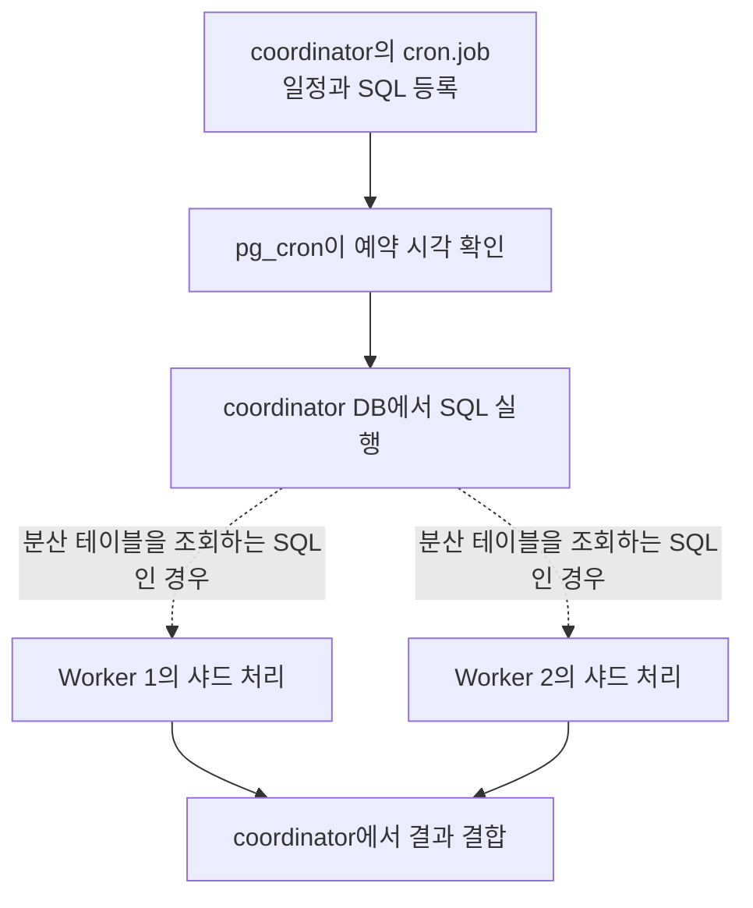
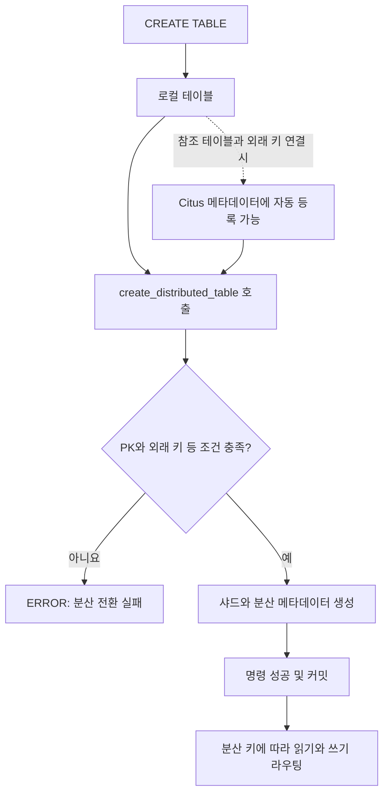
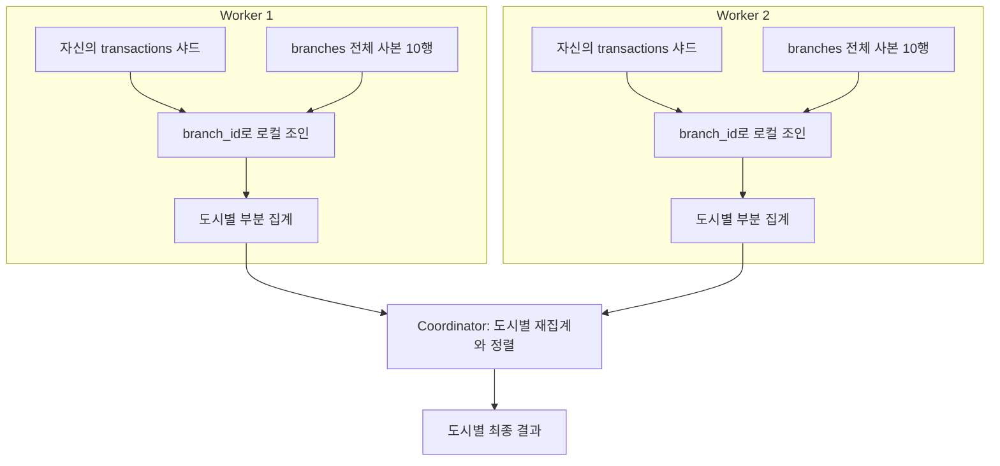
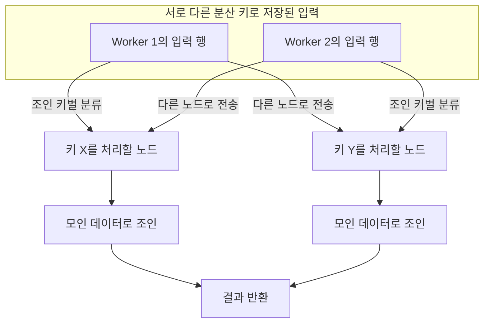

Citus는 테이블 데이터를 샤드로 나누고 여러 노드에서 처리할 수 있게 합니다. 일반적인 다중 노드 구성에서는 coordinator가 쿼리를 받고 worker가 데이터를 보관·처리합니다.

## 단일 노드에서 여러 worker로 확장하기

단일 PostgreSQL 서버에서 처리하는 워크로드는 해당 서버의 CPU·메모리·디스크 자원에 영향을 받습니다. Citus는 분산 테이블을 여러 샤드로 나눠 worker에 배치하고, 쿼리도 나누어 실행할 수 있도록 합니다.



샤드 이름과 배치는 설명용입니다. 홀수 샤드는 worker1, 짝수 샤드는 worker2라는 고정 규칙이 있는 것은 아닙니다. 분산한다고 모든 쿼리가 빨라지는 것도 아니며, 분산 키·데이터 편중·통신 비용을 함께 확인해야 합니다. 이 Docker 실습에서는 컨테이너들이 한 호스트의 자원을 공유하므로, 물리 서버를 추가했을 때의 성능 향상을 측정할 수는 없습니다.

## 논리 테이블과 실제 샤드는 다릅니다

애플리케이션에서는 `transactions`라는 하나의 테이블을 사용합니다. 실제 데이터는 worker의 여러 샤드에 저장되고, coordinator가 메타데이터를 보고 필요한 샤드로 쿼리를 보냅니다.



실선은 논리 테이블과 데이터 배치의 관계이고, 점선은 쿼리의 전달 경로입니다. 매번 coordinator에 원본 데이터 전체를 모은 뒤 worker로 보내는 구조는 아닙니다.

## coordinator와 worker의 역할



다중 노드 구성의 기본 흐름입니다. worker는 이미 자신에게 배치된 샤드를 읽습니다. 전체 조회인지 분산 키 조건이 있는 조회인지에 따라 접근하는 샤드와 worker가 달라집니다.

## Docker Compose로 실행하기

Citus 14.2.0 / PostgreSQL 17.10 기준입니다. [이미지 태그](https://hub.docker.com/r/citusdata/citus/tags)

`compose.yml`

```yaml
name: pg-citus-pg17-lab

x-environment: &environment
  POSTGRES_USER: postgres
  POSTGRES_PASSWORD: ${POSTGRES_PASSWORD:?Set POSTGRES_PASSWORD}
  POSTGRES_DB: lab

x-healthcheck: &healthcheck
  test: ["CMD-SHELL", "pg_isready -U postgres -d lab"]
  interval: 5s
  timeout: 5s
  retries: 20

services:
  citus:
    image: citusdata/citus:14.2.0-pg17@sha256:a8e720198e83d9f8bd3884a0aeb32aa1e2b426393fba96882587c9fe607d1417
    platform: linux/amd64
    environment: *environment
    ports: ["127.0.0.1:5545:5432"]
    volumes: ["citus-data:/var/lib/postgresql/data"]
    healthcheck: *healthcheck

volumes:
  citus-data:
```

```bash
read -r -s -p 'Lab DB password: ' POSTGRES_PASSWORD
echo
export POSTGRES_PASSWORD

docker compose config --quiet
docker compose up -d --wait
docker compose exec citus psql -U postgres -d lab
```

## 단일 노드에서 분산 테이블 만들기

Compose의 `citus`는 **단일 노드 실습**입니다. 분산 테이블 API를 익힐 수 있지만 서버 간 분산이나 장애 대응을 검증하는 구성은 아닙니다. [Citus Docker 프로젝트](https://github.com/citusdata/docker)

```sql
CREATE EXTENSION IF NOT EXISTS citus;

CREATE TABLE tenant_orders (
    tenant_id bigint NOT NULL,
    order_id bigint NOT NULL,
    amount numeric(12, 2) NOT NULL,
    PRIMARY KEY (tenant_id, order_id)
);

-- tenant_id를 분산 키로 사용
SELECT create_distributed_table('tenant_orders', 'tenant_id');

INSERT INTO tenant_orders VALUES
(10, 1, 12000), (10, 2, 8000), (20, 1, 15000);

-- 테넌트 조건을 통해 대상 샤드로 범위를 좁힌다.
SELECT tenant_id, sum(amount)
FROM tenant_orders
WHERE tenant_id = 10
GROUP BY tenant_id;
```

테넌트 10의 주문 합계 20000을 구합니다. 여러 테이블을 같은 테넌트 기준으로 함께 배치하는 colocation을 설계하면 테넌트 내부 조인을 처리하기 유리합니다. [Citus 멀티테넌트 예제](https://docs.citusdata.com/en/stable/get_started/tutorial_multi_tenant.html)

분산 테이블의 PK와 UNIQUE 제약은 분산 키를 포함하도록 설계해야 합니다. 특정 테넌트에 데이터가 집중되면 샤드 불균형이 생길 수 있어 노드를 추가하는 것만으로 병목이 해결되지는 않습니다. 테넌트 조건이 없는 조회나 노드 간 조인에는 통신과 결과 병합 비용도 발생할 수 있습니다. 샤딩과 자동 복제·고가용성 구성은 별도로 설계합니다.

## 다중 노드: coordinator에 pg_cron 함께 설치하기

이 구성은 Citus 14.2.0 / PostgreSQL 17 이미지로 고정했습니다. 확인한 이미지의 PostgreSQL은 17.10이며, coordinator와 worker가 같은 기반 이미지를 사용합니다. coordinator에는 Debian 13용 `postgresql-17-cron=1.6.8-1.pgdg13+1`을 설치합니다. [Citus 이미지 태그](https://hub.docker.com/r/citusdata/citus/tags?name=14.2.0-pg17)

실습 디렉터리에 다음 두 파일을 준비합니다.

```text
citus-lab/
├── compose.citus.yml
└── coordinator/
    └── Dockerfile
```

### coordinator/Dockerfile

```dockerfile
FROM citusdata/citus:14.2.0-pg17@sha256:a8e720198e83d9f8bd3884a0aeb32aa1e2b426393fba96882587c9fe607d1417

RUN apt-get update \
    && apt-get install -y --no-install-recommends postgresql-17-cron=1.6.8-1.pgdg13+1 \
    && rm -rf /var/lib/apt/lists/*
```

worker에는 Citus만, coordinator에는 Citus와 pg_cron을 설치합니다. 패키지 설치는 확장 파일을 준비하는 과정이며, DB 안에서의 `CREATE EXTENSION`은 뒤에서 별도로 실행합니다. 기반 이미지는 digest로, pg_cron은 패키지 버전으로 고정했습니다. 이미지가 amd64 전용이므로 ARM 호스트에서는 에뮬레이션이 필요합니다.

### compose.citus.yml

```yaml
name: citus-fintech-pg17-lab

x-environment: &environment
  POSTGRES_USER: admin
  POSTGRES_PASSWORD: ${POSTGRES_PASSWORD:?Set POSTGRES_PASSWORD}
  POSTGRES_DB: fintech_dist_db
  # 로컬 실습 전용. 접속을 허용한 호스트의 비밀번호 검증을 생략한다.
  POSTGRES_HOST_AUTH_METHOD: trust

x-healthcheck: &healthcheck
  test: ["CMD-SHELL", "pg_isready -U admin -d fintech_dist_db"]
  interval: 5s
  timeout: 5s
  retries: 20

services:
  citus-coordinator:
    platform: linux/amd64
    build: ./coordinator
    container_name: citus-coordinator
    environment: *environment
    ports: ["127.0.0.1:5434:5432"]
    command:
      - postgres
      - -c
      - shared_preload_libraries=citus,pg_cron
      - -c
      - cron.database_name=fintech_dist_db
      - -c
      - cron.timezone=Asia/Seoul
      - -c
      - citus.node_conninfo=sslmode=disable
    volumes: ["citus_coordinator_data:/var/lib/postgresql/data"]
    healthcheck: *healthcheck

  citus-worker-1:
    image: citusdata/citus:14.2.0-pg17@sha256:a8e720198e83d9f8bd3884a0aeb32aa1e2b426393fba96882587c9fe607d1417
    platform: linux/amd64
    container_name: citus-worker-1
    environment: *environment
    command:
      - postgres
      - -c
      - shared_preload_libraries=citus
      - -c
      - citus.node_conninfo=sslmode=disable
    volumes: ["citus_worker_1_data:/var/lib/postgresql/data"]
    healthcheck: *healthcheck

  citus-worker-2:
    image: citusdata/citus:14.2.0-pg17@sha256:a8e720198e83d9f8bd3884a0aeb32aa1e2b426393fba96882587c9fe607d1417
    platform: linux/amd64
    container_name: citus-worker-2
    environment: *environment
    command:
      - postgres
      - -c
      - shared_preload_libraries=citus
      - -c
      - citus.node_conninfo=sslmode=disable
    volumes: ["citus_worker_2_data:/var/lib/postgresql/data"]
    healthcheck: *healthcheck

volumes:
  citus_coordinator_data:
  citus_worker_1_data:
  citus_worker_2_data:
```

`5434`는 호스트에서 coordinator로 접속할 때 쓰는 포트입니다. 노드끼리는 Docker 서비스 이름과 내부 포트 `5432`로 통신합니다. worker의 포트는 호스트에 공개하지 않습니다. TLS를 구성하지 않은 실습이라 노드 간 연결에 `sslmode=disable`을 명시했습니다. [Citus 연결 설정](https://docs.citusdata.com/en/stable/develop/api_guc.html#citus-node-conninfo-text)

`trust`에서는 비밀번호를 입력해도 해당 인증 규칙의 비밀번호 검증은 생략됩니다. localhost 바인딩은 외부 노출 범위를 줄이지만 같은 Docker 네트워크의 접속까지 인증하는 것은 아닙니다. 운영에서는 비밀번호 인증·접속 범위·TLS를 별도로 구성합니다.

### 실행과 노드 등록

```bash
# Bash에서 실습용 비밀번호 입력. 파일에 고정 비밀번호를 저장하지 않는다.
read -r -s -p 'Lab DB password: ' POSTGRES_PASSWORD
echo
export POSTGRES_PASSWORD

docker compose -f compose.citus.yml config --quiet
docker compose -f compose.citus.yml up -d --build --wait

# 모든 노드의 동일한 DB에 Citus 활성화
for node in citus-coordinator citus-worker-1 citus-worker-2; do
  docker compose -f compose.citus.yml exec -T "$node" \
    psql -U admin -d fintech_dist_db -v ON_ERROR_STOP=1 \
    -c 'CREATE EXTENSION IF NOT EXISTS citus;'
done

docker exec -it citus-coordinator psql -U admin -d fintech_dist_db
```

이후 SQL은 coordinator의 `fintech_dist_db`에서 실행합니다. Citus 이미지가 확장을 미리 활성화했을 수 있어 `IF NOT EXISTS`를 사용합니다.

```sql
SELECT citus_set_coordinator_host('citus-coordinator', 5432);
SELECT citus_add_node('citus-worker-1', 5432);
SELECT citus_add_node('citus-worker-2', 5432);

SELECT * FROM pg_dist_node ORDER BY nodeid;
```

두 worker의 주소와 `isactive`를 확인합니다. 컨테이너가 실행 중인 것과 Citus 클러스터에 등록된 것은 별개입니다. 노드 등록 시 같은 DB 이름과 계정으로 연결할 수 있어야 합니다.

### pg_cron을 coordinator에만 활성화하기

```sql
SET citus.enable_ddl_propagation = off;
CREATE EXTENSION IF NOT EXISTS pg_cron;
RESET citus.enable_ddl_propagation;

SELECT extname, extversion FROM pg_extension
WHERE extname IN ('citus', 'pg_cron');
```

Citus는 지원하는 DDL을 다른 노드에 전파할 수 있습니다. 이 예제의 worker에는 pg_cron 패키지가 없으므로, 확장 생성 DDL이 전파되면 worker에서 실패할 수 있습니다. 생성할 때만 전파를 끄고 원래 설정으로 복원합니다. [DDL 전파 설정](https://docs.citusdata.com/en/stable/develop/api_guc.html#citus-enable-ddl-propagation-boolean)

이 설정은 현재 세션에 적용됩니다. 중간 명령이 실패해도 `RESET`을 실행해야 하며, 트랜잭션이 오류 상태라면 먼저 롤백해야 합니다. 이후 분산 테이블 생성과 변경까지 전파를 꺼 둔 채 진행하지 않습니다.

`cron.database_name`은 작업 메타데이터를 둘 DB이고, `shared_preload_libraries`는 서버 시작 시 불러올 라이브러리입니다. 파일 설치·preload·DB별 활성화의 세 단계가 모두 필요합니다. 여기서는 pg_cron의 기본 DB 연결 방식이므로 작업 실행에 사용할 로컬 연결의 인증도 허용되어 있어야 합니다. [pg_cron 문서](https://github.com/citusdata/pg_cron)



예약을 시작하는 곳은 coordinator 한 곳입니다. 예약 SQL이 분산 테이블을 조회하면 그때 Citus가 worker에 작업을 나눕니다. worker마다 같은 cron 작업을 별도로 등록하는 구조가 아닙니다. 작업 등록·결과 조회 예제는 [pg_cron 글]()에서 이어서 확인할 수 있습니다.

이제 빈 DB에 분산 테이블을 만듭니다. 단일 노드 예제와 이름은 같지만 별도의 DB이므로 충돌하지 않습니다.

```sql
CREATE TABLE tenant_orders (
    tenant_id bigint NOT NULL,
    order_id bigint NOT NULL,
    amount numeric(12, 2) NOT NULL,
    PRIMARY KEY (tenant_id, order_id)
);

-- 실습에서 샤드 배치를 보기 쉽게 4개로 지정한다.
-- 테넌트 수와 샤드 수가 같아야 하는 것은 아니다.
SELECT create_distributed_table(
    'tenant_orders', 'tenant_id',
    colocate_with => 'none', shard_count => 4
);

INSERT INTO tenant_orders (tenant_id, order_id, amount)
SELECT tenant, 1, tenant * 1000
FROM generate_series(1, 20) AS g(tenant);

-- 각 샤드가 어떤 worker에 배치되었는지 확인
SELECT shardid, nodename, nodeport
FROM citus_shards
WHERE table_name = 'tenant_orders'::regclass
ORDER BY shardid;

-- 특정 테넌트의 쿼리: 대상 샤드로 범위를 좁힐 수 있다.
EXPLAIN (COSTS OFF)
SELECT sum(amount) FROM tenant_orders WHERE tenant_id = 10;

-- 전체 집계: 여러 샤드의 결과를 합쳐야 한다.
EXPLAIN (COSTS OFF)
SELECT sum(amount) FROM tenant_orders;

SELECT sum(amount) AS total_amount FROM tenant_orders;
```

샤드 배치 결과에 두 worker가 나타나는지 확인합니다. 마지막 합계는 `210000`입니다. 실행 계획에서는 테넌트 조건 유무에 따른 task 수와 분산 처리 범위를 비교합니다. 샤드 번호와 출력 형식은 환경에 따라 달라질 수 있습니다. [분산 테이블 함수](https://docs.citusdata.com/en/stable/develop/api_udf.html#create-distributed-table), [citus_shards 뷰](https://docs.citusdata.com/en/stable/develop/api_metadata.html#citus-shards-view)

이 실습의 컨테이너 3개는 한 호스트의 CPU와 디스크를 공유하므로 물리 서버 확장에 따른 성능을 측정하는 환경은 아닙니다. 또한 worker 2대가 같은 데이터의 복제본 2개를 뜻하지는 않습니다. worker가 중단되면 해당 샤드가 필요한 쿼리는 실패할 수 있고, worker를 나중에 추가해도 기존 샤드가 자동으로 균등 재배치되지는 않습니다. 재배치와 고가용성은 별도로 구성해야 합니다.

## 참조 테이블과 분산 테이블 조인: 지점별 거래 집계

지점 목록처럼 작고 여러 쿼리에서 함께 사용하는 데이터는 reference table로, 거래처럼 계속 증가하는 데이터는 distributed table로 구성할 수 있습니다. `branches`는 하나의 논리 샤드를 worker마다 복제하고, `transactions`는 `account_id`의 해시를 기준으로 여러 샤드에 나눕니다. 참조 테이블 복제는 거래 샤드의 고가용성 복제를 대신하지 않습니다.

앞의 다중 노드 환경에서 coordinator의 `fintech_dist_db` DB에 접속해 실행합니다. 두 테이블이 없는 상태에서 한 번 실행하는 예제입니다. SQL을 복사할 때는 문자열 구분자가 곡선 따옴표(`’`)로 바뀌지 않았는지 확인합니다.

```sql
CREATE TABLE branches (
    branch_id BIGSERIAL PRIMARY KEY,
    name VARCHAR(50) NOT NULL,
    city VARCHAR(20) NOT NULL,
    region_code VARCHAR(10) NOT NULL
);

SELECT create_reference_table('branches');

INSERT INTO branches (name, city, region_code) VALUES
('강남 지점', '서울', 'SEL'),
('명동 지점', '서울', 'SEL'),
('여의도 지점', '서울', 'SEL'),
('잠실 지점', '서울', 'SEL'),
('홍대입구 지점', '서울', 'SEL'),
('부평 지점', '인천', 'ICN'),
('동성로 지점', '대구', 'TAE'),
('서면 지점', '부산', 'PUS'),
('해운대 지점', '부산', 'PUS'),
('제주공항 지점', '제주', 'CJU');

CREATE TABLE transactions (
    transaction_id BIGSERIAL,
    account_id BIGINT NOT NULL,
    customer_tier VARCHAR(20) NOT NULL,
    amount NUMERIC(15, 2) NOT NULL,
    description TEXT NOT NULL,
    branch_id BIGINT REFERENCES branches(branch_id),
    created_at TIMESTAMPTZ DEFAULT NOW(),
    PRIMARY KEY (account_id, transaction_id)
);

-- 이 시점에는 아직 account_id 기준 분산 전환 전이다.
SELECT create_distributed_table('transactions', 'account_id');
```

`transactions`를 생성할 때는 일반 테이블이지만, 이미 참조 테이블인 `branches`와 외래 키로 연결됩니다. Citus의 로컬 테이블·참조 테이블 간 외래 키 지원이 활성화되어 있으면, 이 과정에서 `transactions`를 Citus 메타데이터에 자동 등록할 수 있습니다. 그 다음 `create_distributed_table`이 계좌 기준 분산 테이블로 전환합니다. [로컬 테이블의 메타데이터 등록](https://docs.citusdata.com/en/stable/develop/api_udf.html#citus-add-local-table-to-metadata)

### PK와 UNIQUE에 분산 컬럼을 포함하는 이유

이 예제처럼 컬럼 값의 해시로 나누는 분산 테이블에서는 **PK와 UNIQUE 제약에 분산 컬럼을 포함해야 합니다.** 분산 컬럼이 `account_id`이므로 PK를 `(account_id, transaction_id)`로 선언했습니다. `account_id` 하나만 PK로 만들면 계좌당 거래를 한 건만 저장할 수 있으므로 거래 ID와 조합합니다.

| 제약 선언                                  | account_id 기준 분산 가능 여부 | 보장하는 범위                                                 |
| ------------------------------------------ | ------------------------------ | ------------------------------------------------------------- |
| `PRIMARY KEY (transaction_id)`             | 불가                           | 분산 컬럼이 빠져 승격 시 제약 조건 오류                       |
| `PRIMARY KEY (account_id, transaction_id)` | 가능                           | 계좌와 거래 ID 조합의 유일성                                  |
| `UNIQUE (transaction_id)`                  | 불가                           | PK를 올바르게 만들어도 이 제약이 별도로 있으면 문제           |
| `UNIQUE (account_id, transaction_id)`      | 가능                           | 계좌별 거래 ID의 유일성. 위 복합 PK가 있으면 중복 선언 불필요 |

같은 `account_id`의 행은 같은 샤드로 라우팅됩니다. 따라서 분산 컬럼을 포함한 키의 중복은 해당 샤드에서 검사할 수 있습니다. 반면 `transaction_id`만의 중복을 보장하려면 서로 다른 샤드까지 검사해야 합니다. 이것이 분산 컬럼을 제약에 포함하는 이유입니다.

`BIGSERIAL`이나 UUID처럼 ID를 생성하는 방식과 PK·UNIQUE가 보장하는 범위는 별개입니다. 복합 PK는 서로 다른 계좌에 같은 `transaction_id`가 들어가는 것을 금지하지 않습니다. API에서 거래를 식별하거나 다른 테이블이 이 거래를 참조할 때도 계좌 ID를 함께 다루는 설계가 필요합니다.

분산 컬럼이 반드시 PK의 첫 번째에 올 필요는 없습니다. 예제에서는 계좌별 조회를 고려해 `account_id`를 앞에 두었습니다. 이 규칙은 PK·UNIQUE를 선언할 때 적용되며, 모든 분산 테이블에 PK가 필수라는 뜻은 아닙니다. [Citus 제약 조건 문서](https://docs.citusdata.com/en/stable/develop/reference_ddl.html#adding-removing-constraints)

`branches`는 해시 분산 테이블이 아닌 참조 테이블이므로 `PRIMARY KEY (branch_id)`를 유지합니다. 거래의 `branch_id` 외래 키는 **분산 테이블에서 참조 테이블로 향하는 관계**라 가능합니다. 분산 테이블끼리 외래 키를 연결할 때는 colocation과 외래 키의 분산 컬럼 포함 조건을 추가로 맞춰야 합니다.

### 로컬 테이블에서 분산 테이블로 승격하기



테이블 생성과 분산 전환은 별도 단계입니다. 메타데이터에 로컬 테이블로 등록된 것만으로 여러 worker에 분산된 것은 아닙니다.

여기서 승격은 일반 또는 Citus 관리 로컬 테이블을 분산 테이블로 전환한다는 뜻입니다. PostgreSQL 복제에서 standby를 primary로 승격하는 작업과는 다른 의미입니다.

| 단계                       | transactions의 상태 | 의미                                                                               |
| -------------------------- | ------------------- | ---------------------------------------------------------------------------------- |
| `CREATE TABLE`             | 로컬 테이블         | 컬럼·PK·외래 키 정의. 외래 키 처리 과정에서 Citus 메타데이터에 자동 등록될 수 있음 |
| `create_distributed_table` | 분산 전환           | PK·UNIQUE·외래 키 등을 검증하고 샤드와 분산 메타데이터를 생성                      |
| 명령 성공 및 커밋          | 분산 테이블         | account_id의 해시를 기준으로 worker의 샤드에 읽기·쓰기 라우팅                      |
| 이후 `INSERT`              | 분산 테이블 유지    | 애플리케이션은 같은 논리 테이블 이름으로 접근                                      |

위 코드의 `SELECT create_distributed_table('transactions', 'account_id');`가 승격 지점입니다. PK에 분산 컬럼을 빠뜨렸다면 `CREATE TABLE` 자체는 성공하더라도 이 단계에서 실패할 수 있습니다. **테이블 생성과 분산 전환의 성공 여부를 각각 확인해야 하는 이유입니다.**

승격은 테넌트나 계좌마다 테이블을 하나씩 만드는 것도 아닙니다. 여러 계좌의 해시 범위가 하나의 샤드에 들어갑니다. 샤드 수와 worker 수, 계좌 수는 서로 다른 값입니다.

기존 행이 있는 테이블도 `create_distributed_table`로 전환할 수 있습니다. 이 경우 기존 데이터를 worker로 복사하며, 일반 방식은 데이터 이동 중 쓰기를 차단할 수 있습니다. 신규 실습에서는 **빈 테이블을 먼저 승격하고 데이터를 넣는 순서**로 이 비용을 피합니다. 기존 운영 테이블 전환은 잠금 시간과 여유 공간을 별도로 검증합니다.

기존 데이터가 있는 일반 테이블을 전환하면 coordinator에 보이지 않는 로컬 데이터가 남아 정리 HINT가 출력될 수도 있습니다. 이 안내는 다음 절의 메타데이터 자동 등록 NOTICE와는 다른 내용입니다. 정리는 데이터 검증 후 별도 절차로 다루며, 이 빈 테이블 실습에는 필요하지 않습니다. [기존 데이터 분산 문서](https://docs.citusdata.com/en/stable/develop/reference_ddl.html#distributing-coordinator-data)

### NOTICE: 자동 등록한 로컬 테이블이 일반 테이블로 돌아갈 수 있다는 안내

이 과정에서 다음과 같은 NOTICE와 HINT가 보일 수 있습니다. 아래 로그는 식별에 필요한 부분만 발췌했으며, 전체 문구와 대상 테이블은 버전·실행 경로에 따라 달라질 수 있습니다.

```text
NOTICE: local tables that are added to metadata automatically by citus, but not chained ...
HINT: Executing citus_add_local_table_to_metadata($$public.transactions$$) ...
```

안내의 의미는 다음과 같습니다.

- **NOTICE:** 자동으로 메타데이터에 등록한 로컬 테이블이 참조 테이블과 외래 키 경로로 연결되어 있지 않으면, 다시 일반 PostgreSQL 테이블로 전환될 수 있습니다.
- **HINT:** 해당 테이블을 명시적으로 메타데이터에 등록하면 그 테이블과 연결된 테이블들에 대한 이런 자동 복귀를 막을 수 있습니다.

Citus 14.2.0 소스는 자동 등록 여부와 로컬·참조 테이블 외래 키 지원 설정을 검사해 이 NOTICE를 출력합니다. 따라서 이 메시지만으로 **현재 외래 키가 끊겼다거나 분산 전환이 실패했다고 판단하면 안 됩니다.** 여기서 일반 테이블로 돌아간다는 것은 Citus 관리 상태의 변화이며 데이터 삭제를 의미하지 않습니다. [NOTICE 발생 코드](https://github.com/citusdata/citus/blob/v14.2.0/src/backend/distributed/commands/citus_add_local_table_to_metadata.c)

이 예제의 목표는 `transactions`를 계좌 기준으로 분산하는 것이므로, 중간 로컬 상태에 대한 HINT를 무조건 실행할 필요는 없습니다. 예정된 `create_distributed_table`을 실행한 뒤 아래 쿼리로 최종 테이블 유형을 확인합니다. 생성 도중 NOTICE가 출력되는 것과 분산 전환의 성공 여부는 구분해야 합니다.

해당 테이블을 coordinator에만 저장하면서 Citus 메타데이터에 계속 유지해야 한다면 명시적으로 로컬 테이블을 등록합니다. 이는 분산 테이블로 전환하는 지금의 예제와는 다른 목적입니다.

```sql
-- 분산 전환 성공 후 branches는 reference,
-- transactions는 distributed인지 확인한다.
SELECT table_name, citus_table_type, distribution_column, shard_count
FROM citus_tables
WHERE table_name IN ('branches'::regclass, 'transactions'::regclass)
ORDER BY table_name::text;
```

`transactions`가 `local`로 남아 있다면 `create_distributed_table` 실행 결과의 ERROR와 트랜잭션 상태를 확인합니다. NOTICE는 안내 메시지이며, 명령 실패를 나타내는 ERROR와 다릅니다. NOTICE만 출력되고 명령이 성공했다면 안내를 읽고 다음 단계를 진행할 수 있습니다.

HINT의 함수는 **로컬 테이블을 유지하는 별도의 선택**입니다. 아래 SQL은 위에서 이미 분산한 `transactions`에 이어서 실행하는 단계가 아닙니다. 아직 로컬 상태인 테이블을 Citus 관리 대상으로 명시적으로 남기려는 경우에만 사용합니다.

```sql
-- 대안 예시: transactions가 아직 로컬 테이블일 때만 실행
SELECT citus_add_local_table_to_metadata('public.transactions');
```

이 함수는 `account_id`로 샤딩하는 함수가 아닙니다. 데이터는 coordinator에 남고 Citus가 메타데이터를 관리합니다. 반대로 `create_reference_table`은 worker마다 복제하고, `create_distributed_table`은 분산 키로 샤딩합니다.

### 거래 10만 건 생성하기

분산 전환과 테이블 유형을 확인한 뒤 실행합니다. 새로 만든 `branches`의 ID가 1~10인 실습을 전제로 합니다. 기존 지점 데이터에 적용할 때는 실제 존재하는 ID를 골라야 외래 키 위반을 피할 수 있습니다.

```sql
INSERT INTO transactions (
    account_id, customer_tier, amount, description, branch_id, created_at
)
SELECT
    floor(random() * 1000)::bigint + 100,
    CASE WHEN random() < 0.2 THEN 'VIP' ELSE 'GENERAL' END,
    (random() * 1000000)::numeric(15, 2),
    '거래 ' || g,
    floor(random() * 10)::bigint + 1,
    NOW() - (random() * INTERVAL '30 days')
FROM generate_series(1, 100000) AS g;

SELECT count(*) AS transaction_count FROM transactions;
```

### 논리 샤드와 실제 배치 확인하기

```sql
-- 논리 샤드 수. 참조 테이블의 복제본 수와 구분한다.
SELECT logicalrelid::regclass AS table_name, count(*) AS shard_count
FROM pg_dist_shard
WHERE logicalrelid IN ('branches'::regclass, 'transactions'::regclass)
GROUP BY logicalrelid;

-- 실제 노드별 배치는 citus_shards 뷰로 확인한다.
SELECT table_name, shardid, nodename, nodeport
FROM citus_shards
WHERE table_name IN ('branches'::regclass, 'transactions'::regclass)
ORDER BY table_name::text, shardid, nodename;
```

`branches`의 논리 샤드 수는 1이지만 배치 조회에는 같은 샤드가 여러 노드에 나타날 수 있습니다. `transactions`의 샤드 수는 생성 시 설정과 colocation에 따라 정해지므로 worker 수(2개)와 같지 않을 수 있습니다. [Citus 메타데이터 뷰](https://docs.citusdata.com/en/stable/develop/api_metadata.html)

### 고객 등급과 도시별로 집계하기

```sql
SELECT customer_tier, count(*) AS txn_count, sum(amount) AS total
FROM transactions
GROUP BY customer_tier;

EXPLAIN (COSTS OFF)
SELECT customer_tier, count(*)
FROM transactions
GROUP BY customer_tier;

SELECT b.city, count(*) AS txn_count, sum(t.amount) AS total
FROM transactions AS t
JOIN branches AS b ON t.branch_id = b.branch_id
GROUP BY b.city
ORDER BY total DESC;
```

### 조인 결과는 어떻게 읽으면 될까요?

도시별 집계 결과는 아래(수치는 설명을 위한 가상 결과이며 실행 로그가 아닙니다)처럼 나옵니다.

```text
 city | txn_count |     total
------+-----------+----------------
 서울 |     50000 | 25000000000.00
 부산 |     20000 | 10000000000.00
 인천 |     10000 |  5000000000.00
 대구 |     10000 |  5000000000.00
 제주 |     10000 |  5000000000.00
```

이 예시에서는 도시별 거래 건수를 더하면 입력한 10만 건과 같습니다. 같은 합계 금액인 도시들의 출력 순서는 달라질 수 있습니다. 실제 데이터에서도 조인 전후 건수를 확인하면 거래가 빠지거나 중복되지 않았는지 점검할 수 있습니다.

```sql
SELECT
    (SELECT count(*) FROM transactions) AS original_count,
    (SELECT count(*)
     FROM transactions AS t
     JOIN branches AS b ON t.branch_id = b.branch_id) AS joined_count;
```

original_count, count(*) 두 값 모두 `100,000`입니다.

참조 테이블이 worker마다 복제되어 있어도 결과가 worker 수만큼 늘어나지는 않습니다. 각 거래 행은 자신이 배치된 샤드의 task에서 처리되고, 그 worker에 있는 지점 사본과 한 번 조인됩니다.

### 실행 계획에서 워커의 역할 확인하기

coordinator에서 같은 조인 쿼리를 다음과 같이 실행합니다. 일반 `EXPLAIN`의 `rows`는 추정값이고, `EXPLAIN ANALYZE`의 `actual rows`는 실제 실행에서 얻은 값입니다.

```sql
-- 모든 task의 실행 계획을 표시한다.
SET citus.explain_all_tasks = on;

EXPLAIN (ANALYZE, BUFFERS, COSTS OFF)
SELECT b.city, count(*) AS txn_count, sum(t.amount) AS total
FROM transactions AS t
JOIN branches AS b ON t.branch_id = b.branch_id
GROUP BY b.city
ORDER BY total DESC;

RESET citus.explain_all_tasks;
```

> `ANALYZE` 옵션은 SELECT를 실제 실행합니다. 모든 task의 상세 정보를 가져오는 데 추가 비용이 들 수 있으므로, 이 결과의 실행 시간을 일반 쿼리의 응답 시간과 동일하게 취급하지 않습니다. [Citus 실행 계획 확인](https://docs.citusdata.com/en/stable/performance/performance_tuning.html)

아래는 **샤드 4개를 worker 2대에 배치했다고 가정한 개념도**입니다. 실제 EXPLAIN 출력의 복사본이 아니며, 노드 이름과 조인·집계 방식은 실행 계획에 따라 달라집니다.

```text
coordinator
  Sort: 도시별 최종 합계로 정렬
    HashAggregate: 같은 도시의 부분 집계 합산
      Custom Scan (Citus Adaptive): 4개 task 결과 수신
        worker1 / task A
          HashAggregate: 도시별 count, sum → 최대 5행
            Hash Join
              transactions 샤드 A → 24,000행
              branches 사본 → 10행
        worker1 / task B
          같은 처리: transactions 샤드 B → 24,000행
        worker2 / task C
          같은 처리: transactions 샤드 C → 26,000행
        worker2 / task D
          같은 처리: transactions 샤드 D → 26,000행
```

이 가정에서는 worker1이 4.8만 행, worker2가 5.2만 행을 처리합니다. **코디네이터에서 거래를 받아 나누는 것이 아니라, 각 worker가 이미 저장하고 있는 거래 샤드를 읽는 것입니다.** worker 수가 2라고 해서 정확히 5만 행씩 배치되는 것은 아닙니다. 계좌별 데이터량과 해시 범위, 샤드 배치에 따라 달라집니다.

실제 계획에서는 다음을 확인합니다.

| 확인할 항목                    | 읽는 방법                                                                                    |
| ------------------------------ | -------------------------------------------------------------------------------------------- |
| `Task Count`                   | 이 쿼리의 task 수입니다. 한 worker가 여러 task를 처리할 수 있어 worker 수와 같지는 않습니다. |
| task의 `Node`                  | 어느 worker에서 해당 task를 처리했는지 확인합니다.                                           |
| 거래 샤드 스캔의 `actual rows` | 각 task가 읽어 상위 단계에 전달한 거래 행 수를 확인합니다.                                   |
| worker의 조인 노드             | 거래 샤드와 지점 사본을 해당 worker에서 조인하는지 확인합니다.                               |
| worker의 집계 노드             | 원본 거래 대신 도시별 부분 집계를 보내는지 확인합니다.                                       |
| coordinator의 집계·정렬        | worker 결과를 도시별로 다시 합치고 최종 순서를 만드는 단계입니다.                            |

한 worker에 여러 task가 있으면 해당 task들의 거래 처리 행 수를 합쳐 봅니다. 다만 `actual rows`는 노드의 출력 행 수이며 `loops`가 여러 번이면 회당 평균값입니다. 필터나 PostgreSQL 병렬 실행이 있는 계획에서는 제거된 행과 병렬 worker 정보도 함께 읽어야 합니다. [PostgreSQL EXPLAIN 문서](https://www.postgresql.org/docs/17/using-explain.html)

### 참조 테이블이면 왜 로컬 조인이 가능한가요?



이 그림은 조인과 집계가 worker로 내려간 경우입니다. worker 사이에서 거래를 교환하지 않고, coordinator로 부분 집계를 전달합니다. 한 worker 안에서도 여러 샤드 task가 각각 부분 집계를 만들 수 있습니다.

`transactions`는 `account_id`로 나눴지만 조인은 `branch_id`로 합니다. 거래가 어느 worker에 있든 필요한 지점 정보를 찾을 수 있는 이유는 **`branches`가 참조 테이블이고 모든 worker가 전체 지점 사본을 가지고 있기 때문**입니다.

각 worker는 자기 거래 샤드와 자기 안의 지점 사본을 조인합니다. 다른 worker에서 같은 지점의 거래를 가져오거나, 지점 정보를 매번 원격 조회할 필요가 없습니다. 이러한 로컬 조인을 여러 worker에서 병렬로 수행할 수 있습니다. [Citus 참조 테이블 조인](https://docs.citusdata.com/en/stable/develop/reference_sql.html#reference-table-joins)

이 쿼리는 `count`와 `sum`을 사용하므로 worker에서 부분 집계를 한 뒤 coordinator에서 합칠 수 있습니다. 위의 샤드 4개·도시 5개 가정에서는 task마다 최대 5행, 총 최대 20행의 부분 집계를 전달하고 최종 5행으로 합치는 구조를 기대할 수 있습니다. 이는 실제 계획에서 집계가 worker로 내려간 경우의 설명입니다.

coordinator는 쿼리 계획과 task 배정, 결과 수신도 담당합니다. 최종 데이터 처리에서는 도시별 건수·금액을 다시 합산하고 정렬합니다. 따라서 단순히 결과를 이어 붙이는 것만 하는 것은 아닙니다. 또한 집계 없이 거래 상세를 모두 조회하면 로컬 조인이 가능하더라도 많은 결과 행을 coordinator로 보내야 합니다. [Citus 분산 집계](https://docs.citusdata.com/en/stable/develop/reference_sql.html#aggregate-functions)

### 두 테이블이 모두 분산 테이블이라면?

둘 다 분산 테이블이라는 사실만으로 로컬 조인이 가능한 것은 아닙니다. **같은 조인 키의 행들이 같은 worker에 배치되어 있는지**가 중요합니다.

| 데이터 배치                                                 | branch_id로 조인할 때                                          |
| ----------------------------------------------------------- | -------------------------------------------------------------- |
| transactions는 account_id로 분산, branches는 참조 테이블    | 각 worker의 지점 사본과 로컬 조인 가능                         |
| 두 테이블 모두 branch_id로 분산하고 colocate                | 같은 지점의 거래와 지점 행이 함께 배치되어 로컬 조인 가능      |
| transactions는 account_id, branches는 branch_id로 각각 분산 | 필요한 지점 행이 다른 worker에 있을 수 있어 데이터 이동이 필요 |

두 번째 경우에는 조인 키의 타입과 샤드 수 등을 맞추고 colocation 관계를 구성해야 합니다. 동일한 컬럼 이름만 사용하는 것으로 충분하지 않습니다. 실제 구성에서는 `create_distributed_table`의 `colocate_with` 인자로 함께 배치할 테이블을 지정할 수 있습니다. [Citus colocated join](https://docs.citusdata.com/en/stable/develop/reference_sql.html#co-located-joins)

대신 거래를 `branch_id`로 나누면 계좌 기준 조회가 여러 샤드에 걸칠 수 있습니다. 특정 지점에 거래가 몰리면 부하가 치우칠 수도 있습니다. 지점 조인이 쉬워지는 대신 계좌 중심의 조회·트랜잭션에 미치는 영향을 함께 검토해야 합니다.

세 번째 경우를 예로 들면, worker1의 거래가 `branch_id = 10`을 가리키는데 지점 10은 worker2에 있을 수 있습니다. 각자 가진 데이터만 조인하면 올바른 결과를 만들 수 없습니다. 이런 경우 Citus는 지원되는 쿼리와 설정에서 조인 키 기준으로 데이터를 재분배하는 repartition join 등을 사용할 수 있습니다. 항상 자동으로 같은 방식이 선택되는 것은 아니므로 설정과 실행 계획을 확인해야 합니다. [Citus repartition join](https://docs.citusdata.com/en/stable/develop/reference_sql.html#repartition-joins)

외래 키도 함께 바뀝니다. 현재의 `transactions.branch_id REFERENCES branches(branch_id)`는 분산 테이블에서 참조 테이블을 가리켜 허용됩니다. 두 테이블을 서로 다른 키로 분산하면서 이 외래 키를 그대로 유지할 수는 없습니다. 분산 테이블 간 외래 키는 colocation과 분산 컬럼 포함 조건을 충족해야 합니다. **조인 쿼리 실행 가능 여부와 외래 키 선언 가능 여부는 별개입니다.**

### 데이터 셔플은 왜 비쌀까요?



재분배 조인의 개념도입니다. 필요한 입력을 조인 키에 맞춰 다시 모으는 과정에서 통신과 버퍼링이 발생합니다. 실제로 어느 테이블을 얼마나 이동시키는지는 플래너와 데이터 배치에 따라 달라집니다.

셔플(shuffle)은 조인이나 집계에 필요한 행을 같은 키끼리 모으기 위해 노드 간에 데이터를 재분배하는 과정입니다. 예를 들어 계좌 기준으로 흩어진 거래를 지점 기준으로 다시 모으면, 원래 다른 worker에 있던 행을 네트워크로 옮겨야 할 수 있습니다.

비용은 네트워크 전송에만 생기지 않습니다.

- **전송량:** 이동할 행이 많거나 행의 크기가 크면 네트워크 대역폭을 더 사용합니다. 다른 쿼리의 통신과도 경쟁합니다.
- **CPU 사용:** 행을 전송 형식으로 변환하고, 받은 데이터를 복원하며, 키를 해시하거나 정렬하는 작업이 필요합니다.
- **메모리와 임시 파일:** 수신한 데이터를 해시 테이블이나 정렬 버퍼에 보관합니다. 메모리가 부족하면 디스크에 임시 파일을 쓸 수 있습니다.
- **대기 시간:** 특정 키에 데이터가 몰리거나 한 worker가 느리면 그 결과가 필요한 후속 단계도 기다리게 됩니다.

그래서 조인에 필요한 데이터가 처음부터 같은 노드에 있으면 재분배 비용을 줄일 수 있습니다. 참조 테이블은 작은 지점 데이터를 미리 복제해 두어 조회 시점에 큰 거래 데이터를 조인용으로 이동시키는 일을 피합니다. worker의 부분 집계는 coordinator로 보내는 결과량도 줄입니다. **로컬 조인으로 셔플을 줄이는 효과와 부분 집계로 반환량을 줄이는 효과는 구분해서 볼 수 있습니다.**

물론 비용이 없어지는 것은 아닙니다. 참조 테이블의 초기 복제와 변경 전파에는 네트워크·저장 비용이 들고, 쿼리 결과도 coordinator로 전송합니다. 지점처럼 작고 자주 조인하는 데이터에서 이 구조가 유리한 이유입니다.

이 예제에서는 지점 데이터가 10행으로 작으므로 `branches`를 참조 테이블로 유지합니다. 거래는 `account_id` 기준 분산을 유지하면서 각 worker 안에서 지점 사본과 조인할 수 있습니다. 대신 모든 worker에 지점 사본을 저장하고 변경 내용을 전파해야 합니다. 참조 데이터가 커져 worker별 저장 예산을 초과하거나 변경 전파의 p95 지연이 목표를 넘으면, 분산 방식과 조인 키를 다시 검토합니다.

이 예제에서 실제로 얼마나 빨라지는지는 측정하지 않았습니다. 성능상 이점은 셔플 감소를 근거로 한 가설이며, 같은 데이터와 자원 조건에서 실행 시간, task별 처리량, 전송량, 임시 파일 사용량을 비교해야 확인할 수 있습니다.

참조 테이블은 모든 worker에 저장할 수 있는 작은 공통 데이터에 적합합니다. 거래처럼 큰 데이터를 참조 테이블로 만들면 복제 비용도 커집니다. 이 실습의 INSERT를 반복하면 거래가 매번 10만 건씩 추가되므로 실행 횟수에 따라 데이터량이 달라집니다.

NOTICE에 관한 내용은 소스를 기준으로 확인했으며, 외래 키 지원 설정이나 Citus 버전에 따라 출력 여부가 달라질 수 있습니다. 사용하는 DB의 메시지와 최종 테이블 상태는 직접 확인해야 합니다.

## 정리

Citus는 논리적으로 하나인 테이블을 여러 샤드로 나눠 worker에서 처리합니다. 이 예제에서는 거래를 account_id로 분산하고 지점 목록을 참조 테이블로 복제해, 각 worker가 자기 거래 샤드와 지점 사본을 조인한 뒤 부분 집계 결과를 coordinator에 보냅니다. 분산 키와 데이터 배치를 함께 설계해야 조인에 필요한 데이터 이동을 줄일 수 있으며, 실제 효과는 실행 계획과 처리량으로 확인합니다.

전체 확장 목록은 [PostgreSQL 확장 소개]()에서 확인할 수 있습니다.
