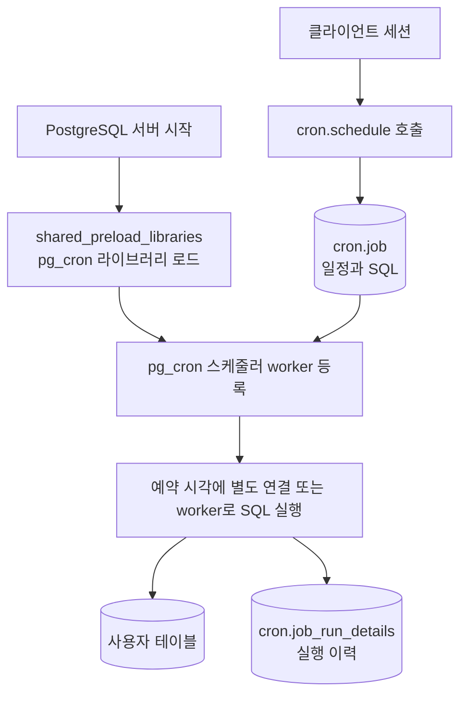
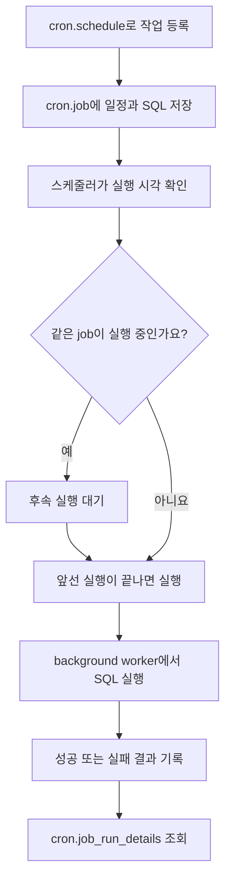
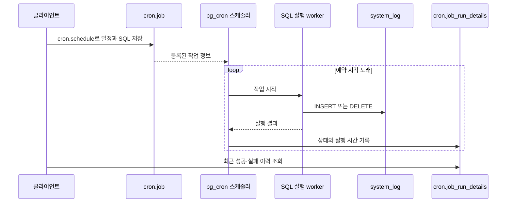

pg_cron은 cron 표현식으로 SQL 실행을 예약합니다. DB 내부 집계처럼 SQL로 끝나는 작업에 사용할 수 있습니다.

## Airflow로 실행해도 되는데, 왜 pg_cron일까요?

매일 거래 통계를 집계하거나 오래된 로그를 지우는 작업은 Airflow나 애플리케이션 스케줄러에서도 실행할 수 있습니다. 다만 작업이 PostgreSQL 안의 SQL로 끝난다면, pg_cron을 사용해 별도 실행 서버 없이 일정과 SQL을 DB에서 관리할 수 있습니다. 애플리케이션 세션을 계속 열어 둘 필요도 없습니다.

Airflow는 여러 작업의 순서와 의존성을 DAG로 표현하고, 외부 시스템을 포함한 워크플로우를 운영하는 도구입니다. 파일 수집 → 변환 → DB 적재처럼 단계를 연결하는 작업에 어울립니다. [Airflow 구조](https://airflow.apache.org/docs/apache-airflow/stable/core-concepts/overview.html)

이 글의 로그 정리와 DB 내부 집계는 SQL로 끝나므로 pg_cron을 사용합니다. 별도 스케줄러 서비스를 운영할 필요는 없지만, 예약 작업이 서비스 쿼리와 DB 자원을 공유하고 복잡한 의존성이나 재시도 흐름은 별도로 구현해야 합니다. 외부 시스템을 거치거나 여러 작업의 성공·실패에 따라 실행 순서를 관리해야 한다면 Airflow 같은 워크플로우 도구가 더 적합합니다.

### 어떤 작업에 사용할까요?

| 용도               | 예약할 작업                                           | 확인할 점                                                |
| ------------------ | ----------------------------------------------------- | -------------------------------------------------------- |
| 통계 집계          | 시간별·일별 거래 집계 테이블 갱신                     | 재실행해도 중복되지 않도록 집계 구간과 키 설계           |
| 플래너 통계        | 대량 적재 이후 `ANALYZE`                              | 업무 통계 집계와 구분하며 autovacuum을 보완              |
| 인덱스 관리        | 필요성이 확인된 인덱스의 `REINDEX` 예약               | 매일 무조건 재구축하지 않고 잠금·I/O 비용 확인           |
| 시계열·로그 데이터 | 보존 기간이 지난 데이터 정리                          | 대량 DELETE는 WAL과 dead tuple을 만들므로 배치 크기 조절 |
| 캐시 테이블        | 만료 행 삭제, 요약 데이터 또는 materialized view 갱신 | 갱신 중 잠금과 허용 가능한 데이터 지연 확인              |
| 임시 작업 큐       | 완료·만료된 작업 정리                                 | 실행 중인 작업과 재시도할 작업은 삭제 대상에서 제외      |

pg_cron은 SQL을 실행할 시점을 정합니다. 어떤 인덱스가 필요한지 판단하거나 로그의 보존 정책을 정해 주는 기능은 아닙니다.

## shared_preload_libraries는 무엇일까요?

`shared_preload_libraries`는 PostgreSQL 서버가 시작할 때 미리 불러올 라이브러리 목록입니다. pg_cron은 이 단계에서 스케줄러 background worker를 등록합니다. 설정 변경에는 서버 재시작이 필요하며, `CREATE EXTENSION`만 실행해서는 이 시작 절차를 대신할 수 없습니다. 존재하지 않는 라이브러리를 지정하면 서버 시작이 실패할 수 있어 패키지를 먼저 설치합니다. [PostgreSQL 설정 문서](https://www.postgresql.org/docs/current/runtime-config-client.html#GUC-SHARED-PRELOAD-LIBRARIES)



클라이언트는 작업을 등록하고 결과를 조회합니다. 실제 예약 실행은 별도 경로로 진행되므로 클라이언트가 접속을 종료해도 예약은 유지됩니다. 위 그림은 pg_cron의 흐름만 나타낸 것입니다. PostgreSQL의 autovacuum까지 `shared_preload_libraries`로 설치하는 것은 아닙니다.

이미 Citus 등을 사용한다면 기존 목록에 `pg_cron`을 함께 지정합니다. 예를 들어 `shared_preload_libraries=citus,pg_cron`입니다. [Citus 실습]()은 coordinator에서 예약하고, SQL이 분산 테이블에 접근할 때 worker에 작업을 나눕니다.

## 예약 등록부터 실행 결과 확인까지



아래 Compose에서 설정한 background worker 방식의 흐름입니다. 실행 결과 기록이 활성화된 환경을 기준으로 하며, 기록 확인과 실패 대응은 별도로 해야 합니다. 같은 job의 중복 실행이 대기하는 것과 실패한 작업을 재시도하는 것은 다른 동작입니다.

## Docker Compose로 실행하기

pg_cron 1.6.8 / PostgreSQL 17.11 기준입니다. [이미지 태그](https://hub.docker.com/r/library/postgres/tags)

pg_cron 패키지도 `1.6.8-1.pgdg12+1`로 고정합니다. [pg_cron 릴리스](https://github.com/citusdata/pg_cron/releases/tag/v1.6.8)

`compose.yml`

`Dockerfile`

```dockerfile
FROM postgres:17.11-bookworm@sha256:639ab7ceb90e13123085b741fb31ef493fba25463002f6da665352e7b534b652

# PostgreSQL 메이저 버전에 맞는 pg_cron 패키지 설치
RUN apt-get update \
    && apt-get install -y --no-install-recommends postgresql-17-cron=1.6.8-1.pgdg12+1 \
    && rm -rf /var/lib/apt/lists/*
```

```yaml
name: pg-pg-cron-lab

x-environment: &environment
  POSTGRES_USER: postgres
  POSTGRES_PASSWORD: ${POSTGRES_PASSWORD:?Set POSTGRES_PASSWORD}
  POSTGRES_DB: lab

x-healthcheck: &healthcheck
  test: ["CMD-SHELL", "pg_isready -U postgres -d lab"]
  interval: 5s
  timeout: 5s
  retries: 20

services:
  ops:
    build: .
    environment: *environment
    ports: ["127.0.0.1:5546:5432"]
    command:
      - postgres
      - -c
      - shared_preload_libraries=pg_cron
      - -c
      - cron.database_name=lab
      - -c
      - cron.timezone=Asia/Seoul
      - -c
      - cron.use_background_workers=on
      - -c
      - max_worker_processes=16
    volumes: ["ops-data:/var/lib/postgresql/data"]
    healthcheck: *healthcheck

volumes:
  ops-data:
```

`shared_preload_libraries`로 pg_cron을 로드하고, 작업 메타데이터를 저장할 DB와 시간대를 지정했습니다. 작업은 background worker 방식으로 실행합니다.

```bash
read -r -s -p 'Lab DB password: ' POSTGRES_PASSWORD
echo
export POSTGRES_PASSWORD

docker compose config --quiet
docker compose up -d --build --wait
docker compose exec ops psql -U postgres -d lab
```

## 초 단위 예약은 1.5.0부터 지원합니다

pg_cron **1.5.0부터 1~59초 간격**을 지원합니다. `'5 seconds'`처럼 지정하며, 일반 cron 표현식에 초 필드를 추가한 6칸 문법이 아닙니다. `'* * * * *'`는 매분, `'*/5 * * * *'`는 5분마다 실행합니다. [1.5.0 릴리스 노트](https://github.com/citusdata/pg_cron/releases/tag/v1.5.0)

```sql
CREATE EXTENSION IF NOT EXISTS pg_cron;

SELECT extversion FROM pg_extension WHERE extname = 'pg_cron';
SHOW shared_preload_libraries;
SHOW cron.database_name;
SHOW cron.use_background_workers;
```

이 Dockerfile은 pg_cron 1.6.8 패키지로 고정했습니다. 초 단위 예제 전에 DB에 활성화된 버전도 확인합니다. 기존 DB에서 패키지만 교체한 경우 확장 업데이트 절차도 필요할 수 있습니다.

## 5초마다 로그를 남기고, 오래된 로그 정리하기

`system_log`가 없는 실습 DB에서 실행합니다. 이 작업은 스케줄러 실행 여부를 관찰하는 예제이며, 서비스 전체의 상태를 검사하는 health check는 아닙니다.

```sql
CREATE TABLE system_log (
    id BIGSERIAL PRIMARY KEY,
    message TEXT NOT NULL,
    ts TIMESTAMPTZ DEFAULT NOW()
);

SELECT cron.schedule('healthcheck', '5 seconds', $$
    INSERT INTO system_log(message) VALUES ('OK')
$$);
```

등록 직후에는 아직 실행되지 않았을 수 있습니다. 25~30초 정도 지난 뒤 다음 쿼리를 실행합니다. 전체 실습을 한 트랜잭션으로 묶지 않고, 테이블 생성과 작업 등록을 커밋한 상태에서 기다립니다.

```sql
SELECT count(*) FROM system_log;

SELECT id, message, ts
FROM system_log
ORDER BY id
LIMIT 5;

SELECT jobid, jobname, schedule, command, active
FROM cron.job;

SELECT jobid, status, start_time, return_message
FROM cron.job_run_details
ORDER BY start_time DESC
LIMIT 5;
```

`system_log`는 작업이 만든 데이터, `cron.job`은 예약 정의, `cron.job_run_details`는 실행 이력입니다. 작업을 등록했다고 성공이 보장되지는 않으므로 실패 여부와 메시지도 확인합니다. 행 수와 실행 간격은 조회 시점과 DB 부하에 따라 달라집니다.



앞의 Compose처럼 background worker 실행과 이력 기록이 활성화된 경우의 개념도입니다. 스케줄러 worker와 SQL을 실행하는 worker의 역할을 나누어 표시했습니다.

이제 10초마다 30초보다 오래된 로그를 지웁니다.

```sql
SELECT cron.schedule('cleanup', '10 seconds', $$
    DELETE FROM system_log WHERE ts < NOW() - INTERVAL '30 seconds'
$$);

-- 40초 이상 지난 뒤 여러 번 조회하며 증가와 정리를 관찰한다.
SELECT count(*) FROM system_log;
```

입력과 정리가 계속되므로 행 수는 늘었다가 줄어듭니다. 항상 정확히 6행만 남는 구조는 아닙니다. 정리 주기가 10초이므로 30초가 지난 행도 다음 정리 시점까지 남을 수 있고, 실행 지연도 생길 수 있습니다.

### 예약을 해제한 다음 테이블 정리하기

```sql
SELECT cron.unschedule('healthcheck');
SELECT cron.unschedule('cleanup');

-- 예약이 제거되었는지 확인
SELECT jobid, jobname, active
FROM cron.job
WHERE jobname IN ('healthcheck', 'cleanup');

-- 실행 중인 작업이 남아 있는지도 확인
SELECT jobid, status, start_time
FROM cron.job_run_details
WHERE status IN ('starting', 'connecting', 'sending', 'running');
```

관련 작업의 종료를 확인한 뒤 아래 문장을 별도로 실행합니다. 예약 해제를 실행 완료를 기다리는 동기화 수단으로 사용하지 않습니다. 테이블만 먼저 지우면 예약 작업이 없는 테이블에 접근할 수 있습니다.

```sql
DROP TABLE system_log;
```

## Citus와 함께 최근 1분 거래 통계 갱신하기

VIP와 GENERAL 등급별로 최근 1분 동안 발생한 거래의 합계와 건수를 저장해 두면 대시보드, 모니터링 알림, 마케팅 이벤트의 KPI로 사용할 수 있습니다. 조회할 때마다 원본 거래를 집계하는 대신, pg_cron이 통계 테이블을 주기적으로 갱신하고 조회 요청은 저장된 결과를 읽는 방식입니다.

이 예제는 [Citus 실습]()의 다중 노드 구성에서 이어집니다. coordinator에 pg_cron을 활성화하고, `account_id`로 분산한 `transactions`와 참조 테이블 `branches`를 만든 상태를 전제로 합니다. 앞의 pg_cron 단독 Compose에는 Citus가 없으므로 `create_reference_table`을 실행할 수 없습니다. 아래 SQL은 Citus coordinator의 `fintech_dist_db`에서 실행합니다.

### 통계 테이블을 만들고 5초마다 갱신하기

먼저 등급별 통계를 저장할 테이블을 만들고 참조 테이블로 등록합니다.

```sql
CREATE TABLE transaction_stats (
    tier         VARCHAR(20) PRIMARY KEY,
    total_amount NUMERIC(20, 2) NOT NULL,
    txn_count    BIGINT NOT NULL,
    updated_at   TIMESTAMPTZ NOT NULL
);

SELECT create_reference_table('transaction_stats');
```

`tier`마다 한 행을 저장합니다. 다음 작업은 5초마다 최근 1분 거래를 다시 집계하고, 같은 등급의 행이 있으면 새 결과로 덮어씁니다.

```sql
SELECT cron.schedule('refresh_stats', '5 seconds', $$
    INSERT INTO transaction_stats (tier, total_amount, txn_count, updated_at)
    SELECT
        customer_tier,
        SUM(amount),
        COUNT(*),
        NOW()
    FROM transactions
    WHERE created_at > NOW() - INTERVAL '1 minute'
    GROUP BY customer_tier
    ON CONFLICT (tier) DO UPDATE SET
        total_amount = EXCLUDED.total_amount,
        txn_count    = EXCLUDED.txn_count,
        updated_at   = EXCLUDED.updated_at
$$);
```

기존 합계에 더하는 것이 아니라 이번 집계값으로 교체합니다. 조회 구간이 이전 실행과 겹치므로 기존 값에 누적하면 같은 거래를 중복 계산하게 됩니다. `updated_at`은 이 집계에 사용한 `NOW()`, 즉 작업 트랜잭션의 시작 시각이며 완료 시각은 아닙니다.

이 기본 쿼리는 하한만 지정합니다. 미래 시각의 거래도 들어올 수 있다면 `created_at <= NOW()` 조건을 함께 넣어 집계 범위를 제한해야 합니다.

Citus 실습에서 만든 `branch_id = 1`이 존재하는지 확인한 뒤 테스트 거래를 넣습니다.

```sql
INSERT INTO transactions (
    account_id, customer_tier, amount, description, branch_id, created_at
)
VALUES (300, 'VIP', 5000000, '실시간 결제 테스트', 1, NOW());

-- INSERT를 커밋하고 다음 예약 실행이 끝난 뒤 조회한다.
SELECT tier, total_amount, txn_count, updated_at
FROM transaction_stats
ORDER BY tier;

SELECT r.jobid, r.status, r.start_time, r.end_time, r.return_message
FROM cron.job_run_details AS r
JOIN cron.job AS j ON j.jobid = r.jobid
WHERE j.jobname = 'refresh_stats'
ORDER BY r.start_time DESC
LIMIT 5;
```

최근 1분의 VIP 거래가 이 한 건뿐이라면 합계는 `5000000.00`, 건수는 `1`입니다. 다른 거래가 있으면 함께 집계합니다. 예약 주기가 5초여도 실행 대기와 집계 시간이 더해질 수 있으므로, 대시보드에서는 `updated_at`으로 통계가 오래되지 않았는지도 확인합니다.

> 이 쿼리는 최근 1분 거래가 없는 등급을 갱신하지 않습니다. 마지막 VIP 거래가 집계 구간을 벗어나면 `GROUP BY` 결과에서 VIP가 빠져 이전 합계와 건수가 남습니다. 거래가 없는 등급도 0으로 표시하려면 아래처럼 등급을 지정해 갱신해야 합니다.
{: .prompt-warning }

### 통계 테이블을 참조 테이블로 두는 이유

이 예제의 통계는 등급별 한 행이라 데이터가 작습니다. 참조 테이블로 두면 Citus가 전체 결과를 모든 worker에 복제하므로, 각 worker에서 거래 샤드와 같은 등급의 통계를 조인할 수 있습니다. worker마다 자기 거래만 집계한 통계가 아니라, 전체 거래를 집계한 결과의 사본을 갖습니다. [Citus 참조 테이블](https://docs.citusdata.com/en/stable/develop/reference_ddl.html#reference-tables)

`transactions`를 집계할 때는 Citus가 분산 쿼리를 실행하고 결과를 합칩니다. 이후 `transaction_stats`에 기록한 결과를 worker에 복제합니다. 참조 테이블로 지정하는 것은 **결과를 어디에 저장할지 정하는 배치 방식**이며, 집계 주기나 계산 방법을 정하는 기능은 아닙니다. [Citus INSERT … SELECT](https://docs.citusdata.com/en/stable/develop/reference_dml.html#from-select-clause-distributed-rollups)

대시보드가 coordinator에서 통계만 읽는다면 참조 테이블이 반드시 필요한 것은 아닙니다. 여기서는 worker에서도 같은 통계를 읽거나 분산 테이블과 조인하는 용도로 사용합니다. 대신 갱신할 때마다 모든 worker에 변경을 전파하므로, 통계 행 수와 갱신 빈도가 커지면 복제 비용도 확인해야 합니다.

### VIEW, Materialized View와 무엇이 다를까요?

| 방식                | 저장하는 내용                  | 계산·갱신 시점                                                  |
| ------------------- | ------------------------------ | --------------------------------------------------------------- |
| VIEW                | SELECT 정의                    | 조회할 때 계산하며 결과는 별도로 저장하지 않음                  |
| MATERIALIZED VIEW   | SELECT 정의와 결과             | 생성 시 결과를 채우거나 `REFRESH MATERIALIZED VIEW`로 다시 계산 |
| `transaction_stats` | 일반 테이블에 저장한 집계 결과 | pg_cron이 실행하는 SQL과 UPSERT로 직접 갱신                     |

VIEW는 조회 정의를 저장하고, Materialized View는 조회 결과도 저장합니다. 지금 구조는 **SELECT 결과를 일반 테이블에 저장하면서 갱신 정책까지 직접 관리**하는 방식입니다. Materialized View의 `REFRESH`도 pg_cron으로 예약할 수 있지만, PostgreSQL의 기본 `REFRESH`에는 특정 등급만 갱신하는 `WHERE` 옵션이 없습니다. `CONCURRENTLY`도 증분 갱신을 뜻하지 않습니다. [PostgreSQL Materialized View](https://www.postgresql.org/docs/17/rules-materializedviews.html), [REFRESH 구문](https://www.postgresql.org/docs/17/sql-refreshmaterializedview.html)

### VIP는 1초, GENERAL은 10초마다 갱신하기

일반 테이블은 등급별로 갱신 주기를 나누거나 특정 등급만 다시 계산할 수 있습니다. 먼저 등급 하나를 받아 최근 1분 통계를 갱신하는 함수를 만듭니다. 이 함수는 coordinator에서 실행하고, 내부 집계 SQL이 분산 테이블을 조회합니다.

```sql
CREATE OR REPLACE FUNCTION refresh_transaction_stats(p_tier VARCHAR(20))
RETURNS void
LANGUAGE plpgsql
AS $function$
DECLARE
    v_as_of TIMESTAMPTZ := NOW();
    v_total_amount NUMERIC;
    v_txn_count BIGINT;
BEGIN
    SELECT COALESCE(SUM(amount), 0), COUNT(*)
    INTO v_total_amount, v_txn_count
    FROM transactions
    WHERE customer_tier = p_tier
      AND created_at > v_as_of - INTERVAL '1 minute'
      AND created_at <= v_as_of;

    INSERT INTO transaction_stats (tier, total_amount, txn_count, updated_at)
    VALUES (p_tier, v_total_amount, v_txn_count, v_as_of)
    ON CONFLICT (tier) DO UPDATE SET
        total_amount = EXCLUDED.total_amount,
        txn_count    = EXCLUDED.txn_count,
        updated_at   = EXCLUDED.updated_at;
END;
$function$;
```

`GROUP BY` 없이 특정 등급만 집계하므로 거래가 없어도 한 행을 반환합니다. 이때 `SUM`의 `NULL`은 `COALESCE`로 0으로 바꾸고, `COUNT(*)`는 0을 반환합니다. 따라서 마지막 거래가 1분 구간을 벗어나면 해당 등급의 합계와 건수도 0으로 갱신합니다.

앞의 전체 등급 작업과 동시에 같은 행을 갱신하지 않도록 기존 예약부터 해제합니다.

```sql
SELECT cron.unschedule('refresh_stats');
```

예약 해제 전에 시작된 `refresh_stats` 실행이 끝났는지 실행 이력에서 확인한 다음, 두 작업을 등록합니다.

```sql
SELECT cron.schedule('refresh_stats_vip', '1 second', $$
    SELECT refresh_transaction_stats('VIP')
$$);

SELECT cron.schedule('refresh_stats_general', '10 seconds', $$
    SELECT refresh_transaction_stats('GENERAL')
$$);
```

필요할 때 `SELECT refresh_transaction_stats('VIP');`로 VIP만 갱신할 수도 있습니다. 다만 같은 등급의 예약 작업과 수동 실행을 겹치게 하면 계산 시점이 다른 결과가 서로 덮어쓸 수 있으므로, 해당 예약을 멈추고 실행 중인 작업이 끝난 뒤 수행합니다. 실습을 마치면 `cron.unschedule('refresh_stats_vip')`와 `cron.unschedule('refresh_stats_general')`로 예약을 해제합니다.

등급별 주기가 다르면 두 행의 `updated_at`도 다를 수 있습니다. 따라서 두 값을 합쳐 같은 시점의 전체 통계라고 해석해서는 안 됩니다. 전체 등급을 같은 기준 시각으로 비교해야 한다면 하나의 작업에서 함께 갱신하는 편이 맞습니다.

### 여러 KPI를 함께 저장하기

일반 테이블이므로 필요한 KPI 컬럼을 추가하고 같은 집계에서 계산할 수 있습니다. 확장한 테이블의 컬럼 구성은 다음과 같이 잡을 수 있습니다.

```text
tier
total_amount
txn_count
avg_amount
max_amount
fraud_count
updated_at
```

`avg_amount`는 `AVG(amount)`, `max_amount`는 `MAX(amount)`로 계산합니다. `fraud_count`를 유지하려면 원본에 이상 거래 판정 결과가 있거나 판정 데이터를 연결할 수 있어야 합니다. 현재 `transactions` 예제에는 해당 정보가 없으므로 먼저 판정 기준과 데이터 구조를 정해야 합니다. 판정 결과가 나중에 바뀌는 경우 어느 기간까지 다시 집계할지도 결정합니다.

거래가 없을 때 평균과 최댓값을 `NULL`로 둘지 0으로 표시할지도 정해야 합니다. 컬럼을 추가하면 집계 SQL과 UPSERT의 갱신 목록에도 반영합니다. 저장 구조와 갱신 범위를 자유롭게 정할 수 있는 대신, 누락된 갱신과 오래된 결과의 처리를 직접 관리해야 합니다.

### Kafka와 Spark Streaming을 사용하는 구조와 비교하기

거래 이벤트를 Kafka로 받아 Spark Structured Streaming에서 시간 윈도우별로 집계하고, 결과를 Redis나 RDB에 저장하는 구성을 생각할 수 있습니다. 이 사례의 역할을 대응시키면 다음과 같습니다.

| 이벤트 처리 구성                   | 이 예제의 역할                                  |
| ---------------------------------- | ----------------------------------------------- |
| Kafka로 들어오는 거래 이벤트       | `transactions`에 저장된 원본 거래               |
| 스트리밍 처리기의 시간 윈도우 집계 | pg_cron이 주기적으로 실행하는 최근 1분 집계 SQL |
| Redis/RDB에 저장한 조회용 결과     | `transaction_stats`                             |

Spark Structured Streaming도 기본적으로 마이크로배치 방식으로 실행할 수 있지만, 집계 상태를 유지하며 새 데이터를 증분 처리한다는 점에서 이 SQL의 전체 구간 재집계와 다릅니다. [Spark Structured Streaming 개요](https://spark.apache.org/docs/latest/streaming/index.html)

이 표는 역할을 비교한 것이며 처리 방식까지 같다는 뜻은 아닙니다. **5초마다 최근 1분 전체를 다시 읽는 방식은 스트리밍 증분 집계가 아니라, 5초 주기의 작은 배치 재집계에 가깝습니다.** 이전 집계 상태에 새 이벤트만 반영하는 구조가 아니며, 별도의 이벤트 전달·재생 기능도 제공하지 않습니다. 늦게 저장된 거래는 `created_at`이 다음 실행의 최근 1분 범위 안에 있어야 반영됩니다. 이미 구간을 벗어난 거래를 보정하려면 별도의 과거 구간 집계가 필요합니다.

거래 데이터가 이미 PostgreSQL에 있고 수초 단위의 지연을 허용한다면 Citus와 pg_cron으로 이 집계를 구성할 수 있습니다. 다만 등급 조건은 분산 키인 `account_id`를 지정하지 않으므로 여러 샤드를 읽습니다. 분산했다고 재집계 비용이 없어지는 것은 아닙니다. 최근 1분의 입력 행 수를 N, 등급 수를 G라고 하면 해당 구간을 읽는 집계는 대략 O(N)의 처리와 O(G)의 집계 상태가 필요합니다. 시간 조건을 지원하는 인덱스나 파티션이 없으면 더 오래된 데이터까지 스캔할 수 있습니다.

적용 전에는 집계 실행 시간이 예약 간격 안에 들어오는지, 원본 거래의 쓰기와 다른 조회에 어떤 영향을 주는지 측정합니다. 실행 지연이 계속 쌓이거나 지연 이벤트 처리·재생·증분 집계가 필요해지면 별도의 이벤트 처리 구조를 검토합니다. 여기서 Kafka와 Spark를 대체할 수 있는 범위는 DB 안에서 끝나는 이 집계 작업입니다.

## 운영할 때 확인할 점

기본 실행 방식은 스케줄러가 별도 PostgreSQL 연결을 여는 방식입니다. 이때는 `pg_hba.conf`와 실행 계정의 인증을 구성해야 합니다. 이 글은 `cron.use_background_workers=on`으로 SQL 실행용 worker를 사용하므로, 다른 확장이 사용하는 worker까지 합쳐 `max_worker_processes`에 여유가 있어야 합니다. [실행 방식과 설정](https://github.com/citusdata/pg_cron#setting-up-pg_cron)

- **실행 시간:** 같은 job의 이전 실행이 끝나지 않으면 후속 실행이 기다립니다. 5초 예약은 5초 안에 완료된다는 보장이 아닙니다. 서로 다른 job은 동시에 실행될 수 있으므로 로그 입력과 정리가 겹칠 수 있습니다.
- **자원과 잠금:** 통계 집계·인덱스 관리·삭제도 일반 SQL처럼 CPU, I/O, 잠금을 사용합니다. 실행 시간과 대기 상태를 확인하고 작업별 timeout과 처리량을 정합니다.
- **실패 대응:** 실행 이력만으로 자동 재시도나 알림이 완성되지는 않습니다. 실패를 감시하고, 재실행해도 안전한 SQL을 작성합니다.
- **이력 보존:** `cron.job_run_details`는 자동으로 오래된 기록을 지우지 않습니다. 초 단위 작업은 이력도 빠르게 늘어나므로 별도 보존 기간을 정합니다.
- **설치 범위:** pg_cron 확장은 한 PostgreSQL 클러스터의 한 DB에 설치합니다. 다른 DB에 작업을 예약하려면 `cron.schedule_in_database`를 사용합니다.
- **시간대:** `cron.timezone`은 작업을 실행할 시각의 기준이고, 세션의 `TimeZone`은 `TIMESTAMPTZ` 값을 조회할 때 표시할 시간대입니다. 예약 시간대를 바꿔도 조회 결과의 표시 시간대가 함께 바뀌지는 않습니다.

설정·동시 실행·이력 보존에 관한 세부 동작은 [pg_cron 공식 문서](https://github.com/citusdata/pg_cron)에서 확인할 수 있습니다.

예약 실행은 DB가 가동 중이고 자원 여유가 있어야 진행되므로, 지정한 시각에 정확히 실행되는 실시간 타이머로 사용할 수는 없습니다. 작업은 등록한 사용자의 권한으로 실행되므로 운영에서는 사용자의 권한을 확인해야합니다. 관리형 DB에서는 확장 설치와 preload 설정이 제한될 수 있어 서비스가 지원하는 버전과 설정 범위도 확인해야 합니다.

## 정리

pg_cron은 PostgreSQL 안에서 SQL을 예약하고 실행 이력을 관리합니다. 주기적인 통계 집계, 로그 보존 기간 관리, 캐시 테이블 갱신처럼 DB 안에서 끝나는 작업에 활용할 수 있습니다. 예약 주기와 함께 실행 시간·실패 이력을 관리해야 합니다. 여러 외부 시스템의 작업 순서와 의존성까지 관리하려면 별도 워크플로우 도구가 필요합니다.

Citus와 함께 사용하면 분산된 거래를 집계해 작은 통계 테이블에 저장할 수 있습니다. 이때 참조 테이블은 결과의 복제 방식을, pg_cron과 UPSERT는 갱신 시점과 내용을 담당합니다. 최근 1분 전체를 매번 다시 계산하므로 실행 비용과 거래가 없는 등급의 처리도 함께 고려해야 합니다.

전체 확장 목록은 [PostgreSQL 확장 소개]()에서 확인할 수 있습니다.


## 출처

- [pg_cron 공식 문서](https://github.com/citusdata/pg_cron)
- [Citus 참조 테이블](https://docs.citusdata.com/en/stable/develop/reference_ddl.html#reference-tables)
- [Citus 데이터 입력과 집계](https://docs.citusdata.com/en/stable/develop/reference_dml.html)
- [PostgreSQL CREATE VIEW](https://www.postgresql.org/docs/17/sql-createview.html)
- [PostgreSQL Materialized Views](https://www.postgresql.org/docs/17/rules-materializedviews.html)
- [PostgreSQL REFRESH MATERIALIZED VIEW](https://www.postgresql.org/docs/17/sql-refreshmaterializedview.html)
- [Spark Structured Streaming 개요](https://spark.apache.org/docs/latest/streaming/index.html)
