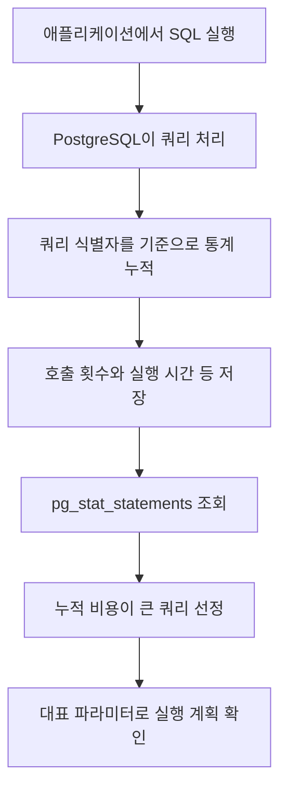

pg_stat_statements는 SQL을 정규화해 호출 횟수, 누적 실행 시간, 평균 실행 시간 등을 집계합니다. 단건 실행이 느린 쿼리뿐 아니라, 짧게 실행되지만 호출이 많아 전체 비용이 큰 쿼리도 찾을 수 있습니다.

## 개별 실행을 쿼리별 통계로 모으기



상수 값이 달라도 정규화된 쿼리가 같으면 통계를 묶어 볼 수 있습니다. 실제 통계 구분에는 DB·사용자 등도 포함됩니다. 다만 개별 요청의 실행 로그나 p95 지연을 저장하지는 않습니다.

## Docker Compose로 실행하기

PostgreSQL 17.11 contrib 기준입니다. [이미지 태그](https://hub.docker.com/r/library/postgres/tags)

`compose.yml`

```yaml
name: pg-pg-stat-statements-lab

x-environment: &environment
  POSTGRES_USER: postgres
  POSTGRES_PASSWORD: ${POSTGRES_PASSWORD:?Set POSTGRES_PASSWORD}
  POSTGRES_DB: lab

x-healthcheck: &healthcheck
  test: ["CMD-SHELL", "pg_isready -U postgres -d lab"]
  interval: 5s
  timeout: 5s
  retries: 20

services:
  ops:
    image: postgres:17.11-alpine@sha256:b0f9560a2de083e2cc7382e75f808c7381a32852a7ec49117deedb300e552b24
    environment: *environment
    ports: ["127.0.0.1:5548:5432"]
    command:
      - postgres
      - -c
      - shared_preload_libraries=pg_stat_statements
      - -c
      - compute_query_id=on
    volumes: ["ops-data:/var/lib/postgresql/data"]
    healthcheck: *healthcheck

volumes:
  ops-data:
```

서버 시작 시 `pg_stat_statements`를 로드하고 쿼리 식별자 계산을 활성화합니다. 기존 서버에서 preload 설정을 바꾸었다면 재시작이 필요합니다.

```bash
read -r -s -p 'Lab DB password: ' POSTGRES_PASSWORD
echo
export POSTGRES_PASSWORD

docker compose config --quiet
docker compose up -d --wait
docker compose exec ops psql -U postgres -d lab
```

## SQL로 사용해 보기

`ops` 서비스에서 실행합니다. Compose에 preload와 `compute_query_id=on`을 지정했으므로 확장을 활성화한 뒤 테스트 쿼리를 실행하면 됩니다.

```sql
CREATE EXTENSION IF NOT EXISTS pg_stat_statements;

SELECT sum(n) FROM generate_series(1, 10000) AS g(n);
SELECT sum(n) FROM generate_series(1, 20000) AS g(n);

SELECT query,
       calls,
       round(total_exec_time::numeric, 2) AS total_ms,
       round(mean_exec_time::numeric, 2) AS mean_ms,
       rows
FROM pg_stat_statements
WHERE dbid = (SELECT oid FROM pg_database WHERE datname = current_database())
ORDER BY total_exec_time DESC
LIMIT 10;
```

통계는 실행 계획 그 자체가 아닙니다. 후보 쿼리를 찾은 뒤 대표 파라미터로 `EXPLAIN (ANALYZE, BUFFERS)`를 확인합니다. `ANALYZE`를 붙인 EXPLAIN은 쿼리를 실제 실행하므로 쓰기 SQL에 무심코 사용하면 안 됩니다. [pg_stat_statements 문서](https://www.postgresql.org/docs/17/pgstatstatements.html)

통계를 비교할 때는 호출량과 관측 기간을 맞춰야 합니다. 누적 실행 시간은 두 조건의 영향을 받고, 평균 실행 시간만으로는 p95·p99 지연을 알 수 없습니다. 개별 실행의 지연 분포가 필요하면 실행 이력이나 애플리케이션 추적을 별도로 수집합니다. 다른 사용자의 SQL을 조회할 때는 추가 권한이 필요할 수 있습니다.

## 정리

pg_stat_statements는 쿼리별 호출 횟수와 누적 실행 시간을 모아, 어떤 쿼리부터 분석할지 판단하는 데 도움을 줍니다. 호출이 잦아 총비용이 큰 쿼리와 한 번 실행할 때 오래 걸리는 쿼리를 구분하고, 후보를 찾은 뒤에는 실행 계획으로 원인을 확인합니다. 누적 통계의 수집 구간도 함께 봐야 비교 기준을 맞출 수 있습니다.

전체 확장 목록은 [PostgreSQL 확장 소개]()에서 확인할 수 있습니다.
