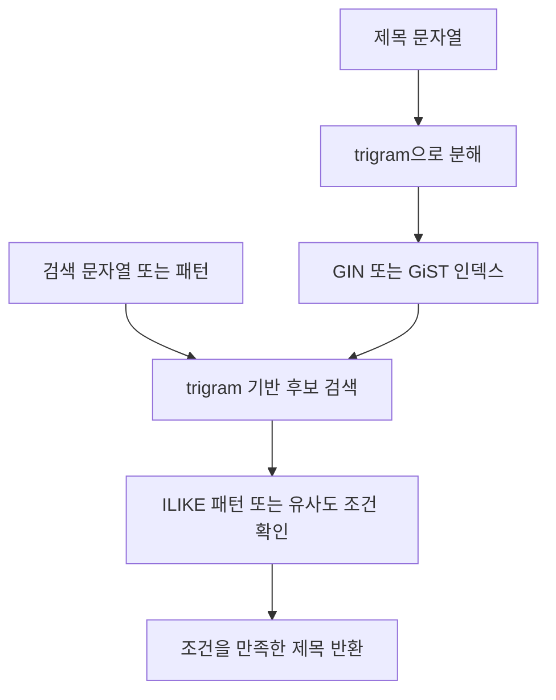

pg_trgm은 문자열을 세 문자 조각인 trigram으로 나누어 유사도를 계산합니다. 의미보다 표기가 비슷한 문자열을 찾으며, GIN·GiST 인덱스로 유사도 및 `LIKE`·`ILIKE` 검색을 지원합니다.

## 문자 조각으로 검색 후보 찾기



문자열을 세 문자 조각으로 비교하는 흐름입니다. 의미를 이해하는 검색은 아니며, 추출할 trigram이 부족한 짧은 패턴은 인덱스의 이점을 얻기 어렵습니다.

## Docker Compose로 실행하기

PostgreSQL 17.11 contrib 기준입니다. [이미지 태그](https://hub.docker.com/r/library/postgres/tags)

`compose.yml`

```yaml
name: pg-pg-trgm-lab

x-environment: &environment
  POSTGRES_USER: postgres
  POSTGRES_PASSWORD: ${POSTGRES_PASSWORD:?Set POSTGRES_PASSWORD}
  POSTGRES_DB: lab

x-healthcheck: &healthcheck
  test: ["CMD-SHELL", "pg_isready -U postgres -d lab"]
  interval: 5s
  timeout: 5s
  retries: 20

services:
  ops:
    image: postgres:17.11-alpine@sha256:b0f9560a2de083e2cc7382e75f808c7381a32852a7ec49117deedb300e552b24
    environment: *environment
    ports: ["127.0.0.1:5549:5432"]
    volumes: ["ops-data:/var/lib/postgresql/data"]
    healthcheck: *healthcheck

volumes:
  ops-data:
```

```bash
read -r -s -p 'Lab DB password: ' POSTGRES_PASSWORD
echo
export POSTGRES_PASSWORD

docker compose config --quiet
docker compose up -d --wait
docker compose exec ops psql -U postgres -d lab
```

## SQL로 사용해 보기

```sql
CREATE EXTENSION IF NOT EXISTS pg_trgm;

CREATE TABLE article_titles (
    id bigint GENERATED ALWAYS AS IDENTITY PRIMARY KEY,
    title text NOT NULL
);

INSERT INTO article_titles (title) VALUES
('PostgreSQL extensions'), ('Postgres indexing'), ('Docker networking');

CREATE INDEX article_titles_trgm_idx
ON article_titles USING gin (title gin_trgm_ops);

-- 중간 문자열 검색
SELECT title FROM article_titles WHERE title ILIKE '%postgres%';

-- % 연산자는 similarity_threshold를 사용한다. 세션 내 설정이다.
SET pg_trgm.similarity_threshold = 0.2;

SELECT title, similarity(title, 'postgre') AS score
FROM article_titles
WHERE title % 'postgre'
ORDER BY score DESC;
```

부분 일치와 유사도는 서로 다른 조건입니다. 임계값을 낮추면 후보가 늘지만 관련 없는 결과도 늘 수 있습니다. 또한 GIN 인덱스가 위 `similarity()` 정렬까지 대신하는 것은 아닙니다. 거리 기준 상위 몇 개를 찾는 패턴에는 GiST의 KNN 검색 지원도 검토할 수 있습니다. [pg_trgm 문서](https://www.postgresql.org/docs/17/pgtrgm.html)

pg_trgm은 문자열의 형태를 비교하므로 의미 검색이나 한국어 형태소 분석을 대신하지 않습니다. 인덱스는 저장 공간과 쓰기 비용을 늘리며, 추출할 trigram이 없는 짧은 검색 패턴에서는 전체 인덱스를 스캔할 수 있습니다. 따라서 실제 입력 패턴으로 실행 계획을 확인해야 합니다.

## 정리

pg_trgm은 문자열을 trigram으로 나눠 유사도와 부분 일치 검색에 활용합니다. 제목의 일부로 검색하거나 오타가 섞인 입력의 후보를 찾을 때 사용할 수 있습니다. 의미가 비슷한 문장이 아니라 표기가 비슷한 문자열을 찾으므로, 실제 입력에 맞춰 유사도 기준을 정하고 인덱스 사용 여부를 확인해야 합니다.

전체 확장 목록은 [PostgreSQL 확장 소개]()에서 확인할 수 있습니다.
