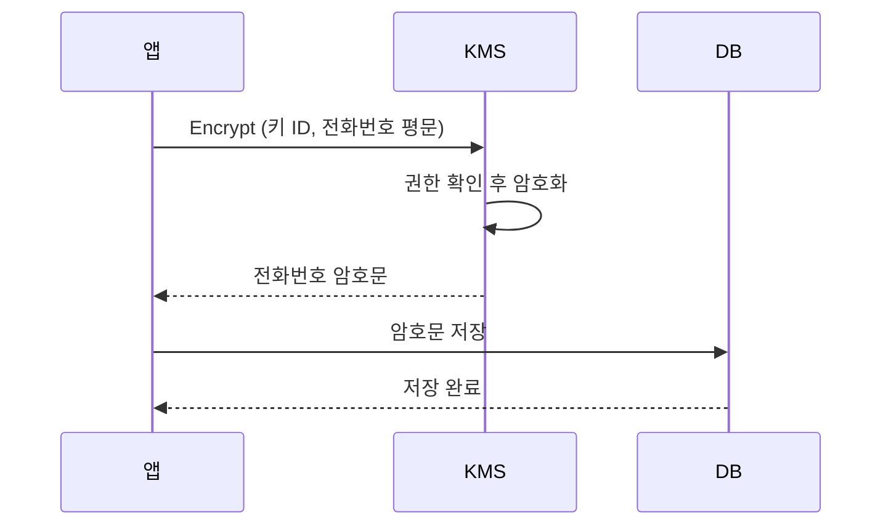
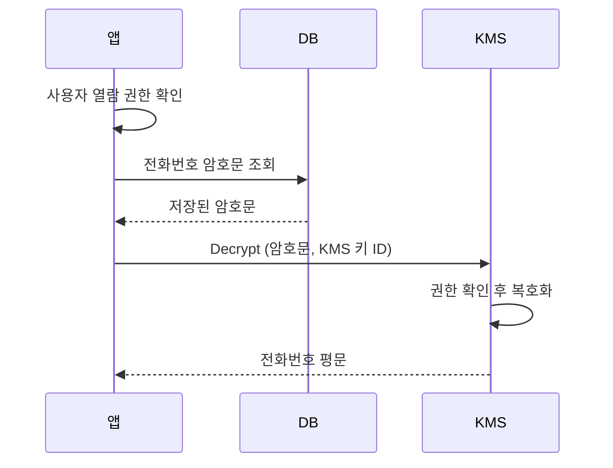
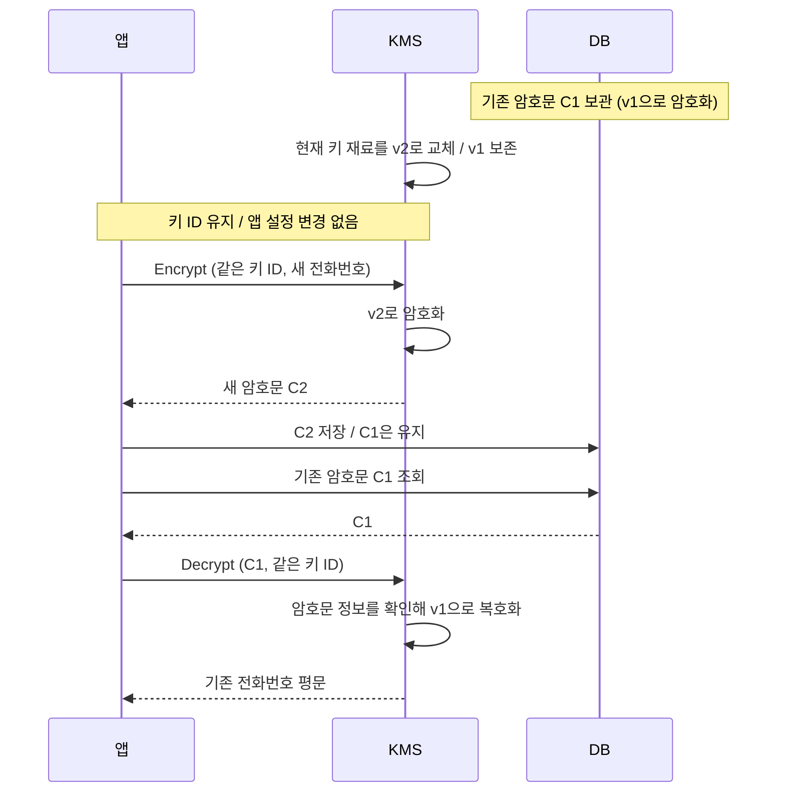
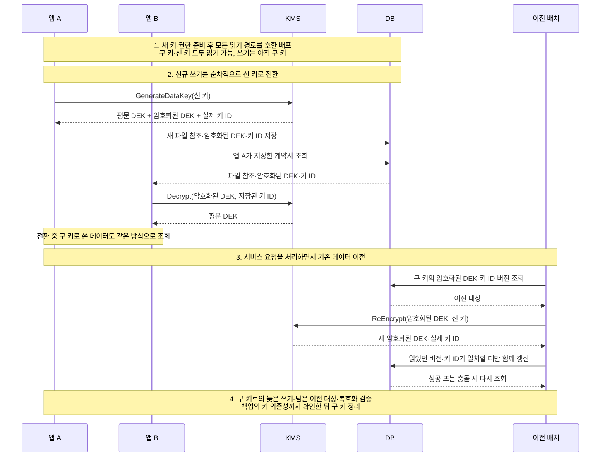

계약서를 보관하는 서비스를 만든다고 가정해 보겠습니다. 고객의 전화번호와 계약서를 저장하고, 담당자가 필요할 때 다시 조회할 수 있어야 합니다. DB나 백업 파일이 유출되더라도 내용을 바로 읽을 수 없도록 데이터를 암호화하기로 합니다.

데이터를 암호화하려면 키가 필요하고, 나중에 다시 읽을 때도 그 키를 사용할 수 있어야 합니다. 데이터를 보관하는 일과 함께 키를 어디에 두고 누가 사용하게 할지도 정해야 합니다.

KMS(Key Management System)는 키의 보관과 사용을 관리하는 시스템입니다. 전화번호를 암호화하는 기능에서 시작해 계약서 저장과 키 교체로 이어가고, 마지막에는 전송 중인 계약서를 보호하는 TLS를 살펴보겠습니다. 구체적인 API와 제한은 AWS KMS를 기준으로 설명하며, 사내 KMS에서는 제품에 따라 달라질 수 있습니다.

## 앱에 직접 보관한 암호화 키

먼저 고객의 전화번호부터 암호화하겠습니다. 고객센터에서 조회할 때는 원래 번호를 보여줘야 하므로, 앱에는 암호화와 복호화 기능이 모두 필요합니다.

전화번호 암호화에는 암호화와 복호화에 같은 비밀키를 사용하는 대칭키 암호 알고리즘인 AES를 쓸 수 있습니다. 앱이 전화번호를 암호화해 저장했다면, 나중에 그 번호를 복호화할 때도 같은 키가 필요합니다.

키를 `application.yml`에 넣어두면 앱은 설정 파일을 읽어 암호화와 복호화에 사용할 수 있습니다. 이 구조에서 DB 백업 파일만 유출됐다면, 키가 없는 사람은 암호문만으로 전화번호를 읽기 어렵습니다.

하지만 앱 서버의 취약점으로 설정 파일까지 유출되면 공격자는 암호문과 키를 함께 확보해 전화번호를 복호화할 수 있습니다. 서버 접근을 차단하더라도 이미 외부로 복사된 암호문과 키의 사용까지 막을 수는 없습니다.

DB에 평문을 남기지 않는 문제는 해결했지만, 이제 설정 파일에 있는 키가 보호 대상이 됩니다. 먼저 키를 코드와 설정 파일 밖으로 옮기는 방법을 생각해 볼 수 있습니다.

### 환경 변수로 옮기면 해결될까

키를 환경 변수로 옮기면 코드 저장소에 실수로 커밋할 위험을 줄일 수 있습니다. 하지만 앱은 실행 중에 환경 변수에서 키를 읽어야 합니다. 공격자가 앱 권한으로 코드를 실행할 수 있다면 그 값을 읽거나 앱의 복호화 기능을 이용할 수 있습니다.

키를 별도 서버에 보관했다가 앱이 시작할 때 받아오는 구조도 비슷합니다. 받아온 평문 키가 앱에 남고, 누군가 이를 복사해 간 뒤 사용하는 일까지 보관 서버가 통제할 수는 없습니다.

보관 위치만 바꿔서는 앱이 평문 키를 계속 갖고 있다는 문제가 남습니다. 그래서 키를 앱에 돌려주는 대신, 키를 보관하는 시스템이 암호 연산까지 처리하도록 바꿉니다. 앱은 키 대신 처리 결과를 받고, 키를 관리하는 쪽에서는 요청 권한을 확인하고 사용 기록을 남깁니다. 권한을 회수하면 이후 요청을 거절할 수도 있습니다.

## KMS의 키 관리와 접근 제어

이 역할을 KMS에 맡길 수 있습니다. 앱은 키를 직접 보관하는 대신 KMS에 암호화와 복호화를 요청합니다. AWS KMS처럼 서비스로 제공되는 제품은 Key Management Service라는 이름을 씁니다.

AWS KMS의 기본 키 저장소에서 생성한 KMS 키는 HSM(Hardware Security Module)이라는 보안 하드웨어로 보호됩니다. 그 키의 비밀값을 평문으로 내보내지 않고 KMS 내부에서 사용합니다. HSM이 키 보관과 암호 연산을 보호한다면, KMS는 여기에 API와 권한 정책, 키를 교체하거나 폐기하는 관리 기능을 제공합니다. 제품에 따라 보호 방식은 다를 수 있습니다. [AWS KMS 개요](https://docs.aws.amazon.com/kms/latest/developerguide/overview.html)

앱이 AWS SDK의 `Encrypt`와 `Decrypt`를 호출하면 SDK가 KMS에 HTTPS 요청을 보냅니다. 앱에서는 SDK 메서드를 호출하지만, 실제 암호 연산은 KMS에서 실행됩니다. 저장과 조회를 나눠 보면 앱과 KMS, DB의 역할을 구분하기 쉽습니다.

### 전화번호 저장

암호화를 요청하려면 KMS에 보관된 키 중 어떤 키를 사용할지 지정해야 합니다. 키 ID는 이때 사용하는 식별자이며, 비밀키 자체가 아닙니다. 설정 파일에 키 ID를 두더라도 실제 키를 사용하려면 KMS의 허가를 받아야 합니다. [AWS KMS의 키와 식별자](https://docs.aws.amazon.com/kms/latest/developerguide/concepts.html)

앱은 전화번호 평문과 사용할 KMS 키 ID를 보내 암호화를 요청합니다. KMS는 호출 권한을 확인하고 암호화한 값을 반환하며, 앱은 이 암호문을 DB에 저장합니다. KMS 키 자체는 앱으로 전달하지 않습니다.



### 전화번호 조회

조회할 때는 앱이 먼저 사용자의 열람 권한을 확인합니다. 권한이 있으면 DB에서 암호문을 읽어 KMS에 복호화를 요청하고, 반환된 전화번호를 사용자에게 보여줍니다. KMS는 앱의 호출 권한을 확인하고, 사용자에게 번호를 보여줘도 되는지는 앱이 판단합니다.



## KMS의 암호화 용량 제한

전화번호는 KMS에 직접 보내 암호화할 수 있었습니다. 하지만 고객이 올린 계약서까지 같은 방식으로 처리하려면 요청에 담을 데이터(payload)의 크기가 문제가 됩니다.

AWS KMS의 대칭키 `Encrypt` API는 한 번에 최대 4,096바이트의 평문을 받습니다. 10MB짜리 계약서는 한 번의 요청에 담을 수 없습니다. [AWS KMS Encrypt API](https://docs.aws.amazon.com/kms/latest/APIReference/API_Encrypt.html)

여기서 4,096바이트는 Base64로 표현한 HTTP 요청 전체의 크기가 아니라, 암호화할 원본 평문의 크기입니다. Base64 인코딩으로 이 제한을 피할 수는 없습니다. 이 수치는 AWS KMS의 대칭키 암호화 기준이며, 다른 알고리즘이나 사내 KMS의 제한은 따로 확인해야 합니다.

파일을 4KiB씩 나눠 암호화하더라도, 10GiB 파일 하나에 KMS API를 2,621,440번 호출해야 합니다. 호출마다 네트워크 통신과 비용이 발생하고, 나눈 조각의 순서와 무결성도 관리해야 합니다.

큰 파일은 앱에서 직접 암호화하면 KMS에 파일 전체를 보낼 필요가 없습니다. 하지만 파일을 암호화한 키를 서버 설정에 남겨두면 설정 파일과 함께 유출될 수 있으므로, 키를 안전하게 보관할 방법이 필요합니다.

## 파일에 사용한 키도 암호화해서 보관하기

파일을 암호화한 키도 KMS의 키로 암호화해 보관할 수 있습니다. AES-256 키는 32바이트이므로 큰 계약서와 달리 KMS가 처리할 수 있는 크기입니다. 앱은 파일을 암호화한 뒤 평문 키를 정리하고, 저장소에는 암호화된 파일과 암호화된 키를 함께 남깁니다.

나중에 파일을 열 때는 보관한 암호화된 키를 KMS에 보내 복원합니다. 앱은 돌려받은 평문 키로 파일을 복호화합니다. 이렇게 하면 파일은 앱에서 처리하면서도, 보관 중인 키를 복원할 때는 KMS의 권한 확인을 거치게 됩니다.

이처럼 데이터를 암호화한 키를 다른 키로 감싸는 방식을 **봉투 암호화**(Envelope Encryption)라고 부릅니다. 여기에 쓰는 두 키는 암호화하는 대상에 따라 이름을 구분합니다.

- **DEK(Data Encryption Key)**: 계약서 내용을 암호화하는 데이터 키입니다.
- **KEK(Key Encryption Key)**: DEK를 암호화하는 키 암호화 키입니다. 이 글에서는 KMS가 관리하는 상위 키가 이 역할을 맡습니다.

평문 DEK와 암호화된 DEK는 같은 키를 서로 다른 형태로 표현한 값입니다. 앱은 평문 DEK로 파일을 처리하고, 저장소에는 KEK로 암호화한 DEK를 보관합니다. 여기서 DEK와 KEK는 모두 대칭키이며, 공개키·개인키 쌍과는 다른 구분입니다.

파일마다 DEK를 따로 만들고 여러 DEK를 하나의 KEK로 보호하면, KMS에 파일 수만큼 상위 키를 만들 필요가 없습니다. 다만 그 KEK의 사용 권한이 넓게 열려 있으면 여러 DEK를 복호화할 수 있습니다. 파일별 키를 나누는 것과 접근 권한을 나누는 것은 함께 고민해야 합니다. [Google Cloud의 봉투 암호화 설명](https://docs.cloud.google.com/kms/docs/envelope-encryption)

아래 애니메이션에서는 계약서 한 개를 **파일 A**, 그 파일의 데이터 키를 **DEK-A**로 표시합니다. 앱과 저장소는 우리 서비스가 운영하고, KMS는 별도로 키를 관리합니다. **저장하기**에서는 계약서를 처음 보관하고, **다시 열기**에서는 같은 계약서를 복원합니다. 파일을 처리하는 앱, KEK를 보관하는 KMS, 암호화된 값을 보관하는 저장소 사이의 데이터 이동을 보여줍니다.



그림의 **평문 DEK**는 앱이 TLS 응답을 받은 뒤 메모리에서 사용할 수 있는 키를 뜻합니다. 네트워크에는 TLS로 암호화된 응답이 흐릅니다. 같은 회사 안에서도 통신 보호는 필요합니다. 이 TLS 연결을 처음에 어떻게 만드는지는 뒤의 외부 회사 연동 부분에서 설명합니다. [AWS KMS의 TLS 통신](https://docs.aws.amazon.com/kms/latest/developerguide/infrastructure-security.html)

애니메이션은 각 단계가 끝난 뒤의 상태를 보여주는 설명용 모형입니다. 실제 암호 연산이나 처리 시간을 재현하지는 않습니다.

### DEK 생성과 파일 암호화

계약서를 저장하려면 앱에 파일을 암호화할 평문 DEK와 나중에 다시 열 때 사용할 암호화된 DEK가 필요합니다.

계약서 서비스가 `GenerateDataKey`를 호출하면 KMS는 새로운 무작위 DEK를 만들고, 지정한 KMS 키로 그 DEK를 암호화합니다. 서비스가 받는 것은 KMS 키 자체가 아니라 같은 DEK의 두 가지 형태입니다. `Plaintext`에는 지금 사용할 평문 DEK가, `CiphertextBlob`에는 보관할 암호화된 DEK가 담깁니다. [AWS KMS GenerateDataKey API](https://docs.aws.amazon.com/kms/latest/APIReference/API_GenerateDataKey.html)

서비스는 평문 DEK로 계약서를 암호화하고, 나중에 다시 열 수 있도록 암호화된 계약서와 암호화된 DEK를 함께 저장합니다. 이 예제에서는 평문 DEK를 캐시하지 않고 사용 후 정리합니다.

`AES_256`으로 요청한 평문 DEK는 256비트, 즉 32바이트입니다. 계약서가 커져도 KMS가 보호하는 대상은 이 키이며, 암호화된 DEK에는 암호화 결과와 메타데이터가 포함됩니다.

파일과 암호화된 DEK 외에도 복호화에 필요한 정보를 함께 남겨야 합니다. AES-GCM이라면 nonce(IV)와 인증 태그, 알고리즘과 형식 버전 등이 해당합니다. nonce와 인증 태그는 비밀키가 아니므로 암호문과 함께 보관할 수 있습니다. 다만 **같은 키로 AES-GCM 암호화를 할 때 nonce를 재사용하면 안 되고, 태그 검증에 실패한 결과를 사용해서도 안 됩니다.** [NIST의 GCM 명세](https://csrc.nist.gov/pubs/sp/800/38/d/final)

평문 DEK는 파일이나 로그에 남기지 않고, 메모리에 보관하는 시간도 줄여야 합니다. Java처럼 메모리를 런타임이 관리하는 환경에서는 변수에 `null`을 넣었다고 복사본까지 즉시 지워지는 것은 아닙니다. 그림에서 키가 사라지는 장면은 사용을 마친 키를 더 보관하지 않는다는 뜻입니다.

### DEK 복원과 파일 복호화

앞에서는 평문 DEK를 캐시하지 않고 정리했으므로, 다음 날 같은 계약서를 열려면 저장해 둔 암호화된 DEK에서 원래 키를 복원해야 합니다.

사용자가 계약서 열람을 요청하면 서비스는 열람 권한을 확인한 뒤 저장소에서 암호화된 계약서와 암호화된 DEK를 읽어옵니다.

복호화에는 파일을 암호화할 때 사용한 DEK가 필요합니다. 새 DEK를 생성하는 대신, 보관해 둔 암호화된 DEK를 KMS의 `Decrypt`에 보냅니다. KMS는 호출한 서비스의 권한을 확인하고 DEK를 복호화해 돌려줍니다. 이제 서비스가 이 키로 계약서를 복호화하고 인증 태그를 검증할 수 있습니다. [AWS KMS Decrypt API](https://docs.aws.amazon.com/kms/latest/APIReference/API_Decrypt.html)

애니메이션에서 **다시 열기**를 선택하면, 저장소의 암호화된 DEK가 KMS를 거쳐 평문 DEK로 돌아옵니다. 계약서 원문을 복원하는 곳은 여전히 애플리케이션입니다.

이 흐름을 보면 “KMS를 사용하면 키가 밖으로 나오지 않는다”는 말을 구분해서 읽을 수 있습니다. **KEK는 KMS 안에 남지만, 평문 DEK는 파일을 처리하는 동안 애플리케이션 메모리에 있습니다.** 애플리케이션이 침해되면 이미 복호화한 파일이나 사용 중인 DEK가 노출될 수 있습니다. 따라서 앱은 사용 중인 DEK와 복호화한 데이터도 보호해야 합니다.

## 전화번호를 봉투 암호화로 저장하기

계약서에 적용한 봉투 암호화는 전화번호에도 사용할 수 있습니다. 처음처럼 전화번호를 KMS에 직접 보내는 대신 앱에서 DEK로 암호화한다면, DB에는 암호문뿐 아니라 어떤 DEK를 사용했는지와 복호화에 필요한 IV·태그를 남겨야 합니다. 다음은 앱에서 정의한 문자열 포맷의 예입니다. AWS KMS나 AWS Encryption SDK의 표준 포맷은 아닙니다.

> IV(Initialization Vector, 초기화 벡터)는 암호화할 때 키와 함께 사용하는 값입니다. AES-GCM에서는 같은 DEK로 암호화할 때마다 중복되지 않는 IV를 사용해야 합니다. 같은 키와 IV를 재사용하면 데이터의 기밀성과 위변조 검증이 깨질 수 있습니다. IV는 비밀값이 아니므로 암호문과 함께 저장하고, 복호화할 때는 저장된 IV를 그대로 사용합니다.
{: .prompt-info }

```text
v1.dek_20261028_01.q3Jk8xV2mN0pLw7a.Zt9rQ0...Xk2w==
│  │               │                └ Base64(암호문 + GCM 태그 16바이트)
│  │               └ Base64(IV 12바이트)
│  └ 어떤 DEK로 암호화했는지 나타내는 dek_id
└ 봉투 포맷 버전
```

**맨 앞의 `v1`은 키 버전이 아니라 포맷 버전입니다.** 이 예에서는 AES-256-GCM, 12바이트 IV, 16바이트 태그를 사용하는 형식을 `v1`으로 정했습니다. 나중에 알고리즘이나 필드 구조를 바꾸면 포맷 버전을 올려 기존 값과 새 값을 구분합니다. 읽는 쪽은 지원하는 버전과 각 필드의 길이를 확인하고, 모르는 버전은 거절해야 합니다.

어떤 키를 사용했는지는 `dek_id`로 구분합니다. 새 DEK를 만들면 `dek_20261028_02`처럼 새 ID를 부여합니다. 신규 쓰기는 새 ID를 사용하고, 기존 행은 재암호화하기 전까지 이전 ID를 그대로 가리킵니다. 날짜와 번호는 앱이 정한 이름일 뿐이며, KMS가 이 문자열에서 키를 만들어 내는 것은 아닙니다.

앱은 별도의 키 테이블 등에 `dek_id`, 암호화된 DEK, 이를 보호한 KMS 키 ID와 필요한 암호화 컨텍스트를 보관합니다. 전화번호를 읽을 때는 봉투의 `dek_id`로 암호화된 DEK를 찾고, KMS에서 평문 DEK를 복원한 뒤 IV와 암호문·태그로 복호화합니다. `dek_id` 자체에는 비밀키가 들어 있지 않습니다. 같은 DEK를 여러 행에 사용한다면 IV가 중복되지 않게 해야 합니다. 그 DEK가 유출되면 해당 행들을 모두 복호화할 수 있습니다.

암호화된 DEK는 사람이 읽는 키 이름이 아니라 KMS가 반환한 바이너리입니다. AWS KMS의 `CiphertextBlob`은 SDK에서 바이트 형태로 다루고, HTTP API 응답에서는 Base64로 표현합니다. 바이너리 컬럼에는 원래 바이트를, 문자열 컬럼에는 이를 Base64로 인코딩한 값을 저장할 수 있습니다. 이미 Base64로 표현된 응답을 다시 인코딩하지 않도록 구분합니다. [GenerateDataKey 응답 형식](https://docs.aws.amazon.com/kms/latest/APIReference/API_GenerateDataKey.html)

AES-256 평문 DEK는 32바이트지만, 암호화된 DEK의 길이가 32바이트인 것은 아닙니다. 암호화된 DEK에는 메타데이터도 포함되므로, 컬럼 크기는 고정값을 가정하지 말고 사용하는 KMS의 명세와 실제 응답 길이를 확인해 정해야 합니다. 원본이 `n`바이트라면 패딩을 포함한 Base64 문자열의 길이는 `4 × ceil(n / 3)`자입니다.

### DEK를 만드는 단위

앞의 계약서 예제는 파일을 새로 암호화할 때마다 DEK를 생성합니다. 이렇게 하면 한 DEK가 유출됐을 때 영향을 받는 파일을 구분하기 쉽지만, 생성·복원 요청과 보관할 키 레코드가 늘어납니다. 전화번호도 행마다 별도 DEK를 사용할 수 있습니다.

여러 전화번호 행이 하나의 DEK를 참조하는 구성도 가능합니다. 이 경우에는 서비스·테넌트·용도처럼 재사용 범위를 명시해야 합니다. 키가 유출되면 그 키를 공유하는 모든 행을 복호화할 수 있습니다. 여러 앱 인스턴스에서 암호화하더라도 같은 키의 IV가 중복되지 않게 관리해야 합니다. 날짜가 바뀌었다는 이유만으로 안전한 사용량이 보장되지는 않습니다.

여기서는 계약서는 파일마다, 전화번호는 행마다 DEK를 만드는 구성을 기본으로 설명합니다. 뒤의 키 테이블은 여러 행이 같은 키를 참조하는 구조도 표현할 수 있지만, 그 자체가 키 재사용을 권장한다는 뜻은 아닙니다. DEK를 재사용해도 매번 KMS로 복원한다면 읽기 호출은 줄지 않으며, 호출 감소 여부는 평문 DEK 캐시와 함께 따져야 합니다.

### 암호화한 전화번호 검색하기

전화번호를 암호화해 저장해도 고객센터에서는 입력한 번호로 고객을 찾아야 합니다. 같은 번호를 다른 DEK나 IV로 암호화하면 암호문이 달라지므로, 암호문끼리 비교하는 대신 검색용 값을 별도로 저장합니다.

아래는 같은 전화번호를 서로 다른 DEK와 IV로 암호화한 설명용 값입니다. 실제 암호화 결과가 아니며, `...`는 생략 표시입니다. 위 포맷을 설명하는 문자열도 그대로 복호화할 수 있는 값은 아닙니다.

| id  | phone_enc                                                                  | phone_bidx      |
| --- | -------------------------------------------------------------------------- | --------------- |
| 1   | `v1.dek_20261028_01.q3Jk8xV2mN0pLw7a.Zt9rQ0bH4kVwP2s8LmXc1uYdA7eRf3NjK5gT` | `3f9a1c...e07b` |
| 2   | `v1.dek_20261028_02.Hc7sT1oWq9ZbN4yE.8mPq2VxK0dLr6TfJa3WcZ9uB1hYsE5nG7kQo` | `3f9a1c...e07b` |

`phone_enc`는 복호화할 전화번호이고, `phone_bidx`는 같은 번호를 검색하기 위한 블라인드 인덱스입니다. 예를 들어 전화번호의 하이픈을 제거하는 등 같은 규칙으로 정규화한 뒤, DEK와 별도로 관리하는 검색용 비밀키로 HMAC을 계산할 수 있습니다. 전화번호는 가능한 값의 범위가 좁으므로 비밀키 없는 단순 해시만 저장하면 후보 번호를 대입해 비교하기 쉽습니다.

두 행은 같은 정규화 값과 검색 키를 사용했으므로, DEK가 달라도 `phone_bidx`는 같습니다. DEK만 교체할 때는 검색 값을 유지할 수 있지만, 검색 키까지 바꾸면 인덱스도 다시 계산해야 합니다. 블라인드 인덱스는 같은 값의 반복을 드러내며, 검색 결과는 권한 확인과 복호화 후 실제 번호 비교를 거쳐 사용합니다.

### 데이터 테이블과 키 테이블

전화번호 행에는 봉투 문자열을 저장하고, 키 테이블에는 그 봉투가 가리키는 암호화된 DEK를 저장합니다. 아래 표의 KMS 키 A는 실제 ARN을 줄여 쓴 설명용 표기입니다. 두 DEK는 서로 다르지만 같은 KEK로 보호할 수 있습니다.

| 데이터 행            | 봉투의 `dek_id`   | 키 테이블의 `encrypted_dek` | 키 테이블의 `kms_key_id` |
| -------------------- | ----------------- | --------------------------- | ------------------------ |
| 고객 1의 `phone_enc` | `dek_20261028_01` | DEK-01을 암호화한 바이너리  | KMS 키 A                 |
| 고객 2의 `phone_enc` | `dek_20261028_02` | DEK-02를 암호화한 바이너리  | KMS 키 A                 |

고객 1을 조회하면 앱은 `dek_20261028_01`의 키 레코드를 읽습니다. 그 레코드의 암호화된 DEK와 컨텍스트를 KMS에 보내고, 반환된 평문 DEK로 `phone_enc`를 복호화합니다. **KMS는 앱의 `dek_id`만 받아 키 테이블을 찾아주지 않습니다.** 앱이 해당 바이너리를 조회해 전달해야 합니다.

다음은 구조를 설명하기 위해 PostgreSQL 문법으로 작성한 스키마이며, 실제 DB에는 적용하지 않았습니다. `encrypted_dek`는 Base64 문자열 대신 `BYTEA`로 저장하고, 평문 DEK 컬럼은 만들지 않습니다.

```sql
CREATE TABLE encryption_key (
  dek_id VARCHAR(64) PRIMARY KEY,
  encrypted_dek BYTEA NOT NULL,
  kms_key_id TEXT NOT NULL,
  encryption_context JSONB NOT NULL DEFAULT '{}'::jsonb,
  key_status VARCHAR(16) NOT NULL DEFAULT 'ACTIVE'
    CHECK (key_status IN ('ACTIVE', 'READ_ONLY', 'BLOCKED')),
  metadata_version BIGINT NOT NULL DEFAULT 1
    CHECK (metadata_version > 0),
  created_at TIMESTAMPTZ NOT NULL DEFAULT CURRENT_TIMESTAMP,
  CHECK (octet_length(encrypted_dek) > 0),
  CHECK (jsonb_typeof(encryption_context) = 'object')
);

CREATE TABLE customer_private (
  id BIGINT GENERATED BY DEFAULT AS IDENTITY PRIMARY KEY,
  phone_enc TEXT NOT NULL,
  phone_dek_id VARCHAR(64) NOT NULL REFERENCES encryption_key(dek_id),
  phone_bidx BYTEA NOT NULL,
  bidx_key_id VARCHAR(64) NOT NULL,
  row_version BIGINT NOT NULL DEFAULT 1 CHECK (row_version > 0),
  CHECK (split_part(phone_enc, '.', 2) = phone_dek_id),
  CHECK (octet_length(phone_bidx) = 32)
);

CREATE INDEX idx_customer_private_phone_dek
  ON customer_private (phone_dek_id);

CREATE INDEX idx_customer_private_phone_bidx
  ON customer_private (bidx_key_id, phone_bidx);
```

`phone_dek_id`는 키 테이블을 외래 키로 연결하고 키별 이전 대상을 조회하기 위해 봉투 안의 ID를 별도 컬럼에도 저장한 값입니다. 위 제약은 두 ID의 일치만 검사하며, 봉투 전체의 필드 수·버전·Base64·IV·태그 길이 검증은 앱이 담당합니다. 지원하지 않는 포맷이나 잘못된 태그는 복호화 실패로 처리합니다.

이 예시는 HMAC-SHA-256 결과 전체를 `phone_bidx`에 저장하므로 32바이트로 제한했습니다. 앞 표의 짧은 16진수는 생략 표기이며 실제 저장값이 아닙니다. `bidx_key_id`는 별도로 관리하는 검색 키를 가리킵니다. 검색 키 자체는 이 데이터 테이블에 저장하지 않으며, 키 교체 기간에는 검색에 허용한 각 키로 인덱스를 계산해 해당 ID와 함께 조회해야 합니다.

`ACTIVE`는 신규 암호화와 복호화에 사용, `READ_ONLY`는 기존 데이터 복호화에만 사용, `BLOCKED`는 앱에서 사용 거절을 뜻합니다. 이 상태는 앱이 검사하는 정책이며 DB 값을 바꾼다고 KMS 권한이나 다른 인스턴스의 캐시가 자동으로 바뀌지는 않습니다. 키 레코드 누락이나 사용 금지 상태에서는 다른 키를 임의로 대입하지 않고 요청을 실패시킵니다.

`row_version`과 `metadata_version`은 데이터를 수정하는 동안 다른 요청이 먼저 갱신했는지 확인할 때 사용합니다. 이 값을 비교하고 증가시키는 처리는 앱에서 구현해야 하며, 뒤의 키 교체 과정에서 함께 설명합니다.

### 앱의 AAD와 KMS의 EncryptionContext

포맷을 실제로 구현할 때는 필드 연결 외에 무결성 규칙도 정해야 합니다. 포맷 버전·DEK ID와 행·컬럼 식별자를 GCM의 추가 인증 데이터(AAD)에 묶으면, 복호화할 때 같은 값을 제공해야 태그 검증을 통과합니다. 이렇게 인증할 정보와 직렬화 규칙은 포맷 정의에 포함해야 합니다. 위 문자열만으로 완성된 암호화 규약이 되는 것은 아닙니다.

> AAD(Additional Authenticated Data)는 암호화하지 않지만, 암호문과 함께 위변조 여부를 확인하는 부가 정보입니다. 예를 들어 고객 ID를 AAD에 넣으면 복호화할 때도 같은 ID를 제공해야 인증 태그 검증을 통과합니다. AAD 자체는 암호화되지 않으므로 비밀값을 넣는 용도로 쓰지 않습니다.
{: .prompt-info }

앱은 데이터를 암호화하고 KMS는 DEK를 암호화하므로, 각각 어떤 부가 정보를 함께 인증하는지 구분해야 합니다.

| 구분                      | 인증하는 대상           | 이 예제에서 넣을 수 있는 정보         |
| ------------------------- | ----------------------- | ------------------------------------- |
| 앱의 AES-GCM AAD          | 전화번호·계약서 암호문  | 포맷 버전, DEK ID, 고객 행 ID, 컬럼명 |
| KMS의 `EncryptionContext` | KMS가 만든 암호화된 DEK | 서비스·용도 식별자, DEK ID            |

고객 1의 전화번호 암호문을 고객 2의 행으로 복사했다고 가정해 보겠습니다. 앱이 권한 확인을 마친 고객 2의 ID와 컬럼명을 AAD로 구성하면, 고객 1의 AAD로 만든 암호문은 태그 검증에 실패합니다. 반대로 암호문에 붙어 온 행 ID까지 그대로 믿고 사용하면 이런 바꿔치기를 막을 수 없습니다. AAD의 행 ID는 실제 조회 대상에서 가져오고, 암복호화 양쪽에서 동일한 바이트로 직렬화해야 합니다. 행 ID를 AAD에 쓴다면 신규 저장 시에도 암호화 전에 ID를 확보해야 합니다.

KMS의 `EncryptionContext`는 DEK를 감싼 암호문에 연결됩니다. 생성할 때 사용한 키·값을 복원할 때도 정확히 전달해야 합니다. 여러 행에서 하나의 DEK를 공유한다면 KMS 컨텍스트에 특정 고객 행 ID를 묶는 대신, 해당 DEK의 공유 범위와 맞는 정보를 사용합니다. 각 행의 암호문을 해당 행 ID와 묶는 데는 앱의 GCM AAD를 사용합니다.

`EncryptionContext`는 암호화되는 비밀값이 아니며 CloudTrail에 평문으로 기록됩니다. 전화번호나 계약서 내용 같은 개인정보를 넣지 않습니다. 키 정책의 조건으로 활용할 수 있지만, 요청자가 보낸 컨텍스트만 믿고 사용자별 권한 확인을 생략해서는 안 됩니다. [AWS EncryptionContext](https://docs.aws.amazon.com/kms/latest/developerguide/encrypt_context.html)

## 평문 DEK의 메모리 보관과 캐시

앱은 키 테이블에서 암호화된 DEK를 읽어 KMS에 보냅니다. KMS가 권한을 확인하고 돌려준 평문 DEK를 메모리에 두고, 이 키로 데이터를 복호화합니다. 캐시하지 않는다면 작업 후 키의 참조와 버퍼를 정리하고, 다음 요청에서 다시 암호화된 DEK를 KMS에 보내 평문 DEK를 받습니다. DB, 설정 파일, 환경 변수, 로그에는 평문 DEK를 남기지 않습니다. [AWS의 데이터 키 사용 절차](https://docs.aws.amazon.com/kms/latest/APIReference/API_GenerateDataKey.html)

봉투 암호화를 사용하면 KMS에 파일 전체를 보내지 않아도 됩니다. 다만 데이터를 읽을 때마다 평문 DEK를 받으려면 KMS를 호출해야 하므로, 자주 읽는 데이터에서는 이 호출이 반복됩니다.

메모리에만 둔다고 유출 가능성이 없어지는 것은 아닙니다. 힙 덤프·코어 덤프, 디버거, 침해된 앱 코드가 키를 읽을 수 있습니다. 진단 파일의 생성과 접근도 제한해야 합니다. 버퍼를 덮어쓰더라도 런타임이나 라이브러리가 만든 모든 복사본까지 삭제된다고 보장할 수는 없습니다.

### KMS 호출을 줄이는 평문 DEK 캐시

KMS에서 받은 평문 DEK를 앱 메모리에 캐시하면, 같은 데이터를 다시 읽을 때 KMS에 키를 요청하지 않아도 됩니다. 앱은 암호문에 기록된 DEK ID로 캐시를 조회하고, 사용할 수 있는 키가 있으면 그 키로 복호화합니다. 키가 없거나 만료됐다면 암호화된 DEK를 KMS의 `Decrypt`에 보내 평문 DEK를 받습니다. 이때 사용하는 키는 현재 쓰기용 키가 아니라 해당 데이터를 암호화했던 키입니다.

파일 A와 B를 서로 다른 DEK로 암호화했다면, 두 파일을 읽은 뒤 캐시에 평문 DEK-A와 DEK-B가 함께 남아 있을 수 있습니다. 이는 같은 키의 두 버전이 아니라, 서로 다른 `dek_id`로 구분하는 두 키입니다. KMS 키 재료의 로테이션 전후에 만든 DEK라도 캐시에서는 각 DEK의 ID로 찾습니다. KMS 키 재료의 v1·v2는 KMS가 암호화된 DEK를 복호화할 때 선택하는 값이며, 평문 DEK 캐시를 구분하는 기준은 아닙니다.

캐시에서 키를 찾았더라도 사용자의 계약서 열람 권한은 매 요청마다 확인해야 합니다. 여러 서비스나 테넌트의 키를 한 캐시에서 관리한다면, 키를 찾을 때 서비스·테넌트와 DEK ID, 필요한 컨텍스트를 함께 구분해야 합니다.

평문 DEK는 요청이 끝난 뒤에도 캐시에 남으므로, 보관 시간과 키 개수를 제한해야 합니다. 자주 사용하는 키라도 만료 시간을 계속 연장하지 않고 정해진 시간이 지나면 제거합니다. 키가 유출되거나 사용을 중지한 경우에는 만료를 기다리지 않고 모든 앱 인스턴스가 해당 키를 더 이상 사용하지 못하게 해야 합니다.

이 글에서는 평문 DEK를 각 앱의 메모리에 캐시하는 방식으로 설명합니다. 공용 Redis에 저장하면 키를 읽을 수 있는 서버와 계정이 늘어날 수 있기 때문입니다. 캐시가 필요한지는 KMS 호출에 걸리는 시간과 횟수, 비용을 확인해 판단하고, 필요한 만큼만 보관합니다.

### 기존 데이터를 읽을 때와 새 데이터를 암호화할 때

기존 데이터를 읽을 때는 암호화에 사용했던 DEK와 저장된 IV·태그로 복호화합니다. 이 DEK가 캐시에 있다면 KMS에 다시 요청할 필요가 없으며, IV도 새로 만들지 않습니다.

반면 캐시된 DEK로 새 데이터를 암호화할 때는 IV를 새로 만들어야 합니다. 같은 DEK로 암호화하면서 이전에 사용한 IV를 다시 쓰면 안 되기 때문입니다. 한 키로 암호화하는 메시지 수와 데이터 양도 제한해야 합니다. 앞에서는 파일마다 새 DEK를 만들었지만, 이 방식에서는 여러 데이터를 하나의 DEK로 암호화하므로 키의 사용량까지 관리해야 합니다.

AWS Encryption SDK는 데이터 키를 캐시할 때 보관 시간과 암호화할 메시지 수·바이트 수를 제한할 수 있습니다. 다만 이 기능은 키 도출 함수를 사용하는 알고리즘을 전제로 합니다. 직접 만든 AES-GCM 키 캐시에 같은 제한값을 적용한다고 해서 SDK와 같은 보안 조건을 갖추는 것은 아니므로, 사용하는 라이브러리와 알고리즘에서 키 재사용을 어떻게 처리하는지 확인해야 합니다. [AWS 데이터 키 캐싱](https://docs.aws.amazon.com/encryption-sdk/latest/developer-guide/data-key-caching.html), [캐시 보안 제한](https://docs.aws.amazon.com/encryption-sdk/latest/developer-guide/thresholds.html)

### 캐시된 키는 KMS를 거치지 않고 사용합니다

앱은 캐시된 평문 DEK만으로 데이터를 복호화할 수 있습니다. 따라서 KMS 호출 권한을 회수하더라도 이미 받은 키의 사용까지 막을 수는 없습니다. 키 사용을 중지하려면 앱에서도 해당 키를 사용하지 못하게 해야 합니다.

캐시된 키로 복호화한 요청은 KMS를 거치지 않아 KMS 호출 로그에 남지 않습니다. 누가 어떤 계약서를 읽었는지 확인하려면 앱에서 열람 기록을 남겨야 합니다.

KMS에 장애가 났을 때도 같은 차이가 있습니다. 사용할 수 있는 평문 DEK가 캐시에 있으면 해당 데이터를 읽을 수 있지만, 키가 없거나 만료됐다면 KMS에서 다시 받을 때까지 복호화할 수 없습니다.

### 암호화된 DEK를 캐시하는 경우

DB에 보관한 암호화된 DEK도 앱 로컬 캐시나 Redis에 복사해 둘 수 있습니다. 다만 이 캐시는 **키 테이블의 DB 조회를 줄이는 용도**입니다. 앱에 평문 DEK가 없다면 캐시에서 꺼낸 암호화된 DEK를 KMS에 보내 평문 DEK를 받아야 합니다.

| 캐시 대상                    | 줄일 수 있는 요청           | 남는 처리와 보호할 대상              |
| ---------------------------- | --------------------------- | ------------------------------------ |
| 복원한 평문 DEK              | 같은 키를 복원하는 KMS 호출 | 앱 메모리에 복호화 가능한 키가 남음  |
| 암호화된 DEK와 키 메타데이터 | 키 테이블의 DB 조회         | 평문 DEK가 없으면 KMS `Decrypt` 필요 |

암호화된 DEK 캐시에는 키 식별자, 암호화된 DEK, KMS 키 ID, 컨텍스트와 메타데이터 버전을 함께 보관합니다. 접근 제어와 전송 보호를 적용하고, 재래핑으로 저장값을 바꾸거나 키 사용을 중지하면 캐시도 무효화합니다. DB에서 DEK를 새 KEK로 다시 암호화했어도, 캐시에 이전 암호화된 DEK가 남아 있으면 복호화할 때 구 KEK가 필요합니다. TTL이 끝나기만 기다리면 키 사용을 즉시 막을 수 없으므로, 앱이 키 상태를 확인하고 각 인스턴스의 캐시에서도 해당 항목을 제거하도록 해야 합니다.

## 키 교체 방식

같은 키를 오래 사용하면 그 키로 보호하는 데이터도 계속 쌓입니다. 키가 유출됐을 때 영향을 받는 데이터를 줄이려면, 일정 기간이나 사용량을 기준으로 새 키를 만들어 이후 데이터를 암호화하는 데 사용할 수 있습니다. 조직의 보안 정책에 따라 주기적으로 교체하거나, 서비스·조직별로 키와 접근 권한을 분리하면서 다른 KMS 키로 옮기는 경우도 있습니다.

다만 키를 교체한다고 유출 자체를 막을 수 있는 것은 아닙니다. 새 키를 사용하기 시작해도 이전 데이터는 여전히 이전 키로 암호화돼 있습니다. 이미 키가 유출됐다면 앞으로의 쓰기만 새 키로 바꿀지, 기존 데이터도 다시 암호화할지를 따로 판단해야 합니다.

이때 무엇을 바꾸는지에 따라 작업이 달라집니다. KMS 내부의 키 재료를 교체하는 경우, 같은 DEK를 다른 KEK로 다시 암호화하는 경우, DEK 자체를 바꾸는 경우를 나눠 보겠습니다.

### KMS 키 재료의 자동 교체

AWS KMS가 생성한 대칭키의 자동 로테이션을 기준으로 보면, **기존 암호문을 다시 암호화할 필요는 없습니다.** 같은 키 ID를 유지하면서 내부의 키 재료를 교체하고, 이전 키 재료도 복호화에 사용할 수 있도록 보존하기 때문입니다. 신규 암호화에는 새 키 재료를 사용하고, 기존 암호문에는 암호화 당시의 키 재료를 선택합니다. 앱이 키 버전을 하나씩 대입하지 않습니다. [AWS KMS 키 교체](https://docs.aws.amazon.com/kms/latest/developerguide/rotate-keys.html)

앞의 전화번호를 키 재료 v1로 암호화한 뒤, KMS가 v2로 교체한 상황은 다음과 같습니다. 여기서 v1과 v2는 KMS 내부의 이전·새 키 재료를 설명하기 위한 표기입니다. 앞서 `phone_enc` 맨 앞에 둔 포맷 버전 `v1`과는 별개이며, 서로 다른 KMS 키 ID를 뜻하지도 않습니다.



봉투 암호화도 같습니다. 교체 전에 저장한 암호화된 DEK는 이전 키 재료로 복호화하고, 그 DEK로 기존 파일을 읽습니다. 교체 후 새로 생성하는 DEK는 새 키 재료로 보호합니다. 기존 파일이나 DEK가 자동으로 바뀌는 것은 아닙니다.

| 구성 요소      | 자동 로테이션 시 동작과 필요한 작업                                                                                                              |
| -------------- | ------------------------------------------------------------------------------------------------------------------------------------------------ |
| KMS            | 설정된 주기에 따라 새 키 재료를 생성하고 이전 재료를 보존합니다. 운영자는 교체 설정과 완료 이력을 확인합니다.                                    |
| 앱             | 같은 키 ID로 기존 API 호출을 유지합니다. 로테이션 때문에 재배포하거나 데이터를 재암호화할 필요는 없으며, 교체 전후 데이터의 복호화를 확인합니다. |
| DB·파일 저장소 | 기존 암호문과 암호화된 DEK를 그대로 보관합니다. 로테이션만을 위한 데이터 갱신은 없습니다.                                                        |

이는 기존 키 재료를 유지하는 AWS KMS의 동작입니다. 사내 KMS에서는 이전 버전의 보존 여부, 암호문의 버전 식별 방식, 앱이 버전을 지정해야 하는지 확인해야 합니다. **이전 키 재료를 삭제하거나 덮어쓰는 제품·설정이라면 기존 데이터의 복호화를 보장할 수 없습니다.** 로테이션과 이전 키 폐기는 별도 작업으로 다뤄야 합니다.

### 로테이션 후 기존 파일을 읽는 과정

KMS 키 재료를 교체하기 전에 파일 A를 저장하고, 교체한 뒤에 파일 B를 저장했다고 가정해 보겠습니다. 각 파일에는 별도의 DEK를 사용합니다. 파일 A의 DEK-A는 이전 키 재료로, 파일 B의 DEK-B는 새 키 재료로 암호화해 보관합니다. 아래에서는 이전 키 재료를 v1, 새 키 재료를 v2로 표시했습니다.

```text
파일 A → DEK-A로 암호화
DEK-A  → KMS 키 재료 v1으로 암호화해 보관

── KMS 키 재료 로테이션: v2 추가, v1 보존 ──

파일 B → DEK-B로 암호화
DEK-B  → KMS 키 재료 v2로 암호화해 보관
```

DB에 로테이션 전후의 데이터가 함께 있어도, 각 암호문은 암호화할 때 사용한 키로 복호화합니다. **v1으로 암호화한 값에는 v1이, v2로 암호화한 값에는 v2가 필요합니다.** 여기서 다루는 대칭키 암호화는 암호화와 복호화에 같은 키 재료를 사용합니다. v2가 생겼다고 v1으로 암호화한 값까지 v2로 복호화할 수 있는 것은 아닙니다.

봉투 암호화에서는 KMS가 DEK를 복호화하는 과정과 앱이 파일을 복호화하는 과정을 나눠 보면 됩니다.

| 조회할 데이터 | 앱이 KMS에 보내는 값  | KMS의 처리                      | 앱의 처리             |
| ------------- | --------------------- | ------------------------------- | --------------------- |
| 파일 A        | v1으로 암호화된 DEK-A | v1으로 복호화해 평문 DEK-A 반환 | DEK-A로 파일 A 복호화 |
| 파일 B        | v2로 암호화된 DEK-B   | v2로 복호화해 평문 DEK-B 반환   | DEK-B로 파일 B 복호화 |

앱은 조회한 파일과 짝을 이루는 암호화된 DEK를 KMS에 보냅니다. 두 요청에 같은 KMS 키 ID를 사용하더라도, KMS는 전달받은 암호문을 보고 v1과 v2 중 필요한 키 재료를 선택합니다. 한 번의 조회에서 파일 A와 B를 함께 읽는 경우에도 각 파일에 연결된 DEK를 받아 각각 복호화합니다. 현재 암호화에 사용하는 최신 키를 모든 행의 복호화에 적용하지 않습니다. [AWS KMS 키 로테이션](https://docs.aws.amazon.com/kms/latest/developerguide/rotate-keys.html)

전화번호를 봉투 암호화로 저장한 경우에도 같은 방식입니다. 앱은 각 행의 `phone_dek_id`로 키 테이블에서 암호화된 DEK를 찾고, KMS에서 받은 평문 DEK와 해당 행에 저장된 IV·태그로 전화번호를 복호화합니다. 앞의 문자열 포맷에 붙인 `v1`은 포맷 버전이므로, 여기서 설명하는 KMS 키 재료의 v1·v2와는 별개입니다.

아래 애니메이션에서 로테이션 전후의 저장 상태와 파일 A를 다시 읽는 과정을 확인할 수 있습니다. AWS KMS의 대칭키 자동 로테이션을 기준으로 하며, v1·v2는 설명을 위해 붙인 이름입니다. 실제 암호문에 이런 이름의 공개 필드가 있다는 뜻은 아닙니다.



### 암호문에 사용한 키 식별하기

AWS KMS는 대칭키로 암호화한 값을 반환할 때, 어떤 키로 암호화했는지 식별할 정보도 `CiphertextBlob`에 함께 담습니다. 앱이 저장해 둔 `CiphertextBlob`을 `Decrypt`에 보내면 KMS가 암호화 당시의 키 재료를 선택해 복호화합니다. 따라서 앱은 생성 날짜로 키 버전을 추측하거나 여러 버전을 차례로 시도할 필요가 없습니다. [AWS KMS Decrypt](https://docs.aws.amazon.com/kms/latest/APIReference/API_Decrypt.html), [키 재료의 자동 선택](https://docs.aws.amazon.com/kms/latest/developerguide/rotate-keys.html)

로테이션 후에도 키 ID와 ARN은 같지만, KMS 내부에는 이전 키 재료와 새 키 재료가 함께 보관됩니다. 앞에서 쓴 v1·v2는 이 둘을 구분하기 위한 이름이며, 실제 암호문에 `version: 1` 같은 공개 필드가 있다는 뜻은 아닙니다. 앱은 `CiphertextBlob`의 내부 형식을 직접 해석하지 않고, 받은 값을 그대로 보관했다가 KMS에 전달합니다.

| 구분                  | 자동 로테이션 후                                                             |
| --------------------- | ---------------------------------------------------------------------------- |
| 키 ID·ARN             | 같은 KMS 키를 가리키므로 바뀌지 않음                                         |
| 키 재료               | 새 암호화에는 새 재료를 사용하고, 이전 재료는 기존 암호문 복호화를 위해 보존 |
| 기존 `CiphertextBlob` | 변경 없이 보관하며, 복호화할 때 KMS에 그대로 전달                            |

복호화에 어떤 키 재료를 사용했는지는 응답에서 확인할 수 있습니다. AWS KMS의 대칭키 `Decrypt` 응답에서 `KeyId`는 KMS 키의 ARN을, `KeyMaterialId`는 복호화에 사용한 키 재료를 가리킵니다. `KeyMaterialId`는 KMS가 선택한 결과를 알려주는 값이지, 앱이 복호화할 버전을 지정하는 입력값은 아닙니다. `Recipient`를 사용하는 응답에서는 이 필드가 생략됩니다. [Decrypt 응답 필드](https://docs.aws.amazon.com/kms/latest/APIReference/API_Decrypt.html#API_Decrypt_ResponseElements)

봉투 암호화에서 KMS가 만든 `CiphertextBlob`은 암호화된 DEK입니다. 앱은 계약서와 함께 보관한 암호화된 DEK를 KMS에 보내 평문 DEK를 받고, 그 키로 계약서를 복호화합니다. 계약서 자체는 앱에서 AES-GCM으로 암호화했으므로 KMS의 키 식별 정보가 자동으로 붙지 않습니다.

사내 KMS는 제품에 따라 키 버전을 별도로 지정해야 할 수도 있습니다. 이런 제품에서는 암호화할 때 반환된 키 ID와 버전을 함께 저장하고, 복호화 요청에 다시 넣어야 합니다. 암호문에 식별 정보가 포함되는 제품이라면 받은 암호문을 그대로 보관합니다. 어느 방식이든 현재 설정된 최신 키나 DB 저장 시각을 기준으로 과거 데이터의 키를 선택해서는 안 됩니다.

### DEK 재래핑

자동 로테이션 후에도 기존 DEK를 복호화하려면 같은 KMS 키가 필요합니다. 이전 키 재료를 그 KMS 키 안에 보관하기 때문입니다. 따라서 기존 KMS 키의 사용을 끝내고 별도의 새 KMS 키로 옮기려면, 저장된 DEK도 새 키로 다시 암호화해야 합니다.

이때 계약서를 암호화한 DEK의 값은 그대로 두고, DEK를 보호하는 KEK만 바꿀 수 있습니다. 이를 재래핑(rewrapping)이라고 합니다. KMS가 기존 KEK로 암호화된 DEK를 복호화한 뒤 새 KEK로 다시 암호화하면, 앱은 반환받은 암호화된 DEK로 저장값을 교체합니다. **계약서를 암호화한 DEK는 바뀌지 않으므로 계약서 본문을 다시 암호화할 필요는 없습니다.**

AWS KMS에서는 `ReEncrypt`로 이 작업을 요청할 수 있습니다. 앱이 `GenerateDataKey` 등으로 받은 암호화된 DEK와 새 KMS 키의 ID를 보내면, KMS 내부에서 복호화와 재암호화를 처리합니다. 평문 DEK를 앱으로 가져오지 않고도 새 키로 암호화된 DEK를 받을 수 있습니다. 이 요청에 보내는 값은 KMS가 만든 암호화된 DEK이며, 앱에서 AES-GCM으로 암호화한 계약서 본문은 보내지 않습니다. [AWS KMS ReEncrypt API](https://docs.aws.amazon.com/kms/latest/APIReference/API_ReEncrypt.html)

다만 암호화된 DEK를 교체할 수 있는지는 파일 형식도 확인해야 합니다. AWS Encryption SDK는 암호화된 DEK가 들어 있는 헤더도 인증하므로, DEK 부분만 임의로 바꾸면 검증에 실패할 수 있습니다. 이런 형식의 파일은 해당 SDK가 지원하는 방식으로 이전해야 합니다. [AWS Encryption SDK 메시지 형식](https://docs.aws.amazon.com/encryption-sdk/latest/developer-guide/message-format.html)

새 KMS 키를 만들면 키 ID도 달라집니다. 앱의 암호화 설정이나 alias를 새 키로 바꾸면 이후 저장할 데이터에는 새 키를 사용할 수 있지만, 이미 저장한 암호문과 암호화된 DEK는 그대로 남습니다. 기존 저장값을 바꾸는 작업은 앱이나 별도 배치에서 처리해야 합니다. [AWS KMS 수동 키 교체](https://docs.aws.amazon.com/kms/latest/developerguide/rotate-keys-manually.html)

기존 데이터는 이전 키로 계속 읽고, 새 데이터부터 새 키를 사용하는 방식으로 운영할 수도 있습니다. 이 경우 재래핑 배치를 실행할 필요는 없지만, 기존 데이터와 백업을 복호화하는 데 필요한 이전 키를 계속 보관해야 합니다. 이전 키의 사용까지 끝내려면 그 키로 보호한 데이터와 백업도 이전하거나 보존 기간이 끝날 때까지 기다려야 합니다.

재래핑해도 평문 DEK의 값과 `dek_id`는 같으므로, 이전 KEK용과 새 KEK용으로 평문 DEK를 두 개 캐시할 필요는 없습니다. 다만 암호화된 DEK나 KMS 키 ID를 캐시하고 있다면 재래핑한 저장값에 맞춰 갱신하거나 무효화해야 합니다. 평문 DEK 캐시에도 키 사용 중지와 접근 정책의 변경을 반영해야 합니다.

앞의 키 테이블에서 재래핑 결과를 저장할 때는 `dek_id`를 유지하고, `encrypted_dek`·`kms_key_id`·컨텍스트를 함께 갱신합니다. 다른 요청이 같은 키 레코드를 먼저 수정했는지 확인하려면, 조회할 때 읽은 `metadata_version`을 갱신 조건에 넣고 성공했을 때 버전을 올립니다.

DEK 자체를 교체할 때는 새 키 레코드를 만들고, 전화번호도 새 DEK로 다시 암호화해야 합니다. 고객 행의 `phone_enc`와 `phone_dek_id`를 함께 갱신하되, 조회할 때 읽은 `row_version`이 여전히 같은 경우에만 저장하고 버전을 올립니다.

두 경우 모두 갱신된 행이 0개라면 다른 요청이 먼저 수정했는지 확인하고 최신 값을 다시 읽어야 합니다. 버전 컬럼만 만들어 둔다고 이런 충돌 검사가 자동으로 적용되지는 않습니다. 앱에서 버전을 비교하는 갱신 조건을 구현하고, 저장값이 바뀌면 관련 캐시도 갱신하거나 무효화해야 합니다.

### 서비스 운영 중 키 전환

배치가 기존 데이터를 옮기는 동안에도 사용자는 계약서를 올리고 조회합니다. 여러 앱 인스턴스의 설정도 한순간에 바뀌지는 않습니다. 따라서 새 키 ID로 이전하는 동안에는 구 키와 신 키로 암호화한 데이터를 함께 처리할 수 있어야 합니다. 아래는 여러 앱 인스턴스가 요청을 처리하는 서비스에서, 저장 형식을 앱이 직접 관리하며 계획된 키 교체를 진행하는 예입니다.

**구 키와 신 키로 저장된 데이터를 모두 읽을 수 있게 앱을 배포한 뒤, 새 데이터를 신 키로 저장하도록 바꿉니다.** 예를 들어 앱 A가 새 키로 저장한 계약서를 앱 B가 조회할 수 있어야 합니다. 모든 서버의 설정을 한꺼번에 바꾸지 않아도, 전환 중 두 키로 저장된 데이터를 모두 읽을 수 있어야 합니다.

봉투 암호화의 전환 과정을 그리면 다음과 같습니다. 앱 A와 B는 같은 서비스를 실행하는 인스턴스입니다. 그림의 쓰기에는 파일을 DEK로 암호화하는 과정이 생략돼 있으며, 배치는 암호화된 DEK만 재래핑합니다.



먼저 KMS에 새 키를 만들고, 앱이 새 키로 암호화하고 복호화할 수 있도록 권한을 부여합니다. 데이터를 이전하는 배치에는 이전 키의 `ReEncryptFrom`과 새 키의 `ReEncryptTo` 권한도 부여합니다. 실제 서비스가 사용하는 실행 권한으로 새 키를 사용할 수 있는지 확인하되, 기존 데이터를 읽는 데 필요한 이전 키의 복호화 권한은 유지합니다.

앱은 새 키로 저장한 데이터와 이전 키로 저장한 데이터를 모두 읽을 수 있어야 합니다. 이를 위해 암호문과 **암호화 API 응답에 포함된 실제 키 ID 또는 ARN**을 함께 저장하고, 조회할 때 저장된 키를 지정합니다. 새 키를 가리키도록 바꾼 alias를 모든 복호화 요청에 사용하면 이전 키로 저장한 데이터를 읽지 못할 수 있습니다. 호출 전에 alias가 가리키는 키를 조회해 기록하는 방식도 피해야 합니다. 조회와 암호화 요청 사이에 alias가 바뀔 수 있기 때문입니다. 저장된 키 ID는 앱에서 허용한 키인지 확인하고 사용하며, `EncryptionContext` 등 복호화에 필요한 값도 함께 보관합니다. [AWS KMS Decrypt](https://docs.aws.amazon.com/kms/latest/APIReference/API_Decrypt.html)

이렇게 두 키로 저장된 데이터를 읽을 수 있는 앱을 먼저 배포합니다. API 서버뿐 아니라 조회용 워커와 예약 작업 등 데이터를 읽는 모든 경로에 적용해야 합니다. 배포 중에는 새로 저장하는 데이터도 이전 키로 암호화하고, 모든 경로의 읽기 호환성을 확인한 뒤 쓰기 키를 전환합니다. 문제가 생겼을 때 되돌릴 앱 버전도 새 키로 저장한 데이터를 읽을 수 있어야 합니다.

앱이 실행 중에 설정을 다시 읽는다면 설정이나 alias를 새 키로 바꿉니다. 앱 시작 시에만 설정을 읽는다면 새 설정으로 인스턴스를 하나씩 재시작합니다. 재시작할 인스턴스는 새 요청을 받지 않게 하고, 처리 중인 요청이 끝난 뒤 종료합니다. 나머지 인스턴스가 트래픽을 처리하는 동안 새 인스턴스가 요청을 받을 준비를 마쳤는지 확인하고 다음 인스턴스로 넘어갑니다. 키 정책이나 alias 변경도 반영되기까지 시간이 걸릴 수 있으므로, 변경 API가 성공했다는 것만으로 전환이 끝났다고 판단하지 않습니다. [AWS KMS의 변경 전파와 재시도](https://docs.aws.amazon.com/kms/latest/developerguide/accessing-kms.html)

전환 중에는 일부 요청이 이전 키로 데이터를 저장할 수 있습니다. 아직 재시작하지 않은 인스턴스뿐 아니라 처리 중이던 요청, 지연된 작업, 재시도 요청도 확인해야 합니다. 캐시된 DEK로 새 데이터를 암호화하는 구성이라면 쓰기에 사용하는 캐시도 전환해야 합니다. 두 키로 저장한 데이터를 모두 읽을 수 있으므로 이 기간에도 조회는 가능하지만, **이전 키로 새 데이터가 더 이상 저장되지 않는지 실제 저장 결과의 키 ID로 확인해야 합니다.**

기존 데이터는 사용자 요청과 별도로 실행하는 배치에서 조금씩 이전합니다. KMS로 직접 암호화한 전화번호는 그 암호문을, 봉투 암호화로 저장한 데이터는 암호화된 DEK를 `ReEncrypt`에 보냅니다. 재래핑할 때도 앞에서 설명한 파일 형식의 인증 규칙을 따라야 합니다. 서비스의 KMS 호출이 느려지거나 오류가 늘어나면 배치의 호출량과 동시 실행 수를 줄이고, 일시적인 오류는 간격을 두고 정해진 횟수만큼 재시도합니다. 쓰기 전환 중에도 배치를 실행할 수 있지만, 이전 키를 사용하는 쓰기가 모두 끝난 뒤 남은 이전 대상을 다시 확인해야 합니다.

배치가 읽은 데이터를 사용자가 먼저 수정할 수도 있습니다. 예를 들어 배치가 계약서의 버전 7을 읽고 KMS 응답을 기다리는 동안 사용자가 수정한 내용을 버전 8로 저장할 수 있습니다. 배치 결과를 그대로 저장하면 사용자의 수정 내용을 덮어쓰게 됩니다. 따라서 **조회할 때 읽은 버전과 이전 키 ID가 DB에 그대로 남아 있을 때만 갱신하고, 버전도 함께 올립니다.** 조건이 맞지 않으면 최신 값을 읽어 아직 이전할 대상인지 다시 판단합니다. KMS를 호출하는 동안 DB 잠금을 유지하지 않고, 응답을 받은 뒤 짧은 트랜잭션에서 암호문과 키 정보를 함께 갱신합니다.

배치는 실패 항목과 진행 상태를 기록하고, 중단 후에는 이전 키로 남아 있는 데이터부터 다시 처리하도록 만듭니다. 배치가 멈춰도 앱이 두 키로 저장한 데이터를 읽을 수 있고 복호화 권한이 유지된다면 기존 조회를 계속 처리할 수 있습니다. 쓰기 전환에 문제가 생기면 배치를 멈추고 원인을 확인합니다. 이미 새 키로 저장한 데이터가 있다면 새 키의 복호화 권한을 회수하거나, 그 데이터를 읽지 못하는 앱 버전으로 되돌려서는 안 됩니다.

이전 작업이 끝나면 현재 데이터가 모두 새 키로 이전됐고 정상적으로 복호화되는지 확인합니다. 백업·스냅샷·보관 파일을 복원할 때도 이전 키가 필요한지 확인해야 합니다. 한동안 이전 키를 사용한 기록이 없더라도, 나중에 복원할 백업에는 그 키가 필요할 수 있습니다. 이전 키를 더 이상 사용하지 않는다는 판단은 현재 데이터와 복구할 사본을 함께 확인한 뒤 내려야 합니다. 이 절차는 키 전환 때문에 생기는 조회 실패를 줄이기 위한 것이며, KMS 장애나 권한 설정 오류까지 막아 주지는 않습니다.

## 접근 제어와 운영 시 주의점

저장소에서 암호화된 계약서와 암호화된 DEK를 가져가더라도, KMS 복호화 권한이나 평문 키가 없다면 계약서를 바로 읽을 수는 없습니다. 하지만 공격자가 앱의 실행 환경을 장악하고 그 앱에 부여된 KMS 권한을 사용한다면, 정상 요청처럼 평문 DEK를 받아 계약서를 복호화할 수 있습니다. 따라서 앱에는 필요한 키와 작업에 대한 권한만 부여하고, 그 권한을 사용하는 실행 환경도 보호해야 합니다.

앱이 모든 사용자의 요청을 같은 서비스 역할로 처리한다면, KMS는 그 역할에 키를 사용할 권한이 있는지 확인합니다. 요청한 사용자가 해당 계약서를 열람해도 되는지는 앱이 판단해야 합니다. **KMS 복호화 권한이 있는 앱이라도 사용자별 열람 권한은 매 요청마다 확인해야 합니다.**

감사 기록도 같은 이유로 나눠 남깁니다. CloudTrail에서는 어떤 역할이 KMS에 키 사용을 요청했는지 확인하고, 앱에서는 어떤 사용자가 어떤 계약서를 열람했는지 기록합니다. 두 기록을 연결할 수 있어야 사용자 요청부터 KMS 호출까지 추적할 수 있습니다. 캐시된 평문 DEK로 복호화하면 KMS를 호출하지 않으므로, 이때도 열람 기록은 앱에서 남겨야 합니다. [AWS KMS 감사 로그](https://docs.aws.amazon.com/kms/latest/developerguide/logging-using-cloudtrail.html)

KMS에서 평문 DEK를 받아야 하는데 응답을 받지 못하면 계약서를 복호화할 수 없습니다. 앱은 이 경우 실패 응답을 반환하고 정해진 정책에 따라 재시도해야 합니다. KMS 장애를 피하려고 계약서를 평문으로 저장하는 방식으로 바꿔서는 안 됩니다.

반대로 앱이 이미 받은 평문 DEK나 복호화한 계약서는 KMS가 회수할 수 없습니다. KMS 권한을 회수해도 메모리에 남아 있는 DEK로는 계속 복호화할 수 있으므로, 키 사용을 중지할 때는 앱에서도 사용을 막고 캐시를 정리해야 합니다. 평소에도 평문 DEK의 보관 시간과 개수를 제한해 메모리에 불필요하게 남지 않도록 합니다. [AWS Encryption SDK의 데이터 키 캐싱](https://docs.aws.amazon.com/encryption-sdk/latest/developer-guide/data-key-caching.html)

키를 비활성화하는 것과 영구 삭제하는 것도 다릅니다. 비활성화한 AWS KMS 키는 다시 활성화할 수 있지만, 영구 삭제한 키는 복구할 수 없습니다. 삭제 예약 후 대기 기간에도 해당 키로 암호화하거나 복호화할 수 없습니다. 필요한 키를 삭제하면 파일 백업이 남아 있어도 다른 복구 수단이 없는 암호문은 읽을 수 없으므로, 파일과 키의 보존 기간을 함께 정해야 합니다. 폐기 전에는 백업을 실제로 복원해 어떤 키와 `EncryptionContext`가 필요한지 확인합니다. [AWS KMS 키 삭제와 대기 기간](https://docs.aws.amazon.com/kms/latest/developerguide/deleting-keys.html)

## 키가 유출됐을 때의 대응

앞에서는 키가 유출되지 않은 상태에서 서비스를 계속 운영하며 키를 교체하는 과정을 설명했습니다. 키가 유출됐거나 앱이 침해됐다면, 키를 바꾸기 전에 공격자의 접근부터 차단해야 합니다. 공격자가 앱이나 KMS에 계속 접근할 수 있으면 새 키로 바꾼 뒤에도 복호화를 요청할 수 있기 때문입니다.

먼저 침해된 인스턴스를 격리하고, 탈취된 자격 증명과 세션으로 더 이상 접근하지 못하게 합니다. 정상 서비스가 기존 데이터를 읽는 데 필요한 권한은 유지하되, 공격자가 사용하는 계정이나 실행 환경의 접근은 차단해야 합니다. 추가 유출을 막기 위해 일부 기능을 일시 중단해야 할 수도 있습니다. [AWS의 침해 자원 격리와 접근 차단](https://docs.aws.amazon.com/security-ir/latest/userguide/contain.html)

이후 감사 로그와 앱의 접근 기록으로 어떤 키가 사용됐고 어떤 데이터가 노출됐을 수 있는지 조사합니다. 평문 DEK나 KEK 자체가 유출된 경우와 KMS 호출 권한이 탈취된 경우는 대응 방법이 다릅니다. 다만 호출 권한을 탈취한 공격자가 이미 평문 DEK를 받아 갔을 수도 있으므로, 권한을 차단하는 것만으로 대응을 끝내서는 안 됩니다. 확인한 유출 범위에 따라 교체할 키와 다시 암호화할 데이터를 정합니다.

### 평문 DEK가 유출된 경우

평문 DEK가 유출됐다면, 그 키로 암호화한 데이터를 새 DEK로 다시 암호화해야 합니다. KEK를 바꾸거나 같은 DEK를 재래핑해도 공격자는 이미 가져간 평문 DEK로 기존 암호문을 읽을 수 있기 때문입니다. 다만 다시 암호화하더라도 공격자가 이미 복사한 평문이나, 암호문과 DEK를 함께 가져간 사본까지 보호할 수는 없습니다.

먼저 유출된 DEK로 암호화한 파일과 행을 찾고, 새 데이터를 저장할 때는 그 키를 더 이상 사용하지 않도록 합니다. 평문 DEK 캐시를 사용한다면 모든 앱 인스턴스에서 해당 항목을 무효화하고, 처리 중인 요청도 유출된 키로 새 데이터를 암호화하지 못하게 해야 합니다.

기존 파일을 옮길 때는 앱이 기존 DEK로 복호화하면서 인증 태그를 검증한 뒤, KMS에서 받은 새 DEK와 새 IV로 다시 암호화합니다. 저장할 때는 새 파일 암호문과 암호화된 새 DEK, IV·태그를 함께 교체해야 합니다. 기존 파일에 새 DEK만 연결하면 암호화에 사용한 키와 복호화할 키가 달라져 파일을 읽을 수 없습니다.

파일은 저장소에, 키 정보는 DB에 따로 보관한다면 새 파일을 별도 버전으로 저장하고 정상적으로 복호화되는지 확인한 뒤 DB가 새 파일과 키 정보를 가리키도록 갱신할 수 있습니다. 새 파일의 저장이나 검증에 실패했을 때는 DB 참조를 바꾸지 않아야 합니다. 이렇게 해야 중간에 작업이 멈춰도 파일과 키 정보가 서로 맞지 않는 상태를 피할 수 있습니다.

전화번호 예시에서는 유출된 `dek_id`를 참조하는 행을 찾아 새 DEK로 다시 암호화하고, 각 행의 암호문·IV·태그와 DEK 참조를 함께 갱신합니다. 한 DEK를 여러 행이나 파일에서 사용했다면 모두 교체 대상에 포함해야 합니다. **새 DEK를 등록하거나 KEK를 자동 로테이션하는 것만으로 기존 데이터에 사용한 DEK가 바뀌지는 않습니다.** [AWS KMS 로테이션의 범위](https://docs.aws.amazon.com/kms/latest/developerguide/rotate-keys.html)

### 암호화된 DEK만 유출된 경우

암호화된 DEK는 데이터 암호문과 함께 보관할 수 있습니다. 공격자가 이 값을 가져갔더라도 KEK나 KMS 복호화 권한이 없다면 평문 DEK를 바로 얻을 수는 없습니다. 따라서 암호화된 DEK가 유출됐다는 이유만으로 모든 데이터를 다시 암호화하기보다는, 공격자가 이를 복호화할 수 있는 키나 권한도 확보했는지 먼저 확인해야 합니다.

저장소에 침입한 경로를 차단한 뒤, 어떤 데이터와 자격 증명이 함께 유출됐는지 조사합니다. KMS 감사 로그와 앱의 접근 기록을 대조해 복호화 요청이 있었는지도 확인합니다. 다만 기록이 없다고 평문 DEK가 유출되지 않았다고 단정할 수는 없습니다. 필요한 로그가 수집됐는지, 앱 메모리나 캐시에 있던 평문 DEK가 노출됐을 가능성은 없는지도 확인해야 합니다.

KMS 복호화 권한까지 탈취됐다면 공격자가 암호화된 DEK를 보내 평문 DEK를 받아 갔을 수 있습니다. 이 경우에는 다음 절에서 설명하는 대로 탈취된 권한의 사용을 막고, 평문이 노출됐거나 노출 가능성을 배제할 수 없는 DEK를 교체합니다. 해당 DEK로 암호화한 데이터도 앞의 절차에 따라 다시 암호화해야 합니다.

새 KEK로 재래핑하더라도 공격자가 가져간 이전 암호화된 DEK 사본은 그대로 남습니다. 공격자가 이전 KEK를 사용하는 KMS 복호화 권한을 계속 갖고 있다면 그 사본에서도 평문 DEK를 얻을 수 있으므로, 재래핑과 별개로 이전 키에 대한 공격자의 접근을 차단해야 합니다.

### KMS 호출 자격 증명이나 권한이 탈취된 경우

KMS 키 ID나 ARN은 어떤 키를 사용할지 가리키는 식별자입니다. 이 값을 아는 것만으로 KMS에 복호화를 요청할 권한이 생기지는 않습니다. 하지만 복호화 권한이 있는 계정의 자격 증명이나 역할의 세션을 탈취하면, 공격자는 그 권한으로 KMS를 호출할 수 있습니다. AWS KMS가 KEK를 평문으로 내보내지 않더라도, 공격자가 `Decrypt`를 호출해 평문 DEK를 받는 것은 막지 못합니다.

먼저 탈취된 자격 증명과 세션으로 더 이상 요청하지 못하게 차단합니다. 키 정책·IAM 정책과 KMS의 권한 위임 설정인 grant도 확인해 공격자가 추가한 접근 권한을 제거합니다. 정상 서비스에 필요한 권한은 침해 원인을 제거한 환경에서 다시 부여해야 합니다. 키만 교체한 뒤 여전히 침해된 인스턴스에 새 권한을 주면 공격자가 그 권한도 사용할 수 있습니다.

권한을 차단해도 공격자가 이미 받은 평문 DEK는 회수할 수 없습니다. KMS 감사 로그와 앱의 접근 기록으로 어떤 DEK가 복호화됐고 어떤 데이터를 읽을 수 있었는지 조사한 뒤, 노출됐거나 노출 가능성을 배제할 수 없는 DEK를 교체하고 해당 데이터를 다시 암호화합니다. 정상 앱의 메모리에 캐시된 DEK도 권한 회수만으로 사라지지 않으므로, 교체 대상 키가 캐시에 남아 있다면 함께 제거하고 더 이상 사용하지 못하게 해야 합니다.

### KEK의 실제 키 재료가 유출된 경우

공격자가 KEK 자체와 그 키로 암호화된 DEK를 함께 가져갔다면, KMS를 호출하지 않고도 평문 DEK를 얻을 수 있는 상황으로 봐야 합니다. KMS 호출 권한을 차단하는 것만으로는 대응할 수 없는 이유입니다. 여기서는 사내 KMS의 키 재료가 탈취됐거나, 외부에서 생성해 KMS로 가져온 키의 원본이 유출된 경우를 가정합니다. AWS KMS가 내부에서 생성한 KEK를 일반 API로 평문 반출할 수 있다는 뜻은 아닙니다.

먼저 침해 경로를 차단하고, 침해 원인을 제거한 환경에서 새 KEK와 DEK를 마련해 새 데이터를 암호화하도록 전환합니다. 기존 데이터는 유출된 KEK로 보호한 DEK를 찾아 교체 범위를 정합니다. 현재 DB뿐 아니라 백업·스냅샷·보관 파일에 남아 있는 암호화된 DEK도 확인해야 합니다.

**같은 DEK를 새 KEK로 재래핑하는 것만으로는 부족합니다.** 공격자는 가져간 KEK와 이전 암호화된 DEK 사본에서 여전히 같은 평문 DEK를 얻을 수 있습니다. 따라서 공격자가 복호화할 수 있었던 DEK는 유출된 것으로 보고, 해당 데이터를 새 DEK와 새 IV로 다시 암호화해야 합니다. 새 DEK는 새 KEK로 암호화해 보관합니다. 노출 범위를 좁힐 근거가 없다면 유출된 KEK로 보호한 DEK 전체를 조사 대상으로 삼아야 합니다.

이전 KMS 키를 비활성화하면 정상 서비스의 조회와 복구 작업도 중단될 수 있습니다. 접근을 제한한 환경에서 데이터를 옮기고 정상적으로 복호화되는지 확인한 뒤, 백업 복원에 필요한 이전 키를 보관할지 백업도 이전할지 결정합니다. 키를 폐기하기 전에는 그 키가 필요한 데이터와 백업이 남아 있는지 확인해야 합니다. 다만 유출이 계속되고 있다면 이전 작업이 끝나기 전이라도 즉시 접근을 차단해야 할 수 있으므로, 사고 대응에서는 서비스 중단을 피하지 못할 수도 있습니다.

새 키로 다시 암호화하면 이후 보관하고 사용할 데이터를 보호할 수 있지만, 공격자가 이미 가져간 암호문과 키나 읽어 간 평문을 회수할 수는 없습니다. 공격자가 KEK나 DEK를 직접 사용해 KMS 밖에서 복호화하면 KMS 감사 로그에도 남지 않습니다. 따라서 KMS 호출 기록이 없다는 이유만으로 데이터가 노출되지 않았다고 판단해서는 안 됩니다.

## 전송 중인 계약서는 TLS로 보호하기

봉투 암호화는 저장소에 보관한 계약서를 보호합니다. 하지만 앱이 계약서를 복호화해 협력사의 검토 API로 보낼 때는, 네트워크를 오가는 내용도 보호해야 합니다. 이때는 HTTPS의 TLS로 통신 내용을 암호화합니다.

TLS도 데이터를 암호화할 때 대칭키를 사용하므로, 보내는 쪽과 받는 쪽에 같은 키가 필요합니다. 그런데 우리 앱과 협력사 서버가 미리 비밀키를 공유하지 않았다면 이 키를 어떻게 마련할 수 있을까요? 암호문과 함께 키를 그대로 보내면 통신을 엿보는 사람도 둘 다 가져갈 수 있습니다. 키를 다른 대칭키로 암호화해 보내더라도 그 키를 전달할 방법이 다시 필요합니다.

따라서 통신을 시작할 때는 비밀키를 그대로 보내지 않고도 양쪽이 같은 키를 얻는 과정이 필요합니다. 협력사 API를 호출할 때뿐 아니라 앱이 KMS와 TLS로 통신할 때도 마찬가지입니다. 이 과정에 사용하는 방법 중 하나가 디피-헬만 키 합의입니다.

### 디피-헬만 키 합의

디피-헬만(Diffie–Hellman, DH) 키 합의에서는 양쪽이 자신의 비밀값과 상대에게 받은 공개값으로 같은 공유 비밀값을 계산합니다. 네트워크로는 공개값만 주고받고, 각자의 비밀값과 계산 결과인 공유 비밀값은 보내지 않습니다.

우리 서버는 비밀값 `a`를 정하고 공개값 `A`를 계산합니다. 상대 서버도 비밀값 `b`를 정하고 공개값 `B`를 계산한 뒤, 두 서버가 `A`와 `B`를 교환합니다. 우리 서버는 `a`와 `B`로, 상대 서버는 `b`와 `A`로 계산하면 같은 공유 비밀값 `S`를 얻습니다.

작은 숫자로 계산해 보면 왜 같은 값이 나오는지 확인할 수 있습니다. 아래는 고전적인 DH의 예로, 양쪽이 공개 매개변수 `p = 23`, `g = 5`를 사용합니다. `mod`는 나눗셈의 나머지를 구하는 연산입니다.

```text
우리 서버: a = 6  → 공개값 A = 5⁶ mod 23 = 8
상대 서버: b = 15 → 공개값 B = 5¹⁵ mod 23 = 19

서로에게 보내는 값: A = 8, B = 19
우리 서버가 계산한 값: Bᵃ mod 23 = 19⁶ mod 23 = 2
상대 서버가 계산한 값: Aᵇ mod 23 = 8¹⁵ mod 23 = 2
```

우리 서버는 `gᵇ`의 `a`제곱을, 상대 서버는 `gᵃ`의 `b`제곱을 구합니다. 양쪽 모두 `gᵃᵇ mod p`를 계산하므로, 결과인 `2`를 서로 보내지 않아도 같은 값을 얻습니다. 다만 이 예제의 숫자는 계산 과정을 보여 주기 위해 작게 정한 것이어서 공격자도 비밀값을 쉽게 알아낼 수 있습니다. 실제 DH에서는 공개값으로부터 비밀값이나 공유 비밀값을 계산하기 어렵도록 충분히 큰 수와 검증된 매개변수를 사용합니다. [DH의 공개값과 공유 비밀 계산](https://www.rfc-editor.org/rfc/rfc2631.html#section-2.1.1)

TLS 1.3에서는 X25519 같은 타원곡선 기반의 ECDHE를 사용할 수 있습니다. 계산 방법은 위 예제와 다르지만, 자신의 비밀값과 상대의 공개값으로 같은 공유 비밀값을 얻는 원리는 같습니다. ECDHE의 마지막 E는 ephemeral을 뜻하며, 키 합의에 사용할 키를 일시적으로 생성한다는 의미입니다. [X25519의 키 합의 과정](https://www.rfc-editor.org/rfc/rfc7748.html#section-6.1)

이렇게 얻은 공유 비밀값 `S`를 그대로 AES 키로 사용하지는 않습니다. TLS 1.3은 HKDF라는 키 도출 함수를 사용해 공유 비밀값과 핸드셰이크 기록 등을 바탕으로 통신에 필요한 키를 만듭니다. 우리 서버가 보내는 데이터를 보호할 키와 상대 서버가 보내는 데이터를 보호할 키도 따로 만듭니다. 양쪽이 같은 값을 바탕으로 키를 도출하므로, 우리 서버의 송신 키는 상대 서버의 수신 키와 같고 반대 방향도 마찬가지입니다. [TLS 1.3의 키 도출](https://www.rfc-editor.org/rfc/rfc8446.html#section-7.1)

### 중간자 공격과 인증서 검증

DH로 같은 공유 비밀값을 얻었더라도, 공개값을 보낸 상대가 실제 협력사 서버인지는 확인해야 합니다. 키 합의만으로는 상대의 신원을 알 수 없기 때문입니다. 공격자가 통신 중간에서 공개값을 바꿀 수 있다면, 협력사가 보낸 `B` 대신 자신의 공개값을 우리 서버에 보내고, 우리 서버가 보낸 `A`도 자신의 공개값으로 바꿔 협력사에 보낼 수 있습니다.

이렇게 되면 우리 서버와 협력사 서버가 서로 같은 비밀값을 얻는 대신, 각각 공격자와 공유 비밀값을 갖게 됩니다. 공격자는 우리 서버에서 받은 내용을 복호화해 읽고, 협력사와 합의한 키로 다시 암호화해 전달할 수 있습니다. 반대 방향도 마찬가지입니다. 이처럼 통신 사이에 끼어들어 내용을 읽거나 바꾸는 것이 중간자 공격입니다. 이를 막으려면 **키 합의와 함께 상대의 신원도 확인해야 합니다.** [인증 없는 키 교환의 한계](https://www.rfc-editor.org/rfc/rfc8446.html#appendix-C.5)

일반적인 HTTPS 연결에서는 인증서로 서버의 신원을 확인합니다. 우리 서버는 협력사가 보낸 인증서의 발급 경로가 신뢰하는 인증기관(CA)까지 이어지는지, 인증서가 유효한지, 인증서에 명시된 이름이 접속하려는 도메인과 일치하는지 검증합니다. 처음 접속하는 서버라도 운영체제나 런타임에 등록된 신뢰할 CA 인증서를 기준으로 검증할 수 있습니다. 사설 CA를 사용한다면 그 CA 인증서를 안전하게 전달받아 신뢰할 대상으로 등록해야 합니다. [인증 경로와 신뢰 기준](https://www.rfc-editor.org/rfc/rfc5280.html#section-6), [TLS 서버 이름 확인](https://www.rfc-editor.org/rfc/rfc9525.html#section-6)

다만 인증서는 공개된 정보이므로 공격자도 복사해 보낼 수 있습니다. 따라서 연결한 상대가 인증서의 공개키에 대응하는 개인키를 실제로 갖고 있는지도 확인해야 합니다. TLS 1.3에서는 서버가 그 개인키로 이번 핸드셰이크 기록에 서명해 `CertificateVerify` 메시지로 보내고, 우리 서버가 인증서의 공개키로 서명을 검증합니다. 인증서만 복사한 공격자는 개인키가 없으므로 바꿔치기한 핸드셰이크 기록에 유효한 서명을 만들 수 없습니다.

여기서 인증서에 대응하는 개인키는 서버의 신원을 증명하는 서명에 사용하고, 앞에서 설명한 임시 개인키는 통신 키를 만들기 위한 키 합의에 사용합니다. 통신용 대칭키를 미리 공유할 필요는 없지만, 어느 CA를 신뢰할지는 정해져 있어야 합니다. 인증서 검증 오류를 무시하면 공격자가 보낸 공개값으로 키를 합의하고도 정상 서버에 연결했다고 판단할 수 있습니다.

### TLS 연결로 계약서 보내기

아래 그림은 인증서를 사용하는 TLS 1.3의 첫 연결에서 키 합의와 인증이 어떻게 이어지는지 보여 줍니다. `A`와 `B`는 주고받는 공개값이고, `a`와 `b`는 각 서버에만 보관하는 임시 비밀값입니다. **정상 연결**에서는 공개값을 교환해 통신 키를 만드는 과정을, **바꿔치기 시도**에서는 공격자가 공개값을 바꿨을 때 인증이 필요한 이유를 확인할 수 있습니다.



실제 TLS 1.3에서는 `ClientHello`와 `ServerHello`로 공개값을 교환한 뒤, 핸드셰이크 메시지를 암호화할 키를 만듭니다. 이후 보내는 인증서와 서명 메시지도 이 키로 보호합니다. 상대의 인증과 `Finished` 메시지 검증을 마치면 계약서를 전송하고, 이때는 애플리케이션 데이터용으로 별도 도출한 통신 키를 사용합니다. 그림은 이 과정을 단순화한 것으로, 재접속과 사전 공유 키(PSK)를 사용하는 경우는 생략했습니다. [TLS 1.3 핸드셰이크](https://www.rfc-editor.org/rfc/rfc8446.html#section-2)

앱에서 이 과정을 직접 구현할 필요는 없습니다. 계약서 검토 API를 호출할 때 HTTP 클라이언트의 HTTPS 기능을 사용하고, 인증서와 호스트 이름을 검증하도록 설정합니다. 협력사가 우리 서버의 신원도 인증서로 확인해야 한다면 클라이언트 인증서를 사용하는 mTLS를 적용할 수 있습니다. 다만 인증서로 상대를 확인하더라도 어떤 계약서에 접근할 수 있는지는 API에서 별도로 검사해야 합니다.

실제로 계약서를 보낼 때 앱은 암호화된 DEK를 KMS에 보내 평문 DEK를 받고, 그 키로 계약서를 복호화합니다. 복호화한 내용을 HTTPS 요청에 담으면 TLS가 전송 중인 데이터를 암호화하고, 협력사 쪽에서 이를 복호화해 API 요청을 처리합니다. **저장에 사용한 DEK와 KEK를 협력사에 전달할 필요는 없습니다.** 협력사가 계약서를 보관한다면 자신의 저장 정책과 키를 사용할 수 있습니다.

| 키          | 보호하는 대상    | 필요한 곳                                |
| ----------- | ---------------- | ---------------------------------------- |
| DEK         | 저장된 계약서    | 계약서를 암호화하거나 복호화하는 우리 앱 |
| KEK         | 보관할 DEK       | 우리 KMS 내부                            |
| TLS 통신 키 | 전송 중인 데이터 | 해당 TLS 연결의 양 끝                    |

KMS가 앱에 평문 DEK를 반환할 때도 TLS가 응답을 보호합니다. 여기서 평문 DEK란 앱이 암호화나 복호화에 바로 사용할 수 있는 키라는 뜻이며, 네트워크에도 평문으로 전송된다는 뜻은 아닙니다. 보관 중인 DEK는 KEK로, 전송 중인 응답은 TLS 통신 키로 보호합니다. TLS 연결이 프록시나 로드밸런서에서 끝난다면, 그 장비에서 실제 앱 서버까지의 구간도 별도로 보호해야 합니다.

이 설명은 협력사 API가 계약서 내용을 받아 처리하는 경우입니다. 협력사가 암호화된 파일을 받아 두었다가 나중에 직접 복호화해야 한다면, 파일과 함께 필요한 DEK를 협력사만 복호화할 수 있도록 보호해 전달하는 방법도 정해야 합니다. 우리 KEK로 암호화한 DEK를 그대로 보내는 것만으로는 협력사가 파일을 열 수 없습니다.

## 정리

암호화한 데이터와 키가 함께 유출되면 내용을 읽을 수 있으므로, 키를 어디에 보관하고 누가 사용할 수 있는지도 관리해야 합니다. 봉투 암호화에서는 앱이 DEK로 데이터를 암호화하고, KMS는 KEK로 DEK를 보호하며 키 사용 권한을 확인합니다. 파일 전체를 KMS에 보내지 않고도 저장된 데이터를 보호할 수 있는 방식입니다.

앱은 평문 DEK를 메모리에서 사용하고, 보관할 때는 암호화된 DEK를 저장합니다. 평문 DEK를 캐시하면 KMS 호출을 줄일 수 있지만 키가 메모리에 더 오래 남으므로 보관 시간과 사용 범위를 제한해야 합니다. 키 교체도 무엇을 바꾸는지 구분해야 합니다. KEK를 교체하거나 DEK를 재래핑해도 평문 DEK는 바뀌지 않으며, 평문 DEK가 유출됐다면 해당 데이터를 새 DEK로 다시 암호화해야 합니다.

저장소에서 꺼낸 데이터를 다른 서버로 보낼 때는 TLS로 전송 내용을 보호합니다. 앞에서 본 TLS 연결은 키 합의로 통신 키를 마련하고 인증서로 상대를 확인하므로, 저장에 사용한 DEK와 KEK를 상대에게 전달할 필요가 없습니다. 앱은 HTTPS의 인증서 검증을 유지하고, 어떤 사용자가 어떤 데이터에 접근할 수 있는지는 별도로 확인해야 합니다.

## 출처

- [AWS KMS 개요](https://docs.aws.amazon.com/kms/latest/developerguide/overview.html)
- [Google Cloud: Envelope encryption](https://docs.cloud.google.com/kms/docs/envelope-encryption)
- [AWS KMS: 키 교체](https://docs.aws.amazon.com/kms/latest/developerguide/rotate-keys.html)
- [RFC 8446: TLS 1.3](https://www.rfc-editor.org/rfc/rfc8446.html)
- [AWS KMS: 수동 키 교체와 alias 전환](https://docs.aws.amazon.com/kms/latest/developerguide/rotate-keys-manually.html)
