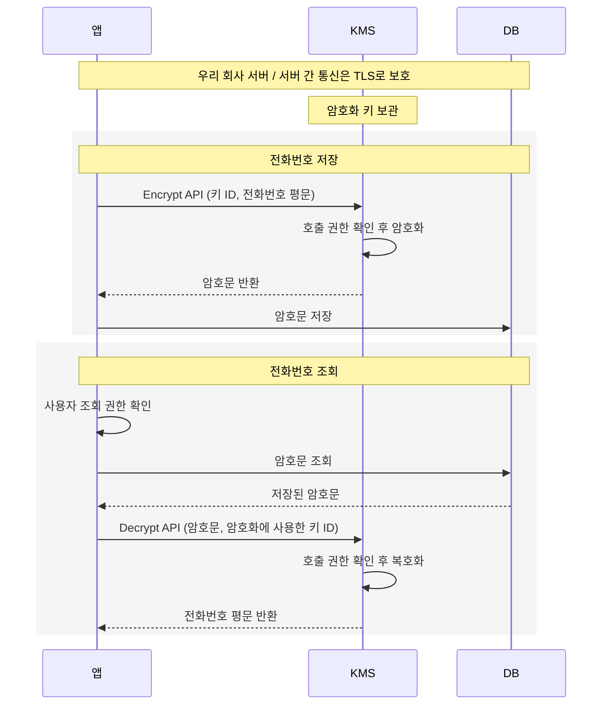
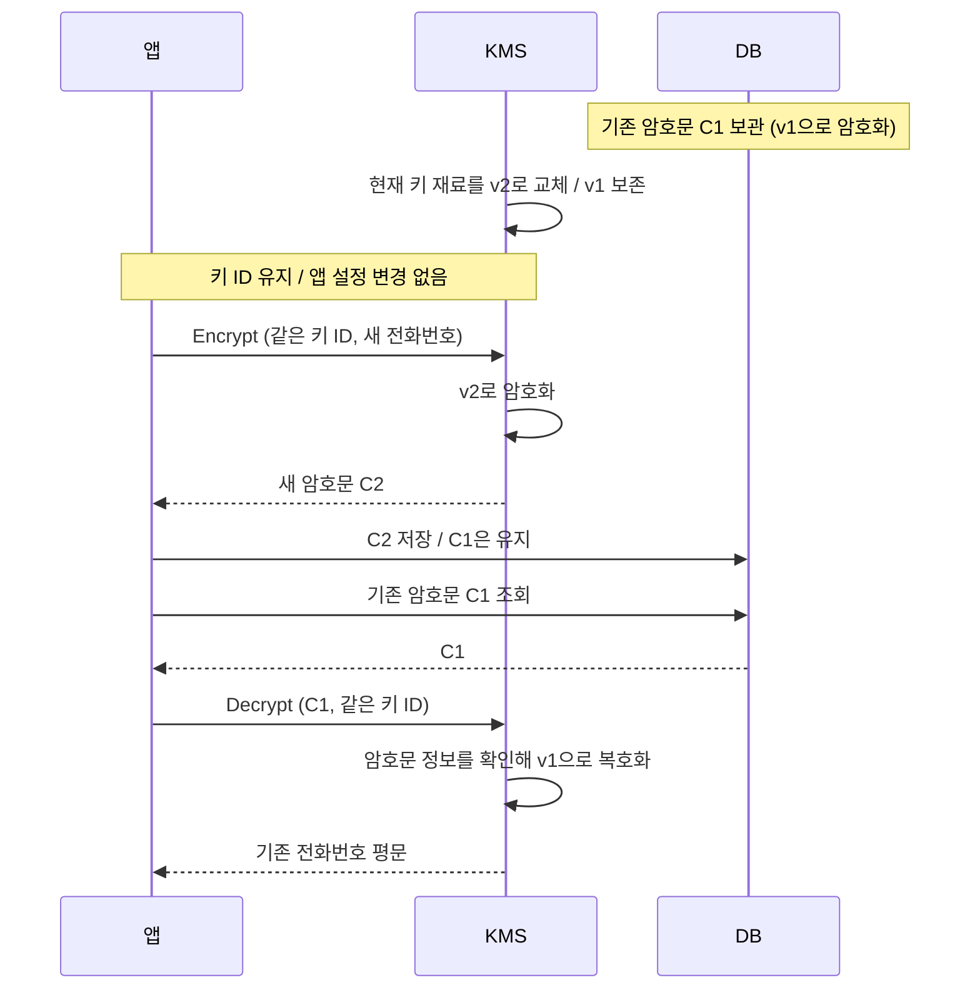
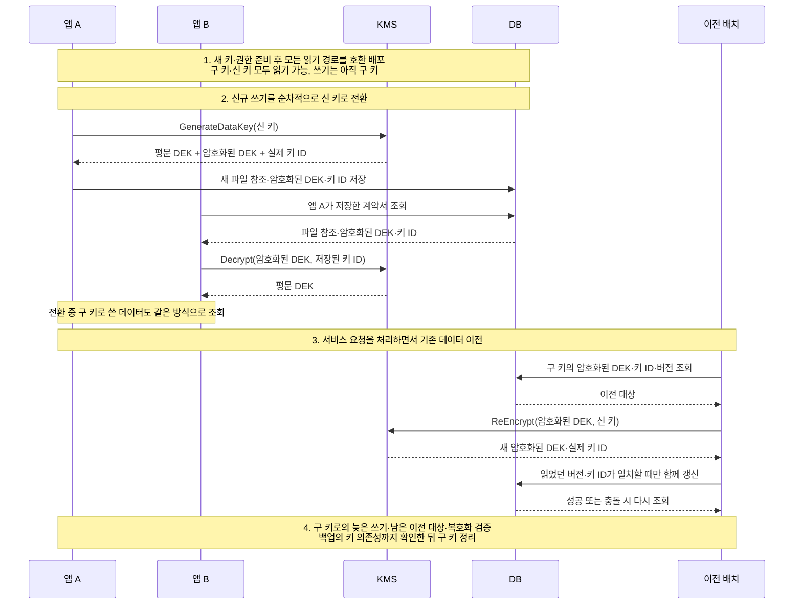

계약서를 보관하는 서비스를 만든다고 가정해 보겠습니다. 고객의 전화번호와 계약서를 저장하고, 담당자가 필요할 때 다시 조회할 수 있어야 합니다. DB나 백업 파일이 유출되더라도 내용을 바로 읽을 수 없도록 데이터를 암호화하기로 합니다.

암호화 코드를 작성하고 나면 키를 어디에 둘지 정해야 합니다. 앱이 데이터를 읽으려면 키가 필요하지만, 데이터와 키가 함께 유출되면 암호화한 의미가 없어집니다. 키를 별도 서버로 옮겨도 앱이 다시 받아 보관한다면 같은 문제가 남습니다.

KMS(Key Management System)는 이런 키의 보관과 사용을 관리하는 시스템입니다. 이 글에서는 전화번호를 암호화하는 작은 기능에서 출발해, KMS가 필요한 이유와 큰 계약서 파일을 처리하는 봉투 암호화 구조를 살펴보겠습니다. 이후 서비스를 운영하면서 키를 바꾸는 과정과 외부 회사에 계약서를 전송하는 과정까지 이어갑니다. 애플리케이션과 DB, KMS는 모두 우리 회사 서버에서 운영한다고 가정합니다.

## 앱에 직접 보관한 암호화 키

먼저 고객의 전화번호부터 암호화하겠습니다. 고객센터에서 조회할 때는 원래 번호를 보여줘야 하므로, 앱에는 암호화와 복호화 기능이 모두 필요합니다.

이때 사용할 수 있는 알고리즘이 AES입니다. AES는 암호화와 복호화에 같은 비밀키를 사용하는 대칭키 암호 알고리즘입니다. 앱이 전화번호를 암호화해 저장했다면, 나중에 그 번호를 복호화할 때도 같은 키가 필요합니다.

키를 `application.yml`에 넣어두면 앱은 설정 파일을 읽어 암호화와 복호화에 사용할 수 있습니다. 이 구조에서 DB 백업 파일만 유출됐다면, 키가 없는 사람은 암호문만으로 전화번호를 읽기 어렵습니다.

하지만 앱 서버의 취약점으로 설정 파일까지 유출되면 암호문과 키를 함께 확보할 수 있습니다. 이때는 해당 키로 전화번호를 복호화할 수 있습니다. 서버 접근을 차단하더라도 이미 외부로 복사된 암호문과 키의 사용까지 막을 수는 없습니다.

DB에 평문을 남기지 않는 문제는 해결했지만, 이제 설정 파일에 있는 키가 보호 대상이 됩니다. 먼저 키를 코드와 설정 파일 밖으로 옮기는 방법을 생각해 볼 수 있습니다.

## 환경 변수에 보관한 키의 한계

우선 키를 환경 변수로 옮길 수 있습니다. 코드 저장소에 실수로 커밋하는 위험은 줄어듭니다. 하지만 앱은 실행 중에 환경 변수에서 키를 읽어야 합니다. 공격자가 앱 권한으로 코드를 실행할 수 있다면 그 값을 읽거나 앱의 복호화 기능을 이용할 수 있습니다.

키를 별도 서버에 보관했다가 앱이 시작할 때 받아오는 구조도 비슷합니다. 받아온 평문 키가 앱에 남고, 누군가 이를 복사해 간 뒤 사용하는 일까지 보관 서버가 통제할 수는 없습니다.

보관 위치만 바꿔서는 앱이 평문 키를 계속 갖고 있다는 문제가 남습니다. 그래서 키를 앱에 돌려주는 대신, 키를 보관하는 시스템이 암호 연산까지 처리하도록 바꿉니다. 앱은 키 대신 처리 결과를 받고, 키를 관리하는 쪽에서는 요청 권한을 확인하고 사용 기록을 남깁니다. 권한을 회수하면 이후 요청을 거절할 수도 있습니다.

## KMS의 키 관리와 접근 제어

이 역할을 KMS에 맡길 수 있습니다. 앱은 키를 직접 보관하는 대신 KMS에 암호화와 복호화를 요청합니다. AWS KMS처럼 서비스로 제공되는 제품은 Key Management Service라는 이름을 씁니다.

아래의 구체적인 API 이름과 제한은 공개 문서가 있는 AWS KMS를 예로 들겠습니다. AWS KMS 자체는 AWS가 운영하는 서비스이며, 사내 제품의 API나 지원 기능은 다를 수 있습니다.

앞의 전화번호 예시라면, 앱이 KMS에 암호화를 요청하고 결과를 DB에 저장하는 구조로 바꿀 수 있습니다. 다시 읽을 때는 암호문을 보내 복호화를 요청합니다. KMS는 호출자의 신원과 권한을 확인한 뒤 내부의 키로 처리한 결과를 돌려줍니다. 앱에 KMS 키의 비밀값을 복사해 둘 필요가 없습니다.

이 예제의 암호화와 복호화는 **앱이 KMS API를 호출하는 방식**입니다. AWS KMS라면 SDK의 `Encrypt`와 `Decrypt`를 호출하고, SDK가 HTTPS 요청을 보냅니다. SDK 메서드를 호출하더라도 암호 연산은 KMS에서 실행됩니다. 사내 KMS도 원격 API를 제공할 수 있지만, 실제 연동 방식은 제품의 SDK와 인터페이스를 확인해야 합니다.



그림의 평문은 API 요청·응답의 내용이며, 네트워크에서는 TLS로 암호화됩니다. KMS 키 자체는 앱으로 전달되지 않습니다. DB는 앱이 받은 암호문을 저장하고 반환하며, 이 구성에서 KMS를 직접 호출하지 않습니다. DB 엔진이 자체적으로 처리하는 저장장치 암호화(TDE)와도 구분해야 합니다.

AWS KMS의 대칭키 암호문에는 키를 식별할 정보가 포함돼 있어 `Decrypt`의 `KeyId`를 생략할 수 있습니다. 다만 사용할 키를 명시하면 의도한 키로 생성된 암호문인지 제한할 수 있습니다. 암호화할 때 `EncryptionContext`를 지정했다면 복호화할 때도 같은 값을 전달해야 합니다. 위 그림에서는 이 부가 정보는 생략했습니다. [Encrypt API](https://docs.aws.amazon.com/kms/latest/APIReference/API_Encrypt.html), [Decrypt API](https://docs.aws.amazon.com/kms/latest/APIReference/API_Decrypt.html)

요청에 쓰는 키 ID는 사용할 키를 가리키는 식별자입니다. 설정 파일에 이 ID가 있다고 해서, 처음처럼 복호화에 쓸 비밀키가 들어 있는 것은 아닙니다. ID를 알아도 KMS가 요청을 허용하지 않으면 그 키를 사용할 수 없습니다. [AWS KMS의 키와 식별자](https://docs.aws.amazon.com/kms/latest/developerguide/concepts.html)

AWS KMS의 기본 키 저장소에서 생성한 KMS 키는 HSM(Hardware Security Module)이라는 보안 하드웨어로 보호됩니다. 그 키의 비밀값을 평문으로 내보내지 않고 KMS 내부에서 사용합니다. HSM이 키 보관과 암호 연산을 보호한다면, KMS는 여기에 API와 권한 정책, 키를 교체하거나 폐기하는 관리 기능을 제공합니다. 제품에 따라 보호 방식은 다를 수 있습니다. [AWS KMS 개요](https://docs.aws.amazon.com/kms/latest/developerguide/overview.html)

앱의 KMS 호출 권한이 탈취되면 공격자도 복호화를 요청할 수 있습니다. 다만 운영자는 그 권한을 회수하거나 키 사용을 차단할 수 있습니다. 차단 정책이 적용된 뒤의 요청은 거절되고, KMS 호출 기록도 확인할 수 있습니다. 이미 가져간 평문까지 회수할 수는 없지만, 비밀키를 복사해 간 뒤 우리 시스템과 상관없이 계속 사용하는 상황과는 차이가 있습니다. [AWS KMS 접근 제어](https://docs.aws.amazon.com/kms/latest/developerguide/control-access.html), [AWS KMS 감사 로그](https://docs.aws.amazon.com/kms/latest/developerguide/logging-using-cloudtrail.html)

백업을 복사하는 계정에는 DB를 읽는 권한만 주고, 전화번호를 보여주는 서비스에만 복호화 권한을 주는 것도 가능합니다. DB를 읽는 권한과 KMS에서 복호화를 요청하는 권한을 따로 관리할 수 있습니다.

## KMS의 암호화 용량 제한

전화번호는 KMS에 보내 암호화하고, 키의 사용 권한도 별도로 관리할 수 있게 됐습니다. 이제 같은 방식으로 고객이 올린 계약서를 저장해 보겠습니다. 앱이 계약서 전체를 KMS에 보내면 될 것 같지만, 여기서 처리할 데이터의 크기가 문제가 됩니다.

AWS KMS의 대칭키 `Encrypt` API는 한 번에 최대 4,096바이트의 평문을 받습니다. 10MB짜리 계약서는 한 번의 요청에 담을 수 없습니다. [AWS KMS Encrypt API](https://docs.aws.amazon.com/kms/latest/APIReference/API_Encrypt.html)

파일을 잘게 나눠 보내는 방법을 떠올릴 수도 있습니다. 하지만 10GiB를 4KiB씩 나누기만 해도 2,621,440조각입니다. 조각마다 API를 호출하면 그만큼 네트워크 요청과 과금 대상 호출이 생기고, 조각의 순서와 무결성을 관리하는 일까지 필요합니다. 파일을 읽고 쓰는 내내 원격 서비스의 응답을 기다리는 구조입니다.

큰 파일은 앱에서 암호화하고 KMS에는 작은 값만 보내도록 역할을 나눌 필요가 있습니다. 그런데 앱에서 암호화하려면 다시 키가 필요합니다. 그 키를 서버 설정에 계속 보관하면 처음의 문제로 돌아갑니다.

여기서 파일을 처리할 때 필요한 키와, 그 키를 보관하는 방식을 분리합니다. 파일마다 별도의 암호화 키를 만들고, 사용이 끝난 뒤에는 키도 암호화해서 남기는 것입니다. AES-256 키의 크기는 32바이트입니다. 앱은 이 키로 계약서를 암호화하고, **보관할 키도 KMS 키로 암호화합니다.** 저장소에는 암호화된 계약서와 암호화된 키를 함께 남기고, 사용을 마친 평문 키는 보관하지 않습니다.

나중에 계약서를 열 때는 저장해 둔 암호화된 키만 KMS에 보내면 됩니다. 권한 확인을 거쳐 원래 키를 돌려받고, 앱이 그 키로 계약서를 복호화합니다. 계약서가 커져도 KMS가 처리하는 대상은 파일 암호화에 사용한 키입니다.

이 구조를 **봉투 암호화**(Envelope Encryption)라고 부릅니다. 특정 제품의 기능명이 아니라, 데이터를 암호화한 키를 다른 키로 감싸는 방식입니다. KMS가 상위 키를 관리하고, 봉투 암호화가 데이터와 키의 보호 관계를 정합니다.

## 봉투 암호화와 DEK·KEK

이렇게 하면 큰 파일의 암호화는 앱에서 처리하면서도, 저장소에 평문 키를 남기지 않을 수 있습니다. 저장소에서 파일과 암호화된 키를 함께 가져가더라도 키를 복원하려면 KMS의 복호화 권한이 필요합니다.

각 키는 암호화하는 대상에 따라 구분합니다.

- **DEK(Data Encryption Key)**: 계약서 내용을 암호화하는 데이터 키입니다.
- **KEK(Key Encryption Key)**: DEK를 암호화하는 키 암호화 키입니다. 이 글에서는 KMS가 관리하는 상위 키가 이 역할을 맡습니다.

평문 DEK와 암호화된 DEK는 같은 키를 서로 다른 형태로 표현한 값입니다. 앱은 평문 DEK로 파일을 처리하고, 저장소에는 KEK로 암호화한 DEK를 보관합니다. 여기서 DEK와 KEK는 모두 대칭키이며, 공개키·개인키 쌍과는 다른 구분입니다.

파일마다 DEK를 따로 만들고 여러 DEK를 하나의 KEK로 보호하면, KMS에 파일 수만큼 상위 키를 만들 필요가 없습니다. 다만 그 KEK의 사용 권한이 넓게 열려 있으면 여러 DEK를 복호화할 수 있습니다. 파일별 키를 나누는 것과 접근 권한을 나누는 것은 함께 고민해야 합니다. [Google Cloud의 봉투 암호화 설명](https://docs.cloud.google.com/kms/docs/envelope-encryption)

아래 애니메이션에서는 계약서 한 개를 **파일 A**, 그 파일의 데이터 키를 **DEK-A**로 표시합니다. 세 칸은 모두 우리 회사가 운영하는 서버입니다. **저장하기**에서는 계약서를 처음 보관하고, **다시 열기**에서는 같은 계약서를 복원합니다. 파일을 처리하는 앱, KEK를 보관하는 KMS, 암호화된 값을 보관하는 저장소 사이의 데이터 이동을 보여줍니다.



그림의 **평문 DEK**는 앱이 TLS 응답을 받은 뒤 메모리에서 사용할 수 있는 키를 뜻합니다. 네트워크에는 TLS로 암호화된 응답이 흐릅니다. 같은 회사 안에서도 통신 보호는 필요합니다. 이 TLS 연결을 처음에 어떻게 만드는지는 뒤의 외부 회사 연동 부분에서 설명합니다. [AWS KMS의 TLS 통신](https://docs.aws.amazon.com/kms/latest/developerguide/infrastructure-security.html)

애니메이션은 각 단계가 끝난 뒤의 상태를 보여주는 설명용 모형입니다. 실제 암호 연산이나 처리 시간을 재현하지는 않습니다.

## DEK 생성과 파일 암호화

구조를 정했으니 계약서 한 개를 저장하는 과정을 따라가 보겠습니다. 앱에는 지금 파일을 암호화할 평문 DEK와, 나중을 위해 보관할 암호화된 DEK가 모두 필요합니다.

계약서 서비스가 `GenerateDataKey`를 호출하면 KMS는 새로운 무작위 DEK를 만들고, 지정한 KMS 키로 그 DEK를 암호화합니다. KMS 키 자체를 꺼내 주는 것이 아닙니다. 서비스가 받는 것은 같은 DEK의 두 가지 형태입니다. `Plaintext`에는 지금 사용할 평문 DEK가, `CiphertextBlob`에는 보관할 암호화된 DEK가 담깁니다. [AWS KMS GenerateDataKey API](https://docs.aws.amazon.com/kms/latest/APIReference/API_GenerateDataKey.html)

두 형태의 DEK는 용도가 다릅니다. 평문 DEK는 지금 계약서를 암호화하는 데 필요하고, 암호화된 DEK는 내일 그 계약서를 다시 열기 위해 보관합니다. 서비스는 평문 DEK로 계약서를 암호화한 뒤, 암호화된 계약서와 암호화된 DEK를 함께 저장합니다. 사용을 마친 평문 DEK는 보관하지 않습니다.

애니메이션에서 KMS로 계약서가 이동하지 않는 것도 이 때문입니다. `AES_256`으로 요청한 DEK는 256비트, 즉 32바이트입니다. 파일의 내용은 애플리케이션이 처리하고, KMS는 이 작은 키를 보호합니다. 암호화된 DEK는 암호화 결과와 메타데이터를 담으므로 평문 DEK보다 커질 수 있습니다.

파일과 암호화된 DEK 외에도 복호화에 필요한 정보를 함께 남겨야 합니다. AES-GCM이라면 nonce(IV)와 인증 태그, 알고리즘과 형식 버전 등이 해당합니다. nonce와 인증 태그는 비밀키가 아니므로 암호문과 함께 보관할 수 있습니다. 다만 **같은 키로 AES-GCM 암호화를 할 때 nonce를 재사용하면 안 되고, 태그 검증에 실패한 결과를 사용해서도 안 됩니다.** [NIST의 GCM 명세](https://csrc.nist.gov/pubs/sp/800/38/d/final)

평문 DEK를 정리하는 동작에도 주의가 필요합니다. 파일이나 로그에 남기지 않아야 하고, 메모리에 머무는 시간도 줄여야 합니다. Java처럼 메모리를 런타임이 관리하는 환경에서는 변수에 `null`을 넣었다고 복사본까지 즉시 지워지는 것은 아닙니다. 그림에서 키가 사라지는 장면은 사용을 마친 키를 더 보관하지 않는다는 뜻입니다.

## DEK 복원과 파일 복호화

저장이 끝나면 앱에는 평문 DEK가 남아 있지 않습니다. 다음 날 같은 계약서를 열려면, 저장해 둔 암호화된 DEK에서 원래 키를 복원해야 합니다.

사용자가 저장된 계약서의 열람을 요청하면 서비스는 먼저 이 사용자에게 해당 계약서를 보여줘도 되는지 확인합니다. 그다음 저장소에서 암호화된 계약서와 암호화된 DEK를 읽어옵니다.

복호화에는 파일을 암호화할 때 사용한 DEK가 필요합니다. 새 DEK를 생성하는 대신, 보관해 둔 암호화된 DEK를 KMS의 `Decrypt`에 보냅니다. KMS는 호출한 서비스의 권한을 확인하고 DEK를 복호화해 돌려줍니다. 이제 서비스가 이 키로 계약서를 복호화하고 인증 태그를 검증할 수 있습니다. [AWS KMS Decrypt API](https://docs.aws.amazon.com/kms/latest/APIReference/API_Decrypt.html)

애니메이션에서 **다시 열기**를 선택하면, 저장소의 암호화된 DEK가 KMS를 거쳐 평문 DEK로 돌아옵니다. 계약서 원문을 복원하는 곳은 여전히 애플리케이션입니다.

이 흐름을 보면 “KMS를 사용하면 키가 밖으로 나오지 않는다”는 말을 구분해서 읽을 수 있습니다. **KEK는 KMS 안에 남지만, 평문 DEK는 파일을 처리하는 동안 애플리케이션 메모리에 있습니다.** 애플리케이션이 침해되면 이미 복호화한 파일이나 사용 중인 DEK가 노출될 수 있습니다. KMS가 보호하는 대상과 애플리케이션이 보호해야 할 대상은 이렇게 나뉩니다.

## 키 교체 방식

여기까지는 계약서를 저장하고 다시 읽는 과정입니다. 서비스를 계속 운영하다 보면 정해진 주기에 따라 키를 교체하거나, 다른 KMS 키로 이전해야 할 때가 있습니다. 새 키로 앞으로의 데이터만 암호화하면 되는지, 이미 저장한 계약서도 모두 바꿔야 하는지가 다음 문제입니다.

이때는 무엇을 교체하는지부터 구분해야 합니다. KMS 내부의 키 재료만 바꾸는 경우, DEK를 다른 KEK로 다시 암호화하는 경우, DEK 자체를 바꾸는 경우는 기존 데이터에 미치는 영향이 다릅니다.

### KMS 키 재료의 자동 교체

AWS KMS가 생성한 대칭키의 자동 로테이션을 기준으로 보면, **기존 암호문을 다시 암호화할 필요는 없습니다.** 같은 키 ID를 유지하면서 내부의 키 재료를 교체하고, 이전 키 재료도 복호화에 사용할 수 있도록 보존하기 때문입니다. 신규 암호화에는 새 키 재료를 사용하고, 기존 암호문에는 암호화 당시의 키 재료를 선택합니다. 앱이 키 버전을 하나씩 대입하지 않습니다. [AWS KMS 키 교체](https://docs.aws.amazon.com/kms/latest/developerguide/rotate-keys.html)

앞의 전화번호를 키 재료 v1로 암호화한 뒤, KMS가 v2로 교체한 상황은 다음과 같습니다. v1과 v2는 이해를 위한 표기이며 서로 다른 KMS 키 ID를 뜻하지 않습니다.



봉투 암호화도 같습니다. 교체 전에 저장한 암호화된 DEK는 이전 키 재료로 복호화하고, 그 DEK로 기존 파일을 읽습니다. 교체 후 새로 생성하는 DEK는 새 키 재료로 보호합니다. 기존 파일이나 DEK가 자동으로 바뀌는 것은 아닙니다.

| 구성 요소      | 자동 로테이션 시 동작과 필요한 작업                                                                                                              |
| -------------- | ------------------------------------------------------------------------------------------------------------------------------------------------ |
| KMS            | 설정된 주기에 따라 새 키 재료를 생성하고 이전 재료를 보존합니다. 운영자는 교체 설정과 완료 이력을 확인합니다.                                    |
| 앱             | 같은 키 ID로 기존 API 호출을 유지합니다. 로테이션 때문에 재배포하거나 데이터를 재암호화할 필요는 없으며, 교체 전후 데이터의 복호화를 확인합니다. |
| DB·파일 저장소 | 기존 암호문과 암호화된 DEK를 그대로 보관합니다. 로테이션만을 위한 데이터 갱신은 없습니다.                                                        |

이는 기존 키 재료를 유지하는 AWS KMS의 동작입니다. 사내 KMS에서는 이전 버전의 보존 여부, 암호문의 버전 식별 방식, 앱이 버전을 지정해야 하는지 확인해야 합니다. **이전 키 재료를 삭제하거나 덮어쓰는 제품·설정이라면 기존 데이터의 복호화를 보장할 수 없습니다.** 로테이션과 이전 키 폐기는 별도 작업으로 다뤄야 합니다.

### 로테이션 후 기존 파일을 읽는 과정

여기서는 계약서를 파일 A와 파일 B로 표시하겠습니다. **A·B는 파일과 그 파일에 쓸 DEK의 구분이고, v1·v2는 DEK를 보호하는 KMS 키 재료의 구분입니다.** 파일마다 새 DEK를 생성하는 예입니다.

```text
파일 A → DEK-A로 암호화
DEK-A  → KMS 키 재료 v1으로 암호화해 보관

── KMS 키 재료 로테이션: v2 추가, v1 보존 ──

파일 B → DEK-B로 암호화
DEK-B  → KMS 키 재료 v2로 암호화해 보관
```

v2로 전환한 뒤 파일 A를 조회하면, 앱은 파일 A 암호문과 암호화된 DEK-A를 읽습니다. KMS에는 암호화된 DEK-A만 보내고, KMS는 이를 보호했던 v1으로 원래 DEK-A를 복원합니다. 앱은 돌려받은 DEK-A로 파일 A를 복호화합니다. **파일 A를 v2로 직접 복호화하는 단계는 없습니다.**

아래에서 재생하거나 다음 단계를 누르면, DB에 A·B가 함께 보관된 상태에서 파일 A를 다시 여는 과정을 확인할 수 있습니다. v1·v2 표시는 실제 암호문의 공개 필드를 재현한 것이 아니라 보호 관계를 나타낸 설명용 표기입니다. AWS KMS의 대칭키 자동 로테이션을 기준으로 합니다.



### 암호문에 사용한 키 식별하기

여기서 같은 키 ID를 보냈는데 KMS가 어떻게 v1과 v2를 구분하는지 궁금할 수 있습니다. **AWS KMS가 반환하는 암호문은 암호화된 내용만 있는 바이트 배열이 아닙니다.** 대칭키 암호문의 `CiphertextBlob`에는 KMS가 키를 식별하는 데 사용하는 메타데이터도 포함됩니다. 앱은 이 값을 온전히 보관했다가 `Decrypt`에 전달하고, KMS는 암호화에 사용했던 키 재료를 자동으로 선택합니다. 앱이 생성 날짜를 보고 버전을 추측하거나 v1, v2를 차례로 대입할 필요는 없습니다. [AWS KMS Decrypt](https://docs.aws.amazon.com/kms/latest/APIReference/API_Decrypt.html), [키 재료의 자동 선택](https://docs.aws.amazon.com/kms/latest/developerguide/rotate-keys.html)

앞의 v1과 v2는 설명을 위해 붙인 이름입니다. 암호문에 `version: 1` 같은 공개 필드가 있다는 뜻은 아니며, 앱이 내부 형식을 직접 파싱하도록 구현하지 않습니다. 여기서는 **KMS 키 자체를 가리키는 ID**와 **그 키 안에서 교체되는 키 재료의 식별자**를 구분하면 됩니다.

| 구분                    | 같은 KMS 키의 자동 로테이션 전후                                   |
| ----------------------- | ------------------------------------------------------------------ |
| 키 ID·ARN               | 동일하게 유지됩니다. 이것만으로 v1과 v2를 구분할 수 없습니다.      |
| 키 재료                 | v1에서 v2로 바뀌며, 기존 암호문의 복호화에는 v1을 사용합니다.      |
| 저장된 `CiphertextBlob` | KMS가 복호화할 때 필요한 식별 정보를 포함하므로 그대로 보관합니다. |

실제로 어떤 키 재료가 사용됐는지 확인할 수도 있습니다. 현재 AWS KMS의 대칭키 `Decrypt` 응답에는 `KeyId`와 함께 `KeyMaterialId`가 반환됩니다. `KeyId`는 사용한 KMS 키의 ARN이고, `KeyMaterialId`는 복호화에 사용한 키 재료의 식별자입니다. 이는 결과를 확인하기 위한 정보이며, 앱이 이 값을 지정해 복호화 버전을 선택하는 방식은 아닙니다. `Recipient`를 사용하는 응답에서는 `KeyMaterialId`가 생략됩니다. [Decrypt 응답 필드](https://docs.aws.amazon.com/kms/latest/APIReference/API_Decrypt.html#API_Decrypt_ResponseElements)

봉투 암호화에서는 이 식별 정보가 **계약서 본문이 아니라 KMS가 만든 암호화된 DEK**에 들어 있습니다. 앱은 계약서와 짝을 이루는 암호화된 DEK를 KMS에 보내고, 복원된 DEK로 계약서를 엽니다. 앱에서 AES-GCM으로 만든 파일 암호문 자체에 KMS 키 정보가 자동으로 붙는 것은 아닙니다.

사내 KMS가 키 버전을 별도로 전달받는 제품이라면, 암호화 응답의 키 ID와 버전을 암호문 또는 암호화된 DEK와 함께 저장해야 합니다. 반대로 암호문 안에 필요한 정보가 포함되는 제품은 그 형식을 그대로 보존합니다. 어느 경우든 현재 설정된 최신 키나 DB 저장 시각만으로 과거 데이터의 키를 결정해서는 안 됩니다.

### DEK 재래핑

자동 로테이션은 기존 키 재료를 보존해 예전 데이터를 계속 읽게 해줍니다. 하지만 기존 KMS 키의 사용을 끝내고 별도의 새 KMS 키로 이전하려는 경우에는 이것만으로 충분하지 않습니다. 저장된 DEK가 여전히 이전 키에 의존하기 때문입니다.

이때 계약서 전체를 다시 암호화할 필요는 없습니다. DEK의 값은 유지하면서 다른 KEK로 다시 암호화할 수 있습니다. 이를 재래핑(rewrapping)이라고 합니다.

이때 암호화된 계약서는 저장소에 그대로 둡니다. KMS가 기존 KEK로 DEK를 풀고 새 KEK로 다시 감싼 뒤, 새로운 암호화된 DEK만 돌려줍니다. 파일 암호화에 사용한 DEK의 값은 같으므로 계약서 본문을 다시 암호화할 필요는 없습니다.

AWS KMS의 `ReEncrypt`가 이러한 작업을 지원합니다. `GenerateDataKey` 등으로 만든 KMS 암호문을 받아 서비스 내부에서 복호화하고 다시 암호화합니다. 여기서 요청에 넣는 것은 암호화된 DEK입니다. 애플리케이션이 AES-GCM으로 암호화한 계약서 전체를 이 API에 넣는 것은 아닙니다. [AWS KMS ReEncrypt API](https://docs.aws.amazon.com/kms/latest/APIReference/API_ReEncrypt.html)

다만 실제 파일 형식에는 주의해야 합니다. AWS Encryption SDK처럼 암호화된 DEK가 포함된 헤더 전체를 인증하는 형식에서는 DEK 부분만 임의로 교체하면 검증에 실패할 수 있습니다. 재래핑의 원리를 이해하는 것과 저장된 파일을 수정하는 절차는 구분하고, 마이그레이션에는 해당 SDK가 지원하는 방식을 사용해야 합니다. [AWS Encryption SDK 메시지 형식](https://docs.aws.amazon.com/encryption-sdk/latest/developer-guide/message-format.html)

새 KMS 키를 만드는 경우에는 자동 로테이션과 달리 키 ID도 바뀝니다. 앱의 신규 암호화 설정이나 alias를 새 키로 바꾸더라도, 기존 DB 암호문과 암호화된 DEK는 이전 키에 의존합니다. KMS는 앱의 DB를 찾아가 자동으로 갱신하지 않습니다. [AWS KMS 수동 키 교체](https://docs.aws.amazon.com/kms/latest/developerguide/rotate-keys-manually.html)

신규 쓰기만 새 키로 전환하고 기존 데이터는 이전 키로 계속 읽는 운영도 가능합니다. 이 경우 재래핑 배치는 필요 없지만, 기존 데이터와 백업을 보존하는 동안 이전 키도 유지해야 합니다. 이전 키에 대한 의존성까지 없애려면 기존 암호문을 이전하는 별도 작업이 필요합니다.

### 서비스 운영 중 키 전환

이전 방법을 정해도 운영 중인 서비스에는 한 가지 문제가 더 남습니다. 배치가 기존 데이터를 옮기는 동안에도 사용자는 계약서를 올리고 조회합니다. 여러 앱 인스턴스의 설정도 한순간에 바뀌지는 않습니다. 따라서 새 키 ID로 이전하는 동안에는 구 키와 신 키로 암호화한 데이터를 함께 처리할 수 있어야 합니다. 아래는 여러 앱 인스턴스가 요청을 처리하는 서비스에서, 저장 형식을 앱이 직접 관리하며 계획된 키 교체를 진행하는 예입니다.

**먼저 읽기를 호환되게 배포하고, 그다음 신규 쓰기를 전환합니다.** 예를 들어 앱 A가 새 키로 저장한 계약서를 앱 B가 조회할 수 있어야 합니다. 모든 서버의 설정을 같은 순간에 바꾸는 것보다, 전환 중 서로 다른 키가 사용돼도 정상 처리할 수 있도록 만드는 것이 필요합니다.

봉투 암호화의 전환 과정을 그리면 다음과 같습니다. 앱 A와 B는 같은 서비스를 실행하는 인스턴스입니다. 그림의 쓰기에는 파일을 DEK로 암호화하는 과정이 생략돼 있으며, 배치는 암호화된 DEK만 재래핑합니다.



준비 단계에서는 KMS에 새 키를 만들고, 앱에 새 키의 암호화·복호화 권한을 부여합니다. 이전 배치에는 원본 키의 `ReEncryptFrom`과 대상 키의 `ReEncryptTo` 권한도 필요합니다. 서비스와 같은 실행 권한으로 새 키의 암복호화가 가능한지 확인한 뒤 전환합니다. 이전 키는 기존 조회를 위해 계속 사용할 수 있어야 합니다.

호환 배포에서는 각 데이터가 어떤 키로 암호화됐는지에 따라 복호화하도록 합니다. 새 키를 가리키는 현재 alias를 모든 조회에 사용해서는 안 됩니다. 이 예제에서는 암호문과 **API 응답에 포함된 실제 키 ID 또는 ARN**을 함께 저장하고, 조회 시 해당 키를 지정합니다. alias를 호출 전 조회한 값이나 앱 설정의 키 ID를 그대로 기록하면, 전환 시점에 실제 사용한 키와 달라질 수 있습니다. 저장된 키 ID는 허용한 키 목록과 권한 범위 안에서 사용하고, `EncryptionContext` 등 복호화 조건도 유지합니다. [AWS KMS Decrypt](https://docs.aws.amazon.com/kms/latest/APIReference/API_Decrypt.html)

새 키로 저장하기 전에는 API 서버뿐 아니라 조회용 워커, 예약 작업, 이전 버전의 앱 등 데이터를 읽는 모든 경로가 이 형식을 처리할 수 있어야 합니다. 호환 버전을 순차 배포하는 동안에는 쓰기 키를 구 키로 유지합니다. 롤백에 사용할 버전도 신 키로 생성된 데이터를 읽을 수 있어야 합니다.

그다음 신규 암호화에 사용할 키를 신 키로 전환합니다. 앱이 설정을 동적으로 읽는다면 설정이나 alias를 바꾸고, 시작할 때만 읽는다면 호환 버전으로 순차 재시작합니다. 재시작할 인스턴스는 새 요청을 받지 않게 하고 처리 중인 요청을 마친 뒤 내립니다. 나머지 인스턴스가 트래픽을 감당할 수 있어야 하며, 새 인스턴스의 준비 상태를 확인한 뒤 다음 인스턴스를 교체합니다. 이때 일부 인스턴스가 잠시 구 키로 저장해도 읽기는 두 키를 모두 지원하므로 처리할 수 있습니다. 키 정책과 alias 변경에는 전파 시간이 있을 수 있으므로, 변경 API가 성공했더라도 모든 요청에 즉시 반영됐다고 볼 수는 없습니다. [AWS KMS의 변경 전파와 재시도](https://docs.aws.amazon.com/kms/latest/developerguide/accessing-kms.html)

전환 완료 여부도 설정값만으로 판단하지 않습니다. 처리 중이던 요청, 지연된 작업과 재시도, 구 키를 사용하는 DEK 캐시에서 늦게 쓰기가 발생할 수 있습니다. 모든 쓰기 경로의 설정과 캐시를 전환하고, 실제 저장 결과의 키 ID를 확인합니다. 기존 데이터 이전은 그동안 계속할 수 있지만, 구 키로 새 데이터가 만들어지는 경로를 정리한 뒤 남은 대상을 다시 확인해야 합니다.

기존 데이터는 요청 처리와 분리한 배치로 조금씩 이전합니다. 전화번호처럼 KMS로 직접 암호화한 값은 그 암호문을, 봉투 암호화는 암호화된 DEK를 `ReEncrypt`에 보냅니다. 파일 본문을 바꾸지 않는 재래핑도 저장 형식의 인증 규칙을 따라야 합니다. 배치의 호출량과 동시 실행 수는 서비스의 KMS 호출 지연·오류를 보며 조절하고, 일시적인 오류는 횟수를 제한해 간격을 두고 재시도합니다.

배치와 사용자 요청이 같은 데이터를 수정하는 경우도 처리해야 합니다. 배치가 계약서의 버전 7을 읽고 KMS에 요청한 사이에 사용자가 내용을 수정해 버전 8을 저장할 수 있습니다. 이때 배치 결과를 그대로 덮어쓰면 최신 데이터가 사라집니다. **DB 갱신은 읽었던 버전과 원본 키 ID가 여전히 일치할 때만 반영하고, 버전도 함께 증가시킵니다.** 조건이 맞지 않으면 최신 값을 다시 읽어 이전 대상인지 판단합니다. KMS 응답을 기다리는 동안 긴 DB 잠금을 잡아두는 대신, 암호문과 키 정보는 짧은 트랜잭션에서 함께 갱신하는 방식입니다.

배치가 중단돼도 구 키와 신 키의 읽기 권한을 유지하면 이미 저장된 데이터는 계속 조회할 수 있습니다. 재개할 때는 구 키로 남은 대상만 처리하도록 만들고, 실패 항목과 진행 상태를 기록합니다. 쓰기 전환에 문제가 생기면 배치를 멈추고 원인을 확인하되, 신 키로 저장된 데이터가 있는 상태에서 신 키의 복호화 권한을 회수하거나 호환되지 않는 앱으로 롤백해서는 안 됩니다.

마지막으로 현재 데이터의 이전 완료와 복호화를 검증하고, 백업·스냅샷·보관 파일의 이전 키 의존성을 확인합니다. 구 키 사용 기록이 한동안 없다는 것만으로 삭제를 결정할 수는 없습니다. 나중에 복원할 백업이 구 키를 요구할 수 있기 때문입니다. 이 절차는 키 전환으로 인한 조회 실패를 피하기 위한 구성이지, KMS 장애나 권한 오류까지 무중단으로 처리한다는 보장은 아닙니다.

### 유출된 DEK 교체

앞의 무중단 전환은 계획된 키 교체를 전제로 합니다. 키 유출이나 앱 침해가 확인됐다면 먼저 침해된 인스턴스를 격리하고, 탈취된 자격 증명과 세션의 접근을 차단해야 합니다. 공격자의 접근이 남아 있으면 새 키로 바꿔도 다시 복호화를 요청할 수 있습니다. 정상 서비스에 필요한 구 키의 사용과 침해된 주체의 접근을 분리하되, 추가 유출을 막기 위해 일부 기능을 일시 중단해야 할 수도 있습니다. 감사 로그로 키 사용과 영향 범위를 조사한 뒤, 실제 키 재료가 유출됐는지 사용 권한만 탈취됐는지에 따라 교체 대상을 정합니다. [AWS의 침해 자원 격리와 접근 차단](https://docs.aws.amazon.com/security-ir/latest/userguide/contain.html)

평문 DEK가 유출됐다면 KEK만 바꿔서는 대응할 수 없습니다. 유출된 DEK로 여전히 기존 파일을 복호화할 수 있으므로, 보호할 데이터를 새로운 DEK로 다시 암호화해야 합니다. 이미 외부로 복사된 평문이나 기존 암호문과 DEK의 조합까지 회수할 수 있는 것은 아닙니다.

이 경우에는 앱이 기존 DEK로 파일을 복호화한 뒤, 새 DEK와 새 nonce로 다시 암호화해야 합니다. KMS는 새 DEK의 생성·보호를 맡고, 앱은 파일 암호화와 인증 태그 검증을 처리합니다. DB·저장소에는 새 파일 암호문, 암호화된 새 DEK, nonce·태그 등 메타데이터가 서로 맞는 묶음으로 반영돼야 합니다.

파일과 DB를 함께 갱신한다면 새 파일을 먼저 별도 버전으로 저장하고 검증한 뒤 DB 참조를 전환하는 식으로 처리할 수 있습니다. 중간에 실패했다고 기존 파일을 덮어쓰거나, 기존 파일에 새 DEK만 연결하면 복호화할 수 없게 됩니다. DEK 캐시를 사용한다면 새 쓰기에 유출된 키가 다시 사용되지 않도록 캐시도 교체해야 합니다.

키 교체를 계획할 때는 어떤 키가 바뀌는지부터 정해야 합니다. 정기적인 키 재료 교체, 다른 KMS 키로의 이전, 키 유출 대응은 같은 작업이 아닙니다.

## 접근 제어와 운영 시 주의점

저장소를 복사해 간 사람에게 KMS 복호화 권한이 없다면, 이 구조는 계약서 내용을 보호하는 데 도움이 됩니다. 반대로 공격자가 계약서 서비스의 실행 권한과 KMS 복호화 권한을 함께 얻었다면 정상 서비스처럼 DEK를 요청할 수 있습니다. KMS를 도입해도 서비스에 필요한 권한을 좁히고 애플리케이션을 보호해야 하는 이유입니다.

KMS가 확인하는 신원도 살펴봐야 합니다. 모든 사용자의 요청을 하나의 서비스 역할로 처리한다면, KMS가 보는 것은 그 역할입니다. 사용자가 자신의 계약서를 요청했는지 다른 사람의 계약서를 요청했는지까지 알아서 판단하지 않습니다. 사용자별 열람 권한은 애플리케이션이 확인해야 합니다.

감사 로그도 마찬가지입니다. AWS KMS 호출은 CloudTrail과 연동되므로 어느 역할이 키 사용을 요청했는지 확인할 수 있습니다. 그 요청이 실제로 어떤 사용자의 계약서 열람이었는지 연결하려면 애플리케이션의 기록이 필요합니다. [AWS KMS 감사 로그](https://docs.aws.amazon.com/kms/latest/developerguide/logging-using-cloudtrail.html)

운영에서는 다음 세 가지도 함께 고려해야 합니다.

- 제약: 필요한 평문 DEK를 확보하지 못한 상태에서 KMS가 응답하지 않으면 계약서를 열 수 없습니다. 이때 평문 저장으로 우회하지 않고, 실패 응답과 재시도 정책으로 처리해야 합니다.
- 위험: 필요한 KMS 키를 영구 삭제하면 다른 복구 수단이 없는 암호문은 읽을 수 없습니다. 파일 백업과 키의 보존 기간을 따로 생각해서는 안 됩니다. [AWS KMS 키 삭제](https://docs.aws.amazon.com/kms/latest/developerguide/deleting-keys.html)
- 예외: 이미 받은 평문 DEK나 계약서를 KMS가 회수하지는 못합니다. DEK를 캐시하면 호출을 줄일 수 있지만, 권한을 회수해도 캐시에 남은 키의 사용까지 즉시 막히지는 않습니다. 키가 메모리에 남는 시간과 노출 범위를 함께 정해야 합니다. [AWS Encryption SDK의 데이터 키 캐싱](https://docs.aws.amazon.com/encryption-sdk/latest/developer-guide/data-key-caching.html)

## 외부 서버와의 키 공유

지금까지는 우리 회사 안에서 계약서를 보관하고 읽는 문제를 다뤘습니다. 앱은 우리 KMS에 권한을 갖고 있으므로 필요한 DEK를 복원할 수 있었습니다. 이제 이 계약서를 협력사의 검토 API로 보내야 한다고 가정해 보겠습니다. 상대는 우리 KMS를 사용하는 앱이 아니고, 두 회사는 통신에 쓸 비밀키를 공유한 적도 없습니다.

계약서를 AES로 암호화해 보내면, 상대도 같은 키가 있어야 읽을 수 있습니다. 그렇다고 키를 바로 뒤에 붙여 보내면 네트워크를 엿보는 사람이 둘 다 복사할 수 있습니다. 키를 다른 키로 암호화해 보내더라도, 이번에는 그 다른 키를 어떻게 전달할지가 남습니다. 이미 공유한 키가 없다면, 키를 암호화하는 것만으로는 전달 방법을 정할 수 없습니다.

앱과 KMS 사이의 TLS 통신에도 같은 문제가 있습니다. TLS도 데이터를 암호화하려면 키가 필요하므로, 통신을 시작할 때 양쪽이 사용할 키를 마련하는 절차가 있어야 합니다.

## 디피-헬만 키 합의

키를 만들어 전달하는 대신, 양쪽이 각자 계산해서 같은 비밀값을 얻을 수 있다면 그 비밀값을 네트워크로 보낼 필요가 없습니다. 디피-헬만(Diffie–Hellman, DH) 키 합의가 이런 방식입니다. 각자 가진 비밀값과 상대가 보내준 공개값을 이용해 같은 비밀값을 계산합니다. 공개값을 주고받지만, 최종 비밀값 자체를 전송하지는 않습니다.

우리 서버는 비밀값 `a`를 만들고, 거기서 공개값 `A`를 계산합니다. 상대도 비밀값 `b`와 공개값 `B`를 만듭니다. 네트워크에는 `A`와 `B`만 내보냅니다. 이후 우리는 `a`와 `B`를, 상대는 `b`와 `A`를 계산에 넣습니다. 입력은 달라 보이지만 결과는 같은 공유 비밀값 `S`가 됩니다.

계산 과정을 확인하기 위해 작은 숫자로 고전적인 DH를 표현하면 다음과 같습니다. 공개 매개변수는 `p = 23`, `g = 5`이고, `mod`는 나눗셈의 나머지를 구하는 연산입니다.

```text
우리 서버: a = 6  → 공개값 A = 5⁶ mod 23 = 8
상대 서버: b = 15 → 공개값 B = 5¹⁵ mod 23 = 19

서로에게 보내는 값: A = 8, B = 19
우리 서버가 계산한 값: Bᵃ mod 23 = 19⁶ mod 23 = 2
상대 서버가 계산한 값: Aᵇ mod 23 = 8¹⁵ mod 23 = 2
```

양쪽 모두 결국 `gᵃᵇ mod p`를 계산하므로 결과가 같습니다. 숫자 `2`를 보내지 않았는데 두 서버가 같은 값을 얻었습니다. 이 작은 예는 손으로 풀 수 있도록 만든 것이어서 공격자도 쉽게 비밀값을 알아낼 수 있습니다. 실제 DH는 공개값을 보고 비밀값이나 공유 비밀값을 거꾸로 계산하기 어렵도록 정해진 큰 수와 검증된 매개변수를 사용합니다. [DH의 공개값과 공유 비밀 계산](https://www.rfc-editor.org/rfc/rfc2631.html#section-2.1.1)

TLS 1.3에서는 X25519 같은 타원곡선 기반의 ECDHE를 사용할 수 있습니다. 수학적 연산은 위 예와 다르지만, **내 비밀값과 상대 공개값으로 같은 비밀을 얻는다**는 구조는 같습니다. 마지막 E는 ephemeral, 즉 이 키 교환을 위해 일시적으로 만든 키를 뜻합니다. [X25519의 키 합의 과정](https://www.rfc-editor.org/rfc/rfc7748.html#section-6.1)

이렇게 얻은 `S`를 그대로 AES 키로 쓰지는 않습니다. TLS는 HKDF라는 키 도출 함수를 사용해 공유 비밀값과 핸드셰이크 기록 등에서 필요한 키를 도출합니다. 우리 쪽에서 상대에게 보내는 방향과 반대 방향의 통신 키도 구분합니다. 두 서버가 같은 계산 재료를 갖기 때문에, 보내는 쪽의 암호화 키와 받는 쪽의 복호화 키가 맞아떨어집니다. [TLS 1.3의 키 도출](https://www.rfc-editor.org/rfc/rfc8446.html#section-7.1)

## 중간자 공격과 인증서 검증

이제 비밀값 자체를 보내지 않고도 통신 키를 마련할 수 있습니다. 다만 계산에 사용한 공개값이 정말 협력사가 보낸 것인지는 아직 확인하지 않았습니다. 키 합의만으로는 상대의 신원을 확인할 수 없기 때문입니다. 공격자가 네트워크 중간에서 값을 바꿀 수 있다면, 상대의 `B` 대신 자기 공개값을 우리에게 보내고 우리의 `A`도 자기 공개값으로 바꿔 상대에게 보낼 수 있습니다.

그러면 우리는 공격자와 비밀을 만들고, 상대도 공격자와 별도의 비밀을 만듭니다. 공격자는 한쪽에서 받은 내용을 풀어 읽고 다른 쪽의 키로 다시 암호화해 전달할 수 있습니다. 이렇게 통신 사이에 끼어들어 내용을 읽거나 바꾸는 것이 중간자 공격입니다. **키 합의에는 상대방의 신원을 확인하는 인증이 함께 필요합니다.** [인증 없는 키 교환의 한계](https://www.rfc-editor.org/rfc/rfc8446.html#appendix-C.5)

일반적인 HTTPS 연결에서는 인증서를 이용합니다. 우리 서버는 협력사의 인증서가 신뢰하는 인증기관(CA)으로 이어지는지, 유효한지, 접속하려던 도메인과 일치하는지 확인합니다. 처음 접속하는 서버라도 운영체제나 런타임에 미리 등록된 신뢰 기준을 이용할 수 있습니다. 사설 CA를 쓰는 연동이라면 그 신뢰 기준을 별도로 안전하게 배포해야 합니다. [인증 경로와 신뢰 기준](https://www.rfc-editor.org/rfc/rfc5280.html#section-6), [TLS 서버 이름 확인](https://www.rfc-editor.org/rfc/rfc9525.html#section-6)

인증서는 공개된 문서여서 공격자도 복사할 수 있습니다. 그래서 인증서만 확인하고 끝내지 않습니다. TLS 1.3의 `CertificateVerify`에서는 상대가 인증서에 대응하는 개인키로 이번 핸드셰이크 기록에 서명합니다. 인증서를 복사한 것만으로는 바꿔치기한 교환 내용에 유효한 서명을 만들 수 없습니다. 여기서 서명하는 장기 개인키와 앞서 키 합의에 쓴 임시 개인키는 역할이 다릅니다.

통신용 AES 키를 사전에 공유하지 않아도 연결할 수 있지만, 신뢰할 인증기관이나 상대의 신원을 확인할 기준은 미리 정해져 있어야 합니다. 인증서 검증 오류를 무시하면 다른 서버를 정상 상대라고 받아들일 수 있습니다.

## TLS 연결을 통한 파일 전송

계약서를 보내려면 통신 키를 만드는 일과 상대를 확인하는 일이 모두 필요합니다. 이 두 절차를 연결해 처리하는 것이 TLS입니다. 아래는 인증서를 사용하는 TLS 1.3 첫 연결을 단순화한 그림입니다. `A`, `B`는 공개값, `a`, `b`는 각 서버에만 있는 임시 비밀값입니다. 앞의 작은 숫자 대신 기호로 표시했습니다. **정상 연결**에서는 네트워크에 보이는 값과 양쪽 서버에만 남는 값을 비교하고, **바꿔치기 시도**에서는 인증이 필요한 이유를 살펴보세요.



실제 TLS에서는 `ClientHello`와 `ServerHello`로 공개값을 교환한 뒤 핸드셰이크를 보호할 키를 도출합니다. 그 뒤의 인증서와 서명 메시지도 암호화됩니다. 인증과 `Finished` 검증을 거쳐 계약서를 보낼 수 있는 연결을 만들고, 애플리케이션 데이터에는 별도로 도출한 통신 키를 씁니다. 그림은 이 흐름을 압축했으며 재접속과 사전 공유 키(PSK)는 생략했습니다. [TLS 1.3 핸드셰이크](https://www.rfc-editor.org/rfc/rfc8446.html#section-2)

따라서 이 계약서 검토 API 연동에는 HTTP 클라이언트의 HTTPS 기능을 사용하면 됩니다. 인증서와 호스트 이름을 검증하는 설정을 유지하고, 애플리케이션이 직접 DH 계산이나 AES 키 전송 규약을 구현할 필요는 없습니다. 상대가 우리 서버의 신원도 인증서로 확인해야 한다면 클라이언트 인증서를 사용하는 mTLS를 적용할 수 있습니다. 인증된 회사가 어느 계약서를 읽을 수 있는지는 여전히 API의 권한 검사로 정해야 합니다.

계약서를 전송할 때 우리 앱은 KMS에서 DEK를 복원해 계약서를 열고, 그 내용을 협력사와의 TLS 연결로 보냅니다. **우리 저장소의 DEK와 KEK를 협력사에 나눠줄 필요는 없습니다.** 협력사는 받은 계약서를 자기 저장 정책과 키로 보호할 수 있습니다.

| 키          | 보호하는 대상           | 필요한 곳                        |
| ----------- | ----------------------- | -------------------------------- |
| DEK         | 저장된 계약서           | 계약서를 저장하거나 여는 우리 앱 |
| KEK         | 보관할 DEK              | 우리 KMS 내부                    |
| TLS 통신 키 | 연결 위를 오가는 데이터 | 해당 TLS 연결의 양 끝            |

앞의 KMS 응답도 같은 원리입니다. 응답 안의 DEK가 앱에서 사용 가능한 평문이라는 것과, 네트워크 패킷이 평문이라는 것은 다릅니다. 앱과 KMS 사이의 TLS가 전송 중인 응답을 보호하고, KMS의 KEK가 보관 중인 DEK를 보호합니다. TLS가 프록시나 로드밸런서에서 끝나는 구성이라면 그 뒤 서버까지의 연결도 따로 보호해야 합니다.

여기서는 상대 API가 계약서 내용을 받아 처리하는 경우를 다뤘습니다. 상대가 암호화된 파일 자체를 전달받아 나중에 독립적으로 열어야 한다면, 수신자용 DEK를 어떻게 보호해 전달할지까지 별도로 설계해야 합니다. 우리 KEK로 감싼 DEK를 그대로 보낸다고 상대가 열 수 있는 것은 아닙니다.

## 정리

데이터를 암호화해 저장하더라도 키가 함께 유출되면 내용을 읽을 수 있습니다. KMS는 키를 별도로 보호하고 그 사용 권한을 관리합니다. 큰 파일을 처리할 때는 DEK로 파일을 암호화하고, KMS의 KEK로 DEK를 보호합니다. 봉투 암호화는 이 두 역할을 나누는 방식입니다.

다른 회사와 처음 통신할 때는 키 합의로 공통의 비밀을 만들고, 인증으로 그 계산에 참여한 상대를 확인합니다. TLS가 이 과정을 묶어 전송 중인 데이터를 보호합니다. 저장된 파일에는 DEK를, DEK 보관에는 KEK를, 네트워크 전송에는 TLS 통신 키를 사용합니다.

## 참고 자료

- [AWS KMS 개요](https://docs.aws.amazon.com/kms/latest/developerguide/overview.html)
- [Google Cloud: Envelope encryption](https://docs.cloud.google.com/kms/docs/envelope-encryption)
- [AWS KMS: 키 교체](https://docs.aws.amazon.com/kms/latest/developerguide/rotate-keys.html)
- [RFC 8446: TLS 1.3](https://www.rfc-editor.org/rfc/rfc8446.html)
- [AWS KMS: 수동 키 교체와 alias 전환](https://docs.aws.amazon.com/kms/latest/developerguide/rotate-keys-manually.html)
