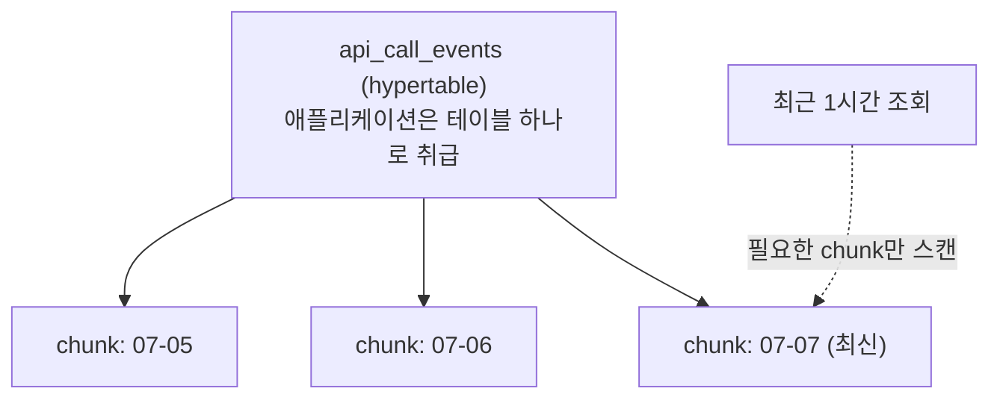
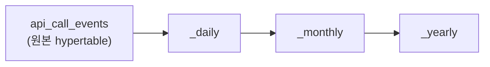

API를 운영하다 보면 최근 호출이 얼마나 늘었는지, 응답이 느려지거나 실패한 요청은 없는지 확인해야 합니다. 클라이언트별로 한 달이나 1년 동안 API를 얼마나 호출했는지 집계할 때도 있습니다.

한 달이나 1년 치 통계를 구하려면 그만큼 많은 호출 이벤트를 읽어야 합니다. 대시보드를 열 때마다 한 달 치나 1년 치 호출 기록을 다시 집계하면 조회에 오래 걸릴 수 있습니다.

호출 이벤트는 TimescaleDB의 hypertable에 저장합니다. 최근 통계는 저장한 이벤트에서 직접 구하고, 자주 조회하는 일·월·연 통계는 Continuous Aggregate로 미리 계산해 둡니다.

> 본문에서는 [timescaledb-api-stats-example](https://github.com/ydj515/sample-repository-example/tree/main/timescaledb-api-stats-example)의 코드를 사용합니다.  
> 예제에서는 시각을 `Instant`로 다루고 시간대는 UTC로 통일했습니다. SQL 실행과 성능 측정에는 `timescale/timescaledb:2.28.2-pg17` 이미지를 사용했습니다.
{:.prompt-info}

## hypertable로 호출 이벤트 저장하기

호출 시각과 응답 상태, 처리 시간을 기록하면 API가 호출될 때마다 데이터가 쌓입니다. 통계는 최근 1시간이나 지난 한 달처럼 기간을 정해 조회하고, 더 보관하지 않을 기록도 호출 시각을 기준으로 삭제합니다.

처음에는 일반 PostgreSQL 테이블에 이벤트를 저장하고 호출 시각에 인덱스를 만들어 조회할 수 있습니다. 데이터가 적고 조회도 빠르다면 그대로 사용해도 됩니다. 다만 이벤트를 오래 보관하면 테이블과 인덱스가 함께 커지고, 보관 기간이 지난 데이터를 삭제하는 작업도 부담이 됩니다.

데이터가 많아지면 호출 시각을 기준으로 하루나 한 달씩 나눠 저장하는 시간 파티셔닝을 고려할 수 있습니다. 조회 기간에 해당하지 않는 파티션은 읽지 않고, 보관 기간이 지난 데이터는 파티션 단위로 삭제할 수 있습니다.

PostgreSQL에서 직접 파티션을 관리하려면 앞으로 사용할 파티션을 미리 만들거나, 주기적으로 만드는 작업을 예약해야 합니다. PostgreSQL 확장인 TimescaleDB의 hypertable을 쓰면 파티션을 직접 만들지 않아도 됩니다. 시간 컬럼과 분할 간격을 지정해 두면 데이터가 들어올 때 필요한 파티션을 자동으로 만듭니다. 애플리케이션은 테이블 하나에 이벤트를 저장하고, TimescaleDB가 호출 시각에 맞는 파티션에 나눠 저장합니다.

### 확장 활성화하기

TimescaleDB에서도 기존 PostgreSQL의 SQL, `JOIN`, 트랜잭션과 JDBC 드라이버를 사용할 수 있습니다. 인덱스, 함수, 뷰, 권한 체계도 그대로 사용합니다.

TimescaleDB가 설치된 PostgreSQL에서 다음 SQL로 확장을 활성화합니다.

```sql
CREATE EXTENSION timescaledb
```

### hypertable의 데이터 저장 방식

hypertable이 시간 컬럼을 기준으로 나눈 물리 파티션을 **청크(chunk)**라고 합니다. 청크 간격이 하루라면 하루 치 호출 이벤트가 같은 청크에 들어갑니다. 애플리케이션에서는 청크를 직접 지정하지 않고 hypertable 하나에 저장하거나 조회합니다.



최근 1시간의 통계를 구한다면 그 시간에 해당하는 청크만 읽으면 됩니다. `WHERE occurred_at >= ... AND occurred_at < ...`처럼 기간을 지정하면 TimescaleDB는 나머지 청크를 조회 대상에서 제외합니다. 이를 **청크 프루닝(chunk pruning)**이라고 합니다.

인덱스도 청크마다 따로 만들어집니다. 새 날짜의 이벤트는 새 청크에 쌓이므로, 최근 이벤트를 조회할 때 오래된 청크의 인덱스까지 검색하지 않아도 됩니다. 오래된 데이터가 필요 없어지면 `drop_chunks`로 해당 청크를 통째로 삭제할 수 있고, 더 보관해야 한다면 압축해 둘 수 있습니다.

호출 기록을 저장할 `api_call_events` 테이블을 만든 뒤, `create_hypertable`에 호출 시각 컬럼인 `occurred_at`과 청크 간격인 `1 day`를 지정합니다.

```sql
CREATE TABLE IF NOT EXISTS api_call_events (
    stream_id text NOT NULL,
    occurred_at timestamptz NOT NULL,     -- 파티션 기준 시간 컬럼
    api_client_id bigint,
    api_client_name text,
    auth_result text NOT NULL,
    method text NOT NULL,
    path text NOT NULL,
    path_pattern text NOT NULL,           -- 예: /api/products/{id}
    status int NOT NULL,
    duration_ms bigint NOT NULL,
    created_at timestamptz NOT NULL DEFAULT now(),
    PRIMARY KEY (stream_id, occurred_at)
);

-- 일반 테이블을 hypertable로 변경
SELECT create_hypertable(
    'api_call_events',
    'occurred_at',
    chunk_time_interval => INTERVAL '1 day',   -- 기본값은 7일
    if_not_exists => TRUE
);

-- 인덱스 생성
CREATE INDEX IF NOT EXISTS idx_api_call_events_client_time
    ON api_call_events (api_client_id, occurred_at DESC);
```

> hypertable의 `PRIMARY KEY`나 `UNIQUE` 제약에 모든 파티션 컬럼이 포함돼야 하기 때문에 기본 키에 `occurred_at`을 넣었습니다.
{:.prompt-info}

청크 간격은 기본값인 7일 대신 1일로 설정했지만, 짧을수록 좋은 것은 아닙니다. 청크 수가 많아지면 쿼리 계획과 메타데이터 관리 비용도 늘어나므로 저장되는 데이터양과 사용할 수 있는 메모리에 맞춰 정합니다.

> `varchar`를 사용하면 `create_hypertable`이 `column type "character varying" does not follow best practices` 경고를 출력합니다.
{:.prompt-tip}

`create_hypertable`은 기본적으로 시간 컬럼의 인덱스(`occurred_at DESC`)를 자동 생성합니다. 앞에서 추가한 클라이언트별 인덱스와 함께 생성됐는지 확인합니다.

```sql
SELECT indexname, indexdef FROM pg_indexes WHERE tablename = 'api_call_events';
```

## 저장한 원본에서 최근 통계 조회하기

`api_call_events`에서 조회할 기간을 정하고 호출 수와 응답 시간을 구합니다. 호출 수의 변화를 확인하기 위해 1분마다 몇 건이 호출됐는지 집계합니다.

### time_bucket으로 분별 호출 수 구하기

PostgreSQL의 `date_trunc`로도 시간·일·월별 통계를 구할 수 있지만, 5분이나 10초 단위로 집계하려면 별도로 계산해야 합니다. TimescaleDB의 `time_bucket`을 사용하면 `interval`에 집계할 간격을 지정할 수 있습니다.

```sql
SELECT time_bucket('1 minute', occurred_at) AS bucket,
       count(*) AS total_calls
FROM api_call_events
WHERE occurred_at >= :from AND occurred_at < :to
GROUP BY bucket
ORDER BY bucket;
```

예제는 1분 단위로 호출 수를 집계합니다. 5분이나 1시간 단위로 보려면 `'1 minute'`을 `'5 minutes'`나 `'1 hour'`로 바꾸면 됩니다. 집계 간격을 요청 파라미터로 받아 `time_bucket(CAST(:bucket AS interval), occurred_at)`에 넘기면 쿼리를 수정하지 않아도 됩니다.

### 같은 시간 구간에서 실패 호출 수 구하기

실패율을 구하려면 같은 시간 구간의 전체 호출 수와 실패한 호출 수가 필요하고, TimescaleDB에서도 PostgreSQL의 집계 함수와 `FILTER` 절로 조건에 맞는 호출만 셀 수 있습니다.

```sql
SELECT time_bucket(CAST(:bucket AS interval), occurred_at) AS bucket,
       count(*) AS total_calls,
       count(*) FILTER (WHERE status >= 400) AS failed_calls
FROM api_call_events
WHERE occurred_at >= :from AND occurred_at < :to
GROUP BY bucket
ORDER BY bucket;
```

전체 호출 수는 `count(*)`, 실패 호출 수는 `FILTER (WHERE status >= 400)`, 평균 응답 시간은 `avg(duration_ms)`, 최대 응답 시간은 `max(duration_ms)`로 구할 수 있습니다. 호출이 많은 엔드포인트를 찾으려면 `GROUP BY method, path_pattern ... ORDER BY count(*) DESC`로 호출 수가 많은 순서대로 정렬합니다. 이때도 시간 조건에 해당하는 청크만 읽습니다.

> **Prometheus와는 무엇이 다른가요?** Prometheus도 시계열 데이터를 저장하지만, 호출 수나 응답 시간 같은 메트릭을 수집해 모니터링하고 알림을 보내는 데 사용합니다. 개별 요청 기록을 저장하는 용도는 아닙니다. 이 글에서는 TimescaleDB에 호출 이벤트를 한 건씩 저장하고 SQL로 클라이언트별·기간별 통계를 구합니다. 자세한 구분은 [Prometheus 공식 FAQ](https://prometheus.io/docs/introduction/faq/)를 참고하세요.
{:.prompt-info}

## Continuous Aggregate: 반복 집계 비용 줄이기

앞의 쿼리는 조회할 때마다 원본(raw) 이벤트를 집계합니다. 최근 1시간의 통계라면 읽을 청크가 적지만, 클라이언트별로 지난 1년간의 일별 호출 수를 구하려면 훨씬 많은 데이터를 읽어야 합니다. 같은 기간의 통계를 조회할 때마다 DB는 원본 이벤트를 다시 읽고 호출 수를 셉니다.

파티션을 월별이나 연별로 나눠도 각 파티션에는 호출 이벤트가 한 건씩 저장됩니다. 1년 치 호출 수를 구하려면 월별 파티션 12개에 나눴든 연별 파티션 하나에 담았든 그해의 이벤트를 집계해야 합니다. PostgreSQL에서 연 단위 파티션 아래에 월 단위 하위 파티션을 만들어도 부모에 연간 통계가 따로 저장되지는 않습니다.

파티셔닝으로 읽지 않아도 될 데이터는 줄일 수 있지만, 조회할 기간의 호출 수는 여전히 계산해야 합니다. 이 통계를 자주 조회한다면 계산한 결과를 따로 저장해 놓을 수 있습니다.

### 집계 결과를 저장하고 변경 구간만 갱신하기

PostgreSQL의 일반 Materialized View로도 집계 결과를 저장할 수 있습니다. 다만 `REFRESH MATERIALIZED VIEW`는 뷰의 내용을 전체 교체하므로, 원본이 수억 행이면 갱신에도 많은 시간이 걸릴 수 있습니다.

Continuous Aggregate는 시간 단위로 집계한 결과를 저장하는 **Materialized View**입니다. 원본 데이터가 추가되거나 수정된 구간을 기록해 두고, 갱신할 때 그중 갱신 범위에 포함된 버킷만 다시 계산합니다. 변경이 없는 과거 통계는 다시 계산하지 않습니다.

### 일별 집계 결과 저장하기

클라이언트가 어떤 API를 얼마나 호출했는지 확인할 수 있도록, API Key 클라이언트와 라우트별로 일별 호출 수와 응답 시간을 저장합니다.

```sql
CREATE MATERIALIZED VIEW IF NOT EXISTS api_key_call_stats_daily
WITH (timescaledb.continuous) AS -- Continuous Aggregate
SELECT
    time_bucket('1 day', occurred_at) AS bucket,
    api_client_id,
    api_client_name,
    method,
    path_pattern,
    count(*) AS total_calls,
    count(*) FILTER (WHERE status >= 400) AS failed_calls,
    sum(duration_ms) AS total_duration_ms,   -- 평균이 아니라 합계를 저장
    max(duration_ms) AS max_duration_ms
FROM api_call_events
GROUP BY bucket, api_client_id, api_client_name, method, path_pattern;
```

`WITH (timescaledb.continuous)` 옵션을 붙여 Continuous Aggregate를 만듭니다. 기본값은 `WITH DATA`이므로 뷰를 만들 때 기존 데이터도 집계합니다. 이때 주의할 점은 [초기 집계와 과거 데이터 갱신](#초기-집계와-과거-데이터-갱신)에서 설명합니다.

응답 시간은 평균을 바로 구하지 않고 합계와 호출 수를 저장합니다. 월별·연별 평균을 구할 때 응답 시간 합계를 호출 수로 나누기 위해서입니다.

### 갱신 정책으로 새 데이터 반영하기

뷰를 만든 뒤에 들어온 호출 이벤트도 통계에 반영해야 합니다. 갱신 정책(policy)을 등록하면 DB가 정해진 주기마다 갱신 범위 안에서 데이터가 바뀐 구간을 다시 집계합니다.

```sql
SELECT add_continuous_aggregate_policy('api_key_call_stats_daily',
    start_offset => INTERVAL '30 days',        -- 지금부터 30일 전까지 구간을
    end_offset => INTERVAL '1 minute',         -- 오늘 데이터는 조회할 때 바로 계산하고
    schedule_interval => INTERVAL '1 minute',  -- 1분마다 실행
    if_not_exists => TRUE
);
```

- `start_offset`: 현재 시각을 기준으로 얼마나 과거까지 갱신할지 정합니다. 이 범위보다 오래된 구간은 다시 계산하지 않습니다.
- `end_offset`: 현재 시각에서 얼마 전까지 갱신할지 정합니다. 갱신 범위에 온전히 들어가는 버킷만 저장하므로, 끝 경계가 오늘 버킷 안에 있으면 오늘 통계는 저장하지 않습니다.
- `schedule_interval`: 갱신 작업의 실행 주기를 정합니다.

일별 통계를 1분마다 갱신하도록 설정했습니다. 통계를 묶는 단위와 갱신 주기는 따로 정할 수 있습니다. 실제 운영에서는 데이터양과 갱신에 걸리는 시간을 확인해 주기를 조정합니다.

### 아직 집계되지 않은 오늘 데이터 조회하기

앞의 정책은 1분마다 실행되지만, 아직 하루가 끝나지 않았으므로 오늘 통계는 저장하지 않습니다. 오늘 호출까지 보려면 조회할 때 원본에서 오늘 통계를 구해 저장된 결과와 합쳐야 합니다.

TimescaleDB의 **real-time aggregation**을 켜면 뷰를 조회할 때 저장된 통계와 아직 집계하지 않은 최신 원본을 함께 읽어 결과를 반환합니다.

TimescaleDB 2.13 이상에서는 `materialized_only = true`가 기본값이라 이 기능이 꺼져 있습니다. 호출 기록이 오늘 것만 있고 아직 집계 결과를 저장하지 않았다면 대시보드에 아무것도 표시되지 않을 수 있습니다.

현재 뷰의 `materialized_only` 값을 확인해야합니다.

```sql
SELECT view_name, materialized_only
FROM timescaledb_information.continuous_aggregates;
```

뷰를 다시 만들지 않고 옵션만 바꿔 이 기능을 켤 수 있습니다.

```sql
-- real-time aggregation 켜기: 저장된 집계 결과와 최신 원본을 합쳐 반환
ALTER MATERIALIZED VIEW api_key_call_stats_daily
    SET (timescaledb.materialized_only = false);

-- 다시 끄고 싶으면 true로 되돌립니다.
ALTER MATERIALIZED VIEW api_key_call_stats_daily
    SET (timescaledb.materialized_only = true);
```

real-time aggregation을 켠 뒤, 원본 조회 쿼리도 일별 뷰와 동일하게 `api_client_id`, `api_client_name`, `method`, `path_pattern`으로 묶어 결과를 비교합니다.

```sql
-- (A) 원본 hypertable 직접 집계
SELECT time_bucket('1 day', occurred_at) AS bucket,
       api_client_id,
       coalesce(api_client_name, 'anonymous') AS api_client_name,
       method,
       path_pattern,
       count(*) AS total_calls,
       count(*) FILTER (WHERE status >= 400) AS failed_calls,
       sum(duration_ms) AS total_duration_ms,
       max(duration_ms) AS max_duration_ms
FROM api_call_events
WHERE occurred_at >= date_trunc('day', now())
GROUP BY bucket, api_client_id, coalesce(api_client_name, 'anonymous'), method, path_pattern
ORDER BY total_calls DESC;

-- (B) Continuous Aggregate를 같은 기준으로 다시 합산
SELECT bucket,
       api_client_id,
       coalesce(api_client_name, 'anonymous') AS api_client_name,
       method,
       path_pattern,
       sum(total_calls) AS total_calls,
       sum(failed_calls) AS failed_calls,
       sum(total_duration_ms) AS total_duration_ms,
       max(max_duration_ms) AS max_duration_ms
FROM api_key_call_stats_daily
WHERE bucket >= date_trunc('day', now())
GROUP BY bucket, api_client_id, coalesce(api_client_name, 'anonymous'), method, path_pattern
ORDER BY total_calls DESC;
```

> 데이터베이스 세션과 API가 모두 UTC를 사용하면, `materialized_only = true`일 때 (B)는 비거나 (A)보다 작은 결과를 반환할 수 있습니다. real-time aggregation을 켜면 저장하지 않은 구간을 원본 테이블에서 즉시 집계하므로 같은 필터와 `GROUP BY` 기준에서 두 결과가 일치합니다.
{:.prompt-info}

### watermark와 실시간 집계 범위

real-time aggregation이 원본을 어디서부터 읽을지는 **집계 저장 경계(watermark)**로 정합니다. watermark 이전은 저장된 집계 결과를 읽고, 이후는 조회할 때 원본에서 계산합니다.

```text
    집계 결과를 저장한 구간       |   실시간 계산 구간
 ---------------------------- watermark --------------->  시간
    (저장된 집계 결과를 읽음)    |  (원본을 즉석에서 집계)
```

이미 집계한 기간에 이벤트가 늦게 들어오면 원본에 저장돼도 통계에는 바로 반영되지 않습니다. watermark 이전 구간은 저장된 집계 결과만 읽기 때문입니다. 과거 데이터를 추가하는 백필(backfill)도 같으므로, 추가한 데이터가 통계에 반영되려면 해당 기간을 갱신 정책이나 수동 갱신으로 다시 집계해야 합니다.

### 계층형 Continuous Aggregate: 일별 결과를 월별·연별로 계산

일별 통계를 합산하면 월별 통계를, 월별 통계를 합산하면 연별 통계를 구할 수 있습니다. TimescaleDB 2.9부터는 집계 뷰를 바탕으로 다른 집계 뷰를 만들 수 있으며, 이를 **계층형 Continuous Aggregate**라고 합니다.

일별 뷰는 원본 테이블을 읽고, 월별·연별 뷰는 각각 일별·월별 결과를 읽습니다. 세 뷰 모두 real-time aggregation을 켜면 아직 집계하지 않은 구간은 하위 뷰에서 계산합니다. 일별 뷰까지 내려오면 원본 이벤트를 직접 집계하므로 연별 통계에도 최신 호출이 포함됩니다.

예제에서는 일별 뷰는 1분, 월별 뷰는 10분, 연별 뷰는 1시간마다 갱신합니다. 세 뷰 모두 `materialized_only = false`로 설정해 real-time aggregation을 켭니다.



```sql
CREATE MATERIALIZED VIEW IF NOT EXISTS api_key_call_stats_monthly
WITH (timescaledb.continuous) AS
SELECT
    time_bucket('1 month', bucket) AS bucket,   -- 원본이 아니라 daily의 bucket을 다시 묶는다
    api_client_id,
    api_client_name,
    method,
    path_pattern,
    sum(total_calls) AS total_calls,
    sum(failed_calls) AS failed_calls,
    sum(total_duration_ms) AS total_duration_ms,
    max(max_duration_ms) AS max_duration_ms
FROM api_key_call_stats_daily
GROUP BY 1, 2, 3, 4, 5;
```

> `time_bucket`의 결과에 원본 컬럼과 같은 `bucket`이라는 별칭을 붙이면, `GROUP BY bucket`은 새로 묶은 월별 값이 아닌 원본 컬럼을 기준으로 집계합니다. 월별로 묶으려면 `GROUP BY 1, 2, ...`처럼 `SELECT` 항목의 순서를 쓰거나, `GROUP BY time_bucket('1 month', bucket), ...`처럼 식을 직접 적어야 합니다. 예제에서는 `SELECT` 항목의 순서를 사용합니다.
{:.prompt-warning}

일별 평균인 `avg(duration_ms)`만 저장해 월별 평균을 구하면 호출이 10건인 날과 10만 건인 날을 똑같이 계산하게 됩니다. 날짜마다 호출 수가 다르므로 일별 평균을 더해 날짜 수로 나누면 전체 호출의 평균과 달라질 수 있습니다.

그래서 응답 시간 합계인 `total_duration_ms`와 호출 수인 `total_calls`를 함께 저장합니다. 월별·연별 평균도 해당 기간의 응답 시간을 모두 더한 뒤 전체 호출 수로 나누면 됩니다.

```sql
SELECT bucket,
       sum(total_duration_ms)::numeric / sum(total_calls) AS avg_ms
FROM api_key_call_stats_monthly
GROUP BY bucket;
```

### 초기 집계와 과거 데이터 갱신

기존 데이터가 많다면 `WITH NO DATA`로 집계 뷰를 만들고, 필요한 과거 기간만 수동으로 집계한 뒤 갱신 정책을 등록할 수 있습니다. 수동 갱신의 종료 시각을 `NULL`로 두면 watermark가 현재 버킷의 끝까지 이동할 수 있습니다. 이후 들어온 이벤트도 발생 시각이 watermark보다 앞서면 다음 갱신 때까지 통계에 반영되지 않을 수 있습니다.

예제에서는 이를 피하려고 이번 달 시작 전까지만 수동으로 집계합니다. 이번 달 통계는 조회할 때 real-time aggregation으로 구하고, 이후 갱신 정책에 따라 저장합니다.

```sql
-- 끝을 NULL로 열지 않고, 현재 버킷은 비워 둔다
CALL refresh_continuous_aggregate('api_key_call_stats_daily', NULL, date_trunc('month', now()));
```

과거 데이터를 추가했다면 일별 → 월별 → 연별 순서로 뷰를 수동 갱신합니다. 월별 통계는 일별 결과를, 연별 통계는 월별 결과를 합산하므로 일별 통계부터 다시 계산해야 합니다.

```sql
CALL refresh_continuous_aggregate('api_key_call_stats_daily',   NULL, date_trunc('month', now()));
CALL refresh_continuous_aggregate('api_key_call_stats_monthly', NULL, date_trunc('month', now()));
CALL refresh_continuous_aggregate('api_key_call_stats_yearly',  NULL, date_trunc('month', now()));
```

> `refresh_continuous_aggregate`로 수동 갱신할 때는 갱신 범위에 완전한 버킷이 하나 이상 들어가야 합니다. 예를 들어 일별 뷰에서 `now() - INTERVAL '1 day'`부터 `now()`까지를 지정하면 두 경계가 자정과 맞지 않아 하루 버킷을 온전히 포함하지 못할 수 있습니다. 이때 `refresh window too small. The refresh window must cover at least one bucket of data.` 오류가 발생합니다. `date_trunc`로 시작과 끝을 버킷 경계에 맞춰야 합니다.
{:.prompt-warning}

## 원본 조회와 집계 뷰의 결과 비교하기

최근 통계는 원본에서 직접 집계하고, 일·월·연 통계는 Continuous Aggregate에 저장된 결과를 조회합니다. 두 쿼리의 결과와 실행 시간을 비교하려면 조회 기간을 맞추고, 새로 들어온 데이터가 양쪽에 모두 반영됐는지 확인해야 합니다.

| 구분             | 원본 hypertable 직접 집계  | Continuous Aggregate                              |
| ---------------- | -------------------------- | ------------------------------------------------- |
| 대상 구간        | 최근의 짧은 구간(분·시간)  | 넓은 구간(일·월·연)                               |
| 최신 데이터 반영 | 저장된 원본까지 즉시 반영  | real-time aggregation을 켜면 미집계 원본까지 계산 |
| 조회 비용        | 구간이 넓으면 매번 재집계  | 미리 저장한 집계 결과를 조회                      |
| 원본 삭제 후     | 삭제한 구간은 조회 불가    | 삭제 구간을 다시 갱신하지 않으면 집계 유지        |
| 적합한 쿼리      | 실시간 모니터링, 최근 추세 | 장기 리포트, 사용량 집계                          |

### 같은 버킷 범위로 조회하기

조회 시간을 비교하려면 두 쿼리의 조회 기간이 같아야 합니다. 예제 API는 `source=raw`이면 원본에서 통계를 구하고, `source=aggregate`이면 집계 뷰에 저장된 결과를 읽습니다. 두 방식 모두 같은 컬럼을 반환하며, 필터 조건과 버킷별 상위 N개 제한도 같습니다.

```sh
# 조회 시점에 hypertable을 조회
curl "http://localhost:8080/api/stats/api-key-calls?period=day&source=raw&from=$FROM&to=$TO"

# 미리 집계해 둔 Continuous Aggregate를 조회
curl "http://localhost:8080/api/stats/api-key-calls?period=day&source=aggregate&from=$FROM&to=$TO"
```

원본 테이블인 `api_call_events`는 호출 시각인 `occurred_at`을 기준으로 조회합니다. 반면 월별 집계 뷰인 `api_key_call_stats_monthly`는 각 달의 시작 시각을 저장한 `bucket`을 기준으로 조회합니다.

예를 들어 7월 통계의 `bucket`은 `2026-07-01`입니다. 조회 시작일을 `from=2026-07-18`로 지정하면 원본에서는 7월 18일부터의 호출을 읽지만, 집계 뷰에서는 7월 통계가 빠집니다. `bucket` 값인 7월 1일이 조회 시작일보다 앞서기 때문입니다.

두 결과를 비교하려면 원본에서도 7월 전체를 집계해야 합니다. 예제 API는 월별 조회를 요청하면 `from`이 속한 달의 1일부터 `to`가 속한 달의 마지막 날까지 조회하도록 기간을 맞춥니다.

```sql
WHERE <time_column> >= time_bucket(CAST(:bucket AS interval), CAST(:from AS timestamptz))
  AND <time_column> <  time_bucket(CAST(:bucket AS interval), CAST(:to AS timestamptz))
                     + CAST(:bucket AS interval)
```

`<time_column>`에는 원본 테이블을 조회할 때는 `occurred_at`을, 집계 뷰를 조회할 때는 `bucket`을 넣습니다. `from=2026-07-18`, `to=2026-07-25`로 요청하면 두 쿼리 모두 7월 1일부터 8월 1일 직전까지, 즉 7월 전체를 조회합니다.

> 이 API는 `to`가 속한 버킷까지 조회합니다. 월별 조회에서 `to=2026-08-01`을 지정하면 8월 전체도 포함됩니다. `to` 직전까지만 조회하는 `[from, to)` 방식과 다르므로 종료일을 지정할 때 주의해야 합니다.
{:.prompt-warning}

### 조회 시간 비교

호출 이벤트 80만 건을 대상으로 연별 통계 조회 시간을 비교했습니다. `api_call_events`에서 직접 집계하는 쿼리와 `api_key_call_stats_yearly`에 저장된 연별 통계를 읽는 쿼리를 각각 실행했습니다.

| 조회 방식                                           | 실행 시간 |
| --------------------------------------------------- | --------- |
| 호출 이벤트를 `time_bucket('1 year', ...)`로 집계   | 4485 ms   |
| `api_key_call_stats_yearly`에 저장된 집계 결과 조회 | 0.1 ms    |

원본에서 직접 집계하면 쿼리를 실행할 때마다 해당 기간의 호출 이벤트를 읽고 연별 통계를 다시 계산합니다. 집계 뷰에서는 미리 계산해 둔 연별 통계만 읽습니다.

위 실행 시간에는 통계를 미리 계산하고 갱신하는 시간은 포함하지 않았습니다. 실제로 적용할 때는 갱신에 걸리는 시간도 확인해야 합니다. 조회 시간은 같은 기간과 캐시 조건에서 여러 번 측정해 비교하는 편이 좋습니다.

## 압축하고 오래된 원본 삭제하기

통계를 미리 계산해 두더라도 개별 호출을 확인하거나 통계를 다시 계산하려면 원본이 필요합니다. 다만 모든 기록을 계속 보관하면 저장 공간이 커지므로, 예제에서는 오래된 청크를 압축하고 보관 기간이 지나면 원본을 삭제합니다. 집계한 통계는 계속 보관합니다.

원본을 삭제한 기간을 다시 집계하면 저장된 통계도 사라질 수 있습니다. 따라서 집계 갱신 대상에 포함된 기간의 원본은 삭제하지 않도록 보관 기간을 정해야 합니다.

```sql
-- 1) 압축 설정: 어떤 기준으로 정렬/그룹핑해 압축할지 지정
ALTER TABLE api_call_events SET (
    timescaledb.compress,
    timescaledb.compress_segmentby = 'api_client_id, path_pattern',
    timescaledb.compress_orderby = 'occurred_at DESC, stream_id'
);

-- 2) 압축 정책: 7일 지난 chunk를 자동 압축
SELECT add_compression_policy('api_call_events', INTERVAL '7 days', if_not_exists => TRUE);

-- 3) 보관 정책: 180일 지난 chunk를 자동 삭제
SELECT add_retention_policy('api_call_events', INTERVAL '180 days', if_not_exists => TRUE);
```

앞의 SQL에서는 기존 compression API를 사용합니다. TimescaleDB 2.18부터는 이 API를 Hypercore로 대체하므로, 새로 도입한다면 Hypercore의 columnstore 설정을 먼저 확인하는 편이 좋습니다.

`compress_segmentby`에는 압축 블록을 나눌 컬럼을 지정합니다. 예제에서는 클라이언트와 엔드포인트로 자주 조회하므로 이 두 컬럼을 사용합니다. `compress_orderby`에는 블록 안에서 데이터를 정렬할 컬럼을 지정합니다. 호출 시각이 같을 때는 `stream_id` 순서로 정렬하며, 기본 키를 유지하기 위해 넣은 컬럼은 아닙니다.

400일 치 호출 이벤트 80만 건을 저장하고 청크 수와 압축 전후 용량을 확인했습니다.

```text
 total_chunks | compressed
--------------+------------
          400 |        393

 before  | after  | saved_pct
---------+--------+-----------
 365 MB  | 106 MB |      70.8
```

원본을 삭제한 뒤에도 통계를 남기려면 **원본 보관 기간(`drop_after`)을 집계 갱신 정책의 `start_offset`보다 길게 설정해야 합니다.** 원본이 없는 기간을 다시 집계하면 저장된 통계도 사라질 수 있기 때문입니다. 예제에서는 최근 30일의 일별 통계를 갱신하고, 원본은 180일 동안 보관합니다. 수동으로 갱신할 때도 원본을 삭제한 기간은 제외해야 합니다.

> TimescaleDB 2.11 이상과 PostgreSQL 14 이상에서는 압축한 청크에도 `INSERT`, `UPDATE`, `DELETE`를 실행할 수 있습니다. 다만 과거 데이터를 한꺼번에 많이 넣으면 압축을 풀고 다시 압축하는 데 시간이 걸릴 수 있습니다. 예를 들어 7일이 지난 청크를 압축하도록 설정했다면, 8일 전 데이터를 백필(backfill)할 때는 이미 압축한 청크에 데이터를 넣게 됩니다. 이때는 압축 정책을 잠시 멈추고 `decompress_chunk`로 해당 청크의 압축을 푼 뒤 데이터를 넣는 편이 안전합니다. 평소 이벤트가 얼마나 늦게 들어오는지 확인해 압축을 시작할 시점도 정해야 합니다.
{:.prompt-warning}

다음 쿼리로 등록된 정책과 각 청크의 압축 상태를 확인합니다.

```sql
-- 등록된 백그라운드 작업(압축/보관/CA 갱신) 목록
SELECT job_id, application_name, schedule_interval, hypertable_name
FROM timescaledb_information.jobs
ORDER BY job_id;

-- chunk별 압축 여부와 압축 전후 크기
SELECT chunk_name, compression_status,
       before_compression_total_bytes, after_compression_total_bytes
FROM chunk_compression_stats('api_call_events')
ORDER BY chunk_name;

-- hypertable 전체 압축률
SELECT pg_size_pretty(sum(before_compression_total_bytes)) AS before,
       pg_size_pretty(sum(after_compression_total_bytes))  AS after
FROM hypertable_compression_stats('api_call_events');
```

## 운영 중 확인할 내용

압축·보관·집계 갱신 정책을 등록한 뒤에는 각 작업에 걸리는 시간과 저장 공간 사용량을 확인합니다. 통계 조회가 빨라졌더라도 이벤트 저장이나 집계 갱신에 오래 걸릴 수 있습니다.

쓰기 성능은 청크 크기, 보조 인덱스 수, WAL, autovacuum 설정에 따라 달라집니다. 조회 쿼리는 `EXPLAIN (ANALYZE, BUFFERS)`로 실행 계획을 확인하고, 집계 갱신은 다음 실행 시각 전에 끝나는지 확인합니다.

DB 상태는 `postgres-exporter`로 지표를 수집해 Prometheus에서 모니터링할 수 있습니다. 앞에서 조회한 API 호출 수와 응답 시간은 서비스 통계이고, 여기서는 DB 자체의 상태를 확인합니다. TimescaleDB 전용 지표를 수집할 수 있는지는 사용하는 도구의 지원 여부를 확인해야 합니다.

거의 조회하지 않는 통계라면 필요할 때 계산해도 됩니다. 미리 계산해 두면 조회하지 않는 동안에도 갱신 작업을 실행하고 결과를 보관해야 합니다.

### 뷰 정의와 초기화 SQL 변경

집계 컬럼이나 초기화 SQL을 수정해도 기존 DB에 바로 반영되지는 않습니다.

- **집계 컬럼 변경**: Continuous Aggregate의 집계 컬럼을 바꾸려면 대개 뷰를 삭제하고 다시 만들어야 합니다. 월별·연별 평균도 구할 예정이라면, 처음부터 응답 시간 합계와 호출 수를 저장하도록 정의합니다.
- **초기화 SQL 변경**: 기존 Docker 볼륨을 사용 중이면 `docker-entrypoint-initdb.d`의 SQL을 수정해도 다시 실행되지 않습니다. 변경한 SQL을 직접 적용하거나, 기존 데이터를 지워도 되는 예제 환경에서는 `docker compose down -v`로 볼륨을 삭제한 뒤 다시 실행합니다.

## 같은 통계를 배치로 만든다면

다른 DB의 데이터를 호출 통계와 합치거나 월말 청구 금액을 계산해 확정해야 한다면 애플리케이션에서 **배치(batch)**로 처리할 수 있습니다.

집계 결과를 저장할 테이블과 SQL을 만들고, cron이나 Spring `@Scheduled`, Quartz, Airflow 등으로 실행 시각을 정합니다. 다음 예제는 매일 자정에 전날 호출 통계를 구해 별도 테이블에 UPSERT합니다.

```sql
CREATE TABLE IF NOT EXISTS api_stats_daily (
    bucket date NOT NULL,
    api_client_id bigint NOT NULL,
    method text NOT NULL,
    path_pattern text NOT NULL,
    total_calls bigint NOT NULL,
    failed_calls bigint NOT NULL,
    PRIMARY KEY (bucket, api_client_id, method, path_pattern)
);
```

배치는 다음 SQL로 지정된 구간을 집계해 결과 테이블에 저장합니다.

```sql
-- 배치 주기마다 실행: 대상 구간을 집계 결과 테이블에 UPSERT
INSERT INTO api_stats_daily (bucket, api_client_id, method, path_pattern, total_calls, failed_calls)
SELECT (time_bucket('1 day', occurred_at) AT TIME ZONE 'UTC')::date,
       api_client_id, method, path_pattern,
       count(*),
       count(*) FILTER (WHERE status >= 400)
FROM api_call_events
WHERE occurred_at >= :from
  AND occurred_at < :to
  AND api_client_id IS NOT NULL
GROUP BY 1, 2, 3, 4
ON CONFLICT (bucket, api_client_id, method, path_pattern)
DO UPDATE SET total_calls = EXCLUDED.total_calls,
              failed_calls = EXCLUDED.failed_calls;
```

`ON CONFLICT ... DO UPDATE`는 이미 저장된 집계 결과가 있으면 새로 계산한 값으로 덮어씁니다. 같은 기간을 다시 집계하거나 과거 데이터를 백필(backfill)한 뒤 재집계해도 중복 행이 생기지 않습니다.

Spring에서는 `@Scheduled(cron = ...)`으로 실행 시각을 정하고, 쿼리에 `from`과 `to`를 넘겨 집계할 기간을 지정합니다. 날짜를 구할 때도 `LocalDate.now(ZoneOffset.UTC)`처럼 UTC를 명시해야 JVM의 기본 시간대가 달라도 UTC 기준으로 전날의 시작과 끝을 계산할 수 있습니다.

```kotlin
@Component
class ApiStatsBatch(private val repository: ApiStatsBatchRepository) {
    // UTC 자정에 전날 UTC 기준 데이터를 집계
    @Scheduled(cron = "0 0 0 * * *", zone = "UTC")
    fun aggregateYesterday() {
        val to = LocalDate.now(ZoneOffset.UTC).atStartOfDay(ZoneOffset.UTC).toInstant()
        val from = to.minus(1, ChronoUnit.DAYS)
        repository.upsertDaily(from, to) // 위 UPSERT SQL 실행
    }
}
```

### 갱신과 재처리의 차이

| 구분      | Continuous Aggregate            | 배치 집계                               |
| --------- | ------------------------------- | --------------------------------------- |
| 갱신 주체 | DB 내부 집계 엔진               | 애플리케이션/스케줄러                   |
| 정의 방식 | 선언형(뷰 정의 + 정책)          | 명령형(집계 SQL + 스케줄 코드)          |
| 증분 처리 | 자동(변경분만)                  | 직접 구현(구간 지정/UPSERT)             |
| 최신성    | 준실시간(real-time aggregation) | 배치 주기만큼 지연                      |
| 표현력    | 지원 범위 안의 집계와 JOIN      | 임의 로직·다중 소스 조인·외부 호출 가능 |
| 이식성    | TimescaleDB에 종속              | DB별 SQL과 스케줄러 구현 필요           |
| 운영 부담 | 정책과 백그라운드 작업 모니터링 | 스케줄·재처리·모니터링 직접 관리        |

두 방식 모두 미리 집계한 결과를 조회하므로, 테이블 구조와 인덱스에 따라 조회 속도가 달라집니다. 어떤 방식을 쓸지 정할 때는 SQL만으로 필요한 통계를 구할 수 있는지, 작업이 실패했을 때 다시 실행하는 코드도 직접 짜야 하는지 확인해야 합니다.

### 배치가 유리한 경우

Continuous Aggregate에서는 모든 SQL을 사용할 수 있는 것은 아닙니다. 예제의 TimescaleDB 2.28은 하나의 hypertable과 여러 일반 PostgreSQL 테이블 사이의 `INNER`, `LEFT`, `LATERAL JOIN`을 지원합니다. 하지만 일반 테이블에서 바뀐 데이터는 추적하지 않아 자동 갱신만으로는 통계에 반영되지 않습니다. 이런 변경까지 반영하거나 청구 금액처럼 계산 후 확정해야 하는 값은 배치로 처리하는 편이 낫습니다.

- **여러 데이터를 합쳐 리포트 만들기**: 호출 기록에 사용자·요금제·조직 정보를 붙이거나 다른 DB의 데이터를 가져와 정산·청구 리포트를 만들 수 있습니다.
- **월말 청구 금액 확정하기**: 계산에 사용한 데이터의 스냅숏을 남겨 어떤 시점의 자료로 청구했는지 확인할 수 있습니다. 금액을 정정해야 한다면 해당 기간만 다시 처리합니다.
- **복잡한 통계 구하기**: 세션화, 퍼널, 리텐션 코호트처럼 단순한 `GROUP BY`만으로 구하기 어려운 통계를 계산할 수 있습니다.
- **다른 저장소로 결과 보내기**: 집계 결과를 데이터 웨어하우스, OLAP, 검색엔진, 사내 지표 API로 보내는 작업을 함께 처리할 수 있습니다.
- **다른 DB에서 집계하기**: TimescaleDB를 사용하지 않아도 해당 DB에 맞는 집계 SQL과 스케줄러로 구현할 수 있습니다.

### 이 예제에서 Continuous Aggregate를 사용하는 이유

이 예제에서는 `time_bucket`과 `GROUP BY`로 호출 수와 응답 시간을 구하면 됩니다. 다른 DB의 데이터를 합치거나 청구 금액을 확정하는 작업은 없으므로 Continuous Aggregate로 통계를 저장하고 갱신합니다. 아직 집계하지 않은 최신 호출은 조회할 때 real-time aggregation으로 계산합니다.

나중에 청구서를 만들거나 다른 저장소로 통계를 보내야 한다면 배치를 추가할 수 있습니다. 배치에서 이미 저장된 통계를 사용하면 원본 이벤트 전체를 다시 집계하지 않아도 됩니다.

## TimescaleDB를 도입하지 않는다면

PostgreSQL에 확장을 설치할 수 없다면 일반 Materialized View에 통계를 저장하고 주기적으로 갱신할 수 있습니다. 여러 곳에서 발생한 이벤트를 모아 처리해야 한다면 별도의 시계열 DB나 스트림 처리 도구를 사용하는 방법도 있습니다.

| 방식                                       | 검토할 조건                                                        | 추가로 맡아야 할 작업                                                                                          |
| ------------------------------------------ | ------------------------------------------------------------------ | -------------------------------------------------------------------------------------------------------------- |
| PostgreSQL + 일반 Materialized View + cron | 확장 없이 PostgreSQL에서 집계를 계속할 때                          | 뷰 전체 갱신을 예약하고, 파티션 생성·보관을 별도로 관리합니다. 데이터가 늘면 전체 갱신 비용을 확인해야 합니다. |
| 전용 시계열 DB(InfluxDB 등)                | 시계열 저장소와 수집 파이프라인을 별도로 도입할 때                 | 제품별 쿼리·기능 차이와 기존 애플리케이션·운영 도구의 이전 비용을 확인해야 합니다.                             |
| Kafka/Flink 등 스트림 처리                 | 여러 소스의 이벤트를 실시간으로 집계해 다양한 소비자에게 전달할 때 | 처리 인프라를 따로 운영해야 합니다. 통계 규모가 작다면 운영할 시스템만 늘어날 수 있습니다.                     |

시계열 DB마다 지원하는 기능이 다르고, 같은 제품도 버전에 따라 차이가 있습니다. InfluxDB 3은 SQL과 JOIN을 지원하지만 트랜잭션이나 확장 기능, 운영 도구까지 PostgreSQL과 같지는 않습니다. 따라서 SQL을 그대로 쓸 수 있는지만 볼 것이 아니라 애플리케이션과 운영 도구도 얼마나 수정해야 하는지 확인해야 합니다.

## 정리

hypertable에는 호출 이벤트를 시간별 청크로 나눠 저장하고, Continuous Aggregate에는 자주 조회하는 통계를 미리 계산해 둡니다. 예제에서는 최근 통계는 원본에서 직접 구하고, 일·월·연 사용량은 저장된 집계 결과를 조회했습니다.

데이터가 적거나 통계를 자주 보지 않는다면 일반 테이블에서 필요할 때 집계해도 충분합니다. 같은 기간의 통계를 매번 계산하느라 조회가 느려졌을 때 Continuous Aggregate를 검토하면 됩니다. 적용 전후의 조회 시간을 비교하고, 집계 결과를 갱신하는 데 걸리는 시간과 저장 공간도 함께 확인해야 합니다.

## 출처

- [TimescaleDB Documentation - Hypertables](https://docs.timescale.com/use-timescale/latest/hypertables/)
- [TimescaleDB Documentation - Continuous Aggregates](https://docs.timescale.com/use-timescale/latest/continuous-aggregates/)
- [TimescaleDB Documentation - Data retention with Continuous Aggregates](https://docs.timescale.com/use-timescale/latest/data-retention/data-retention-with-continuous-aggregates/)
- [TimescaleDB Documentation - Compression](https://docs.timescale.com/use-timescale/latest/compression/)
- [PostgreSQL Documentation - Materialized Views](https://www.postgresql.org/docs/current/rules-materializedviews.html)
